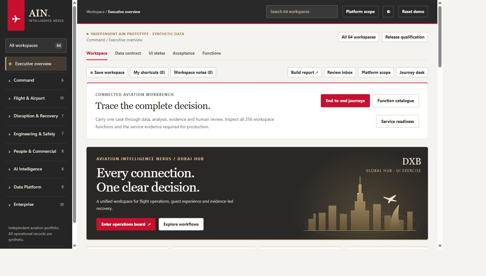

# Aviation Intelligence Nexus

## Start here

- **[Data Architecture and Governance (AIN-EA-06)](docs/enterprise-architecture/06-DATA-ARCHITECTURE-AND-GOVERNANCE.md)** — source register, storage and field contracts, temporal lineage, access, retention, recovery and governance acceptance checks.

- **[Architecture Decision Records (AIN-EA-05)](docs/enterprise-architecture/05-ARCHITECTURE-DECISION-RECORDS.md)** — 12 retrospective implementation decisions with alternatives, consequences and pinned evidence, plus 6 proposed enterprise decisions.

- **[System Architecture Diagrams (AIN-EA-04)](docs/enterprise-architecture/04-SYSTEM-ARCHITECTURE-DIAGRAMS.md)** — seven source-linked context, component, deployment, data, prediction, investigation and recovery views.

- **[Enterprise Architecture Overview (AIN-EA-03)](docs/enterprise-architecture/03-ENTERPRISE-ARCHITECTURE-OVERVIEW.md)** — current and target business, application, data, AI, integration, security and infrastructure views, with diagrams and transition decisions.

- **[Business Requirements and Acceptance Criteria (AIN-EA-02)](docs/enterprise-architecture/02-BUSINESS-REQUIREMENTS-AND-ACCEPTANCE.md)** — research objectives, stakeholder responsibilities, 18 business requirements, 8 quality requirements and 6 acceptance journeys.

- **[Current Implementation Baseline (AIN-EA-01)](docs/enterprise-architecture/01-CURRENT-IMPLEMENTATION-BASELINE.md)** — reviewed source revision, implemented and experimental capabilities, recorded verification, deployment limits and all 24 open production gates.

A research project on how aviation analysts can verify flight-data lineage, evaluate delay alerts, and review synthetic gate proposals.

- [75-second walkthrough](docs/case-study/assets/aviation-intelligence-nexus-walkthrough.mp4) covers the delay-alert trade-off and the recorded synthetic gate-allocation scenario.
- [One-page project summary](docs/case-study/AVIATION_INTELLIGENCE_NEXUS_SUMMARY.md) presents the measured results and one reproducible scenario.
- [Technical case study](docs/case-study/AVIATION_INTELLIGENCE_NEXUS_CASE_STUDY.md) covers the architecture, trade-offs, and reproducibility limits.
- [Data audit](docs/DATA_QUALITY_LINEAGE.md) covers 2,835,101 historical US domestic flight records.
- [Delay evaluation](docs/DELAY_V2.md) reports 30.22% precision at the demonstration threshold and about 58% of eligible May flights flagged.
- [Gate allocation example](docs/GATE_OPTIMIZATION.md) assigned 5 of 5 flights versus 4 of 5 for the greedy baseline in one synthetic scenario.

An independent aviation decision-support portfolio project combining a comprehensive dashboard prototype with an explicit implementation and acceptance roadmap.

**Current status: local research prototype with an authenticated historical-data/model panel, role-checked scenario inference, SQLite history, BTS ingestion, two measured model experiments, a synthetic gate-allocation optimizer, local document RAG and a bounded tool-calling investigation agent. The second model passed prespecified research checks; neither model is approved for operational airline serving. A local Docker release and measured restoration are implemented; managed production identity and cloud deployment remain incomplete.**



## Run locally

Requirements: Node.js 24+ and Git. The current frontend has no third-party runtime dependencies.

```sh
npm run check
npm run dev
```

Open **http://127.0.0.1:8080**. Stop the local server with Ctrl+C.

For the connected API and dashboard together, use `npm run dev:all` after installing the project Python environment. `npm test` runs the complete local test suite. See [daily development](docs/DEVELOPMENT.md) for setup and GitHub checks.

You can also open `apps/web/index.html` directly. A local server gives browser storage a consistent origin.

## Included today

- Validated local monitoring with automatic stale-health expiry, invalid-timing accounting and scoped diagnostic export. See [monitoring integrity](docs/MONITORING_INTEGRITY.md).
- Separate local observer with bounded health probes, persistent endpoint incident history, expiring dashboard observations and Windows install/status/start/stop commands, including periodic recovery configuration. See [continuous local observation](docs/LOCAL_OBSERVER.md).
- Dashboard response headers cover pages, assets, health, proxied API and rejection paths with bounded browser-policy scope. See [local browser response headers](docs/LOCAL_BROWSER_SECURITY.md).
- Optional local BTS intake snapshots and checks monthly archives before import, retaining accepted/quarantined inputs and sanitized receipts with a separate read-only archive/receipt consistency verifier. The retained 2,835,101-row release was checked without primary-database access. See [local data intake](docs/LOCAL_DATA_INTAKE.md).

- Opt-in local AI review of the negative regression experiment, with three mandatory source quotations, retained full metrics and human research review. See [regression review agent](docs/DURATION_AGENT_REVIEW.md).

- Offline delay-duration regression with mean/median baselines, residual/tail diagnostics and a preserved negative research result. Duration inference is not deployed. See [duration evaluation](docs/DELAY_DURATION_REGRESSION.md).

- Full-April Model Decision Trade-off Lab: thresholds, false alerts/missed delays, hypothetical error costs, assumed review limits and scenario export. See [decision analysis](docs/MODEL_DECISION_TRADEOFFS.md).

- Optional second-account research review with explicit pending-report sharing, a reviewer inbox and transactional author/role/session checks. See [second-account review](docs/SECOND_ACCOUNT_REVIEW.md).
- Authors/admins can withdraw pending peer sharing while retaining report evidence, with exact retries and transactional review conflicts. See [sharing withdrawal](docs/SHARING_WITHDRAWAL.md).

- Explicit agent retrieval of recorded input distributions, retained metric snapshots and limitation-checked research drafts. See [distribution evidence agent](docs/DISTRIBUTION_AGENT_INTEGRATION.md).

- Recorded historical input distributions with TV/JS divergence, category shares and export across 2,208,620 eligible records. See [input comparison](docs/INPUT_DISTRIBUTIONS.md).

- Account security with private session counts/expiry and explicit self-service sign-out of other sessions. See [account security](docs/ACCOUNT_SECURITY.md).

- Searchable owner-scoped investigation archive with state filters, older pages and saved-evidence reopening. See [investigation archive](docs/INVESTIGATION_ARCHIVE.md).

- Cooperative running-investigation stop requests, preserved completed evidence and transaction-checked draft suppression. See [investigation stops](docs/COOPERATIVE_INVESTIGATION_STOP.md).

- Local Python API with liveness/readiness checks, persistent SQLite schema and truthful record counts. See [backend setup](docs/BACKEND_SETUP.md).
- Three-month BTS import (1,645,503 local records) and chronological training/validation/test dataset preparation. See [model dataset](docs/MODEL_DATASET.md).
- Trained and evaluated logistic delay baseline, artifact integrity and measured suitability review. See [model results](docs/DELAY_BASELINE.md).
- Five-month database (2,835,101 local records) and a prespecified gradient-boosting experiment trained on 1,611,046 flights. See [second experiment](docs/DELAY_V2.md).
- Connected historical research panel with actual database counts, same-period model comparison and verified backend failure/recovery states. See [dashboard setup](docs/CONNECTED_DASHBOARD.md).
- Local historical-scenario form with actual v2 model inference, strict scope checks and research-only output. See [research prediction](docs/RESEARCH_PREDICTION.md).
- Persistent local research history with model/input provenance, retry deduplication, saved-result review and JSON export. See [research history](docs/RESEARCH_HISTORY.md).
- Local password sign-in, expiring sessions and server-enforced admin/researcher/viewer roles. See [account setup and limits](docs/LOCAL_IDENTITY.md).
- Gate Allocation Lab with an actual mixed-integer solver, independent conflict checking, greedy comparison, saved proposals and JSON export. Synthetic research scenarios only. See [optimization evidence](docs/GATE_OPTIMIZATION.md).
- Local aviation research Q&A with neural embeddings, hybrid retrieval, actual Ollama generation, checked citation/quotation references and saved/exportable results across six public project documents. See [evidence studio setup and limits](docs/KNOWLEDGE_STUDIO.md).
- Local investigation agent with actual model-selected tools, read-only SQL metrics, document retrieval, optional synthetic optimization, persisted execution checkpoints and report-bound research review. See [agent evidence and limits](docs/INVESTIGATION_AGENT.md).
- Agent report quality checks with explicit evidence requirements, document scope, one bounded repair, verified source extracts and server-blocked acceptance of mechanically incomplete reports. See [measured checks and remaining semantic limits](docs/AGENT_REPORT_QUALITY.md).

- Local Docker release with loopback-only dashboard, non-root/read-only containers, trusted snapshot verification, measured restoration and controlled API outage/restart checks. See [deployment and recovery](docs/LOCAL_DEPLOYMENT_RECOVERY.md).

- Administrator service-health panel with fresh/stale component checks, bounded response metrics and locally persisted snapshots. See [local monitoring and limits](docs/LOCAL_MONITORING.md).

- Authenticated encrypted local backups with a Windows user-protected key, safe fresh-target restoration and a measured full-data drill. See [encrypted recovery and key limitations](docs/ENCRYPTED_RECOVERY.md).

- Dated release-readiness assessment for all 24 production requirements, with recorded local progress, evidence integrity, remaining work and read-only export. See [scope and acceptance boundaries](docs/RELEASE_READINESS.md).

- Saved background investigations with bounded waiting queues, owner permissions, live checkpoints, safe retry handling and queued-only cancellation. See [execution and recovery limits](docs/BACKGROUND_INVESTIGATIONS.md).

- Pinned application-image rollback controller tested on an isolated restored copy, with compatibility gates and state/prediction reconciliation. See [rollback scope and evidence](docs/LOCAL_RELEASE_ROLLBACK.md).

- Bounded anonymous HTTP latency/correctness measurements, with a repeatable container CI check. See [measured scope and limits](docs/LOCAL_HTTP_PERFORMANCE.md).

- Disposable authenticated native HTTP drill with concurrent real-model predictions, owner isolation, duplicate-race checks and session revocation. See [workflow evidence and limits](docs/AUTHENTICATED_RESEARCH_WORKLOAD.md).

- Offline route delay-pattern clustering with frozen train-only selection, seed-agreement checks and later-period route transitions. See [real-data results and limits](docs/ROUTE_SEGMENTATION.md).

- Authenticated route-pattern dashboard with period switching, aggregate group profiles, transition/coverage views and evidence export. See [dashboard behavior and validation](docs/ROUTE_PATTERNS_DASHBOARD.md).

- Read-only directional-route lookup with real historical counts, Wilson uncertainty intervals, bounded queries and aggregate export. See [route lookup behavior and measured example](docs/HISTORICAL_ROUTE_LOOKUP.md).

- Explicitly scoped route investigations with actual local-model tool selection, structured counts/intervals, review guards and an indexed source-CLI check. See [route agent evidence and limits](docs/ROUTE_AGENT_INTEGRATION.md).

- All 64 original aviation workspaces across eight departments.
- 256 function specifications and 72 acceptance requirements.
- Four connected **browser-local** case journeys with evidence notes, human review, revision history and export.
- Local record tools, fixture checks and manually advanced job rehearsals.
- An evidence-based completion report covering 24 outstanding production areas.
- Responsive UI, editable source and documented frontend checks.

The historic 320 view checks are UI evidence, not production acceptance or model-performance results. See [the completion report](docs/reports/AIN_Completion_Report.html) and [current status](docs/PROJECT_STATUS.md).

## Source layout

```text
apps/web/              Editable frontend and local completion report
scripts/               Local server, validation and sync-plan tools
docs/reports/          Completion audit, specification and check evidence
docs/images/           Sanitized prototype screenshots
docs/ROADMAP.md        Implementation priorities
docs/GITHUB_SYNC.md    Daily review and synchronization policy
.github/workflows/     Source validation on push and pull request
.vscode/               Editor tasks
```

The existing browser application is currently a single shared script. Refactor it into tested components as real services are introduced, preserving all workspaces and existing local interactions.

## Daily work and GitHub

Open this repository folder in Visual Studio Code and save your work normally. The requested Codex automation reviews this checkout daily at **20:00 Asia/Dubai**, validates eligible changes, creates a meaningful commit and pushes to this repository when it is safe to do so. It stops for conflicts, failed checks, uncertain sensitive content or changes outside the approved scope. It does not force-push or discard work.

`npm run sync:plan` shows local eligibility only; it never commits or pushes. GitHub credentials stay in the operating system's credential manager, not this repository. See [sync policy](docs/GITHUB_SYNC.md).

## First implementation milestone

Authorized historical flight data -> persistent database -> evaluated delay baseline -> versioned API -> dashboard. Build real identity and permission controls alongside the service foundation. Expand to grounded retrieval, governed agents and verified recovery optimization after the core pipeline works.

## Data and operational boundaries

The dashboard's bundled operational records are synthetic. The separate local database now contains an official BTS January 2025 import; see [data ingestion](docs/DATA_INGESTION.md). Large datasets, credentials, personal documents and local databases are excluded from Git. Source registrations do not grant data rights. A local review does not enforce authentication or authorize an airline operation.

AIN is not affiliated with Emirates, Etihad or any airline. It does not provide dispatch, air-traffic, maintenance-release or passenger-communication authority. Use a production description only after implementation and verified deployment, security, monitoring and recovery evidence.

Recorded model quality: [Model diagnostics](docs/MODEL_DIAGNOSTICS.md) exposes calibration, errors and carrier slices without retraining.

Model input reliance: [Grouped permutation evidence](docs/MODEL_INPUT_RELIANCE.md) provides a frozen April-only experiment and interactive metric exploration.

AI model review: [Recorded model-evidence investigations](docs/MODEL_AGENT_REVIEW.md) retain metrics, provenance and limitations alongside source-extract drafts for human review.

Workflow visibility: [Investigation operations](docs/AGENT_OPERATIONS.md) provides administrator-only aggregate queue observations with explicit timing and quality limits.

Proposal review: [Synthetic gate research decisions](docs/GATE_PROPOSAL_REVIEW.md) bind a review to an exact saved proposal with expiry, replay and conflict checks.

Data evidence: [Data quality and lineage](docs/DATA_QUALITY_LINEAGE.md) records full-release structural checks, exclusions and import/population reconciliation.

Release evidence: [Build-bound rollback receipts](docs/ROLLBACK_BUILD_EVIDENCE.md) distinguish the running candidate from historical drills and expose a sanitized evidence export.

Daily startup: use **Terminal > Run Task > AIN: Start saved Docker dashboard** or `npm.cmd start`, then open http://127.0.0.1:8090. See [startup and troubleshooting](docs/DAILY_STARTUP.md).

Retrieval evaluation: [Passage-level RAG diagnostics](docs/RAG_RETRIEVAL_DIAGNOSTICS.md) compare unchanged hybrid search with keyword search on 24 curated questions, retaining misses, abstention errors and availability limits.

Retrieval dashboard: [Recorded comparison and case inspection](docs/RAG_RETRIEVAL_DASHBOARD.md) adds authenticated filters, source quotations and safe JSON export without model calls.

Generated-answer evaluation: [First-run Qwen3 diagnostics](docs/RAG_GENERATION_DIAGNOSTICS.md) preserve incomplete cases and a concrete semantic citation failure; exact quotation checks do not establish answer correctness.

Experiment-scoped research candidate: [Verbatim excerpts and retained challenge failures](docs/SCOPED_RAG_CANDIDATE.md) enforce document/version separation without promoting the candidate to the dashboard.

Explicit version conflicts: [Guarded research entry point](docs/EXPLICIT_SCOPE_GUARD.md) asks for clarification before model access while preserving the original candidate and its failed relevance case.

Source-context research: [Versioned excerpt selection and bounded context](docs/SOURCE_CONTEXT_ANSWERS.md) retain a failed prompt-only run, add the missing rejection explanation and keep the unsupported-answer limitation visible.

Source coverage: [Conservative pre-generation checks](docs/SOURCE_COVERAGE_GATE.md) stop the known unsupported coefficient answer and retain a valid-paraphrase refusal as a visible limitation.

Dashboard research interface: [Scoped Answer Lab](docs/SCOPED_ANSWER_LAB.md) provides explicit experiment selection, cited excerpts, visible refusals and public JSON export without saving questions or replacing existing Q&A.

Analyst checkpoint: [Scoped-result self-review](docs/SCOPED_SELF_REVIEW.md) adds per-excerpt judgments, refusal feedback, notes and an exact-result review export with an offline consistency verifier.

Local review files: [Self-review artifact inspector](docs/REVIEW_FILE_INSPECTOR.md) reopens exported JSON, checks consistency and displays original results/notes without uploading the file or running a model query.
