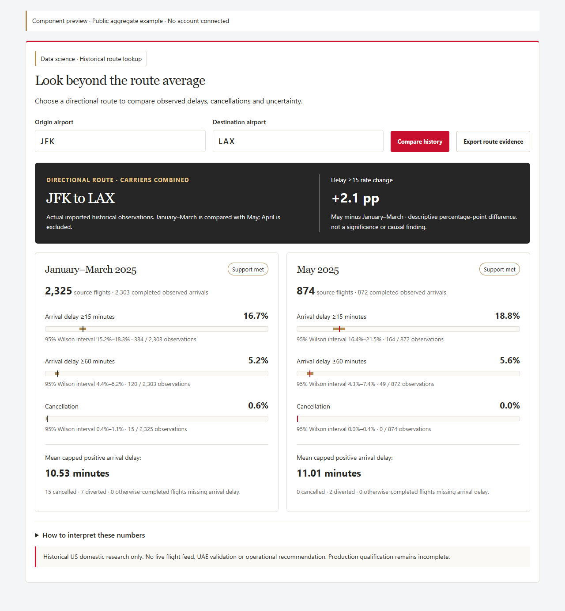

# Historical route lookup

The authenticated research dashboard now supports **Look up a route**. Enter different three-letter origin/destination codes, then choose **Compare history**. All signed-in roles, including viewers, can read the same bounded historical aggregates. Existing workspaces, credentials, database schema and prediction model remain unchanged.

This screenshot is a component preview using the actual public aggregate example, not a real user session or production airline service.

## Actual database query

`GET /api/v1/research/route-profile?origin=JFK&destination=LAX` reads currently imported `BTS_REPORTING_CARRIER` rows for a directional route, combining carriers. It compares January–March 2025 with May 2025, excludes April and returns aggregate counts, rates, nominal Wilson intervals and a capped positive arrival-delay mean. It does not serve individual flight/account records or assign a segmentation cluster.

Only exactly one `origin` and one `destination` parameter are accepted. Codes must be distinct, uppercase and three letters; the form normalizes lowercase input. The proxy validates and forwards these two allowlisted fields in canonical order. Extra/duplicate parameters, malformed codes, writes and arbitrary paths are rejected. The API independently validates the query and binds SQL parameters. Valid requests still require the normal authenticated session. Responses use the existing no-store policy.

The query opens the configured database in read-only URI mode, enables `query_only`, and uses one consistent read transaction. There are no migrations, inserts, saved histories, model loads, embeddings or LLM calls. A nonblocking semaphore allows **one route lookup per API process**. Another request gets 429 with `Retry-After: 2`. A five-second cooperative SQL progress deadline and a 0.5-second SQLite connection timeout bound ordinary local work; blocking OS I/O is not a hard real-time guarantee. Database failures, invalid source status flags and deadline expiry return a safe 503. No observations in either period returns 404; an absent individual period remains explicitly unavailable.

Changing inputs or session clears the prior result/export and aborts the client fetch. Late responses are ignored. Client cancellation does not forcibly interrupt a server thread: it can retain the single lookup slot until the bounded SQL work finishes. Retry after the displayed busy/unavailable message. The single-process guard is not distributed rate limiting or production capacity qualification.

## Definitions and uncertainty

Delay events (at least 15 or 60 minutes) use completed, non-diverted flights with an observed arrival delay as their denominator. Cancellation uses all route source flights. The view separately shows cancelled/diverted records and otherwise-completed records missing an arrival observation. The mean clips each eligible arrival delay to 0–180 minutes before averaging.

Each rate displays its event count, denominator and a **nominal 95% Wilson score interval**. The implementation uses the independent-binomial formula described by [NIST](https://www.itl.nist.gov/div898/handbook/prc/section2/prc241.htm), with two-sided normal critical value 1.959963984540054. Zero observed events still have a positive upper bound; zero observations produce no rate or interval. These model-based intervals do not represent uncertainty in the arithmetic count of the stored dataset. Shared weather, repeated flights and operational dependence can violate the binomial assumptions, and historical source coverage is not a random sample of future UAE flights.

The descriptive May-minus-training delay-rate difference is shown in percentage points only when both cohorts meet the segmentation experiment's completed-observation support thresholds (200 for training, 50 for May). Smaller cohorts retain available descriptive rates but do not receive a supported period comparison. These thresholds are not independent statistical acceptance criteria. No hypothesis test, repeated-search correction, significant-trend conclusion, causal attribution or future-risk guarantee is implemented.

The lookup reads current local rows; the separate Route patterns panel reads a frozen experiment report. No lookup group assignment is claimed, and the model is not refitted by either view.

## Measured example

The native lookup of the real local database completed in approximately **2.84 seconds** on 20 November 2026. The database then contained 2,835,101 official historical rows. That is one workstation measurement, not sustained throughput or an SLA.

| JFK to LAX | January–March | May |
| --- | ---: | ---: |
| Source flights | 2,325 | 874 |
| Completed observed arrivals | 2,303 | 872 |
| Arrival delay >=15 events | 384 | 164 |
| Observed delay >=15 rate | 16.67% | 18.81% |
| Nominal 95% Wilson interval | 15.21–18.25% | 16.35–21.54% |
| Cancellations | 15 | 0 |

The observed rate difference is **+2.13 percentage points**. It is not presented as a significant or causal finding. Zero May cancellations do not imply zero future cancellation risk: that cohort's nominal Wilson upper bound is approximately 0.44%.

The full example, method/scope and browser checks are recorded in [Route_History_Lookup.json](reports/Route_History_Lookup.json). JSON export contains the displayed aggregate evidence and method limits, without actor credentials or raw flight records. Future lookups may differ if the underlying historical import is changed.

## Verification and remaining work

Six Python regressions cover Wilson reference/edge values, correct source/date/direction/denominator rules, clipping/missing data, unchanged database bytes, unknown/invalid routes, cooperative timeout/slot release, authentication/viewer access, parameter validation and safe 404/429/503 handling. Three Node regressions cover rendered rates/limits, absent cohorts, malformed/false claims and allowlisted proxy parameters. The full Windows suite has **185 tests: 152 Python and 33 Node**; Linux skips the Windows-only DPAPI provider case.

An isolated headless browser component preview passed nine scenarios: desktop (1280 CSS pixels), exact 390-pixel layout, input clearing, unknown route, busy response, unavailable query, mismatched-route response, late cancelled response and session clearing. Its export check inspects the actual JSON Blob while intercepting the download click, leaving the user's Downloads folder untouched. Both screenshots were inspected. The real-data example is used for successful preview responses; failures/delays are synthetic. No real user account is connected in preview QA. Hosted test results must be checked for the exact published commit.

Remaining work includes deployed authenticated workload/capacity acceptance, broader devices and screen-reader review, seasonal/UAE validation, dependent-observation uncertainty methods and any independently justified forecasting or operational use. Production qualification remains incomplete in all 24 assessed areas.
