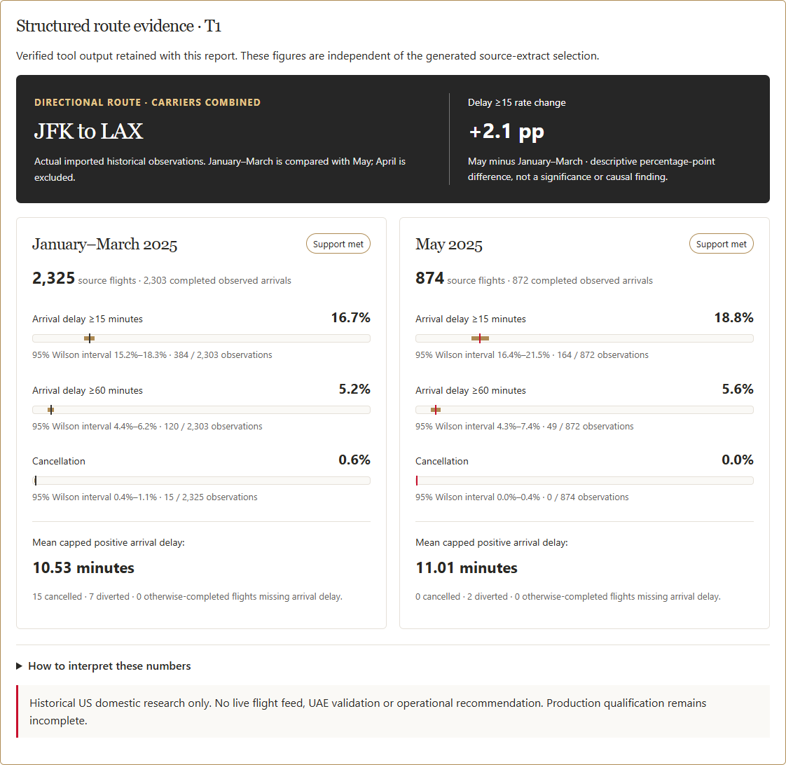

# Scoped route investigations

The Investigation Desk can now use the real historical route lookup as an approved tool. Open **Investigate a route**, choose **Load route investigation**, confirm the two airports and run the investigation. Closing the page does not cancel a saved background job. Completed reports retain the route counts, uncertainty and limitations, alongside the generated source extracts and execution trace.



This is the real component rendering an actual engineering report through synthetic preview transport, without a real user account connected. It is not a screenshot of an operational airline deployment.

## Human scope and model boundaries

`Investigation.route` is an optional object containing distinct uppercase three-letter `origin` and `destination` codes, with no extra fields. Supplying it requires `route_history` in `required_tools`; requiring that tool also requires the explicit scope. The total required-tools limit remains three. With no route, serialization omits the new field entirely, preserving earlier request hashes and queue deduplication semantics. Application schema migration version remains 7.

The route tool is offered only for a scoped request. The model must echo those exact airports as its only arguments. The runtime checks every proposed call before executing the batch, and the dispatcher checks the scope again before querying. Changed airports, SQL, dates, paths, URLs and extra arguments are not accepted. A natural-language objective never grants a different route permission.

The tool uses the same bounded read-only lookup as the manual route view: official source rows, directional route, combined carriers, January–March versus May 2025, with April excluded. The monthly selector still controls `flight_metrics`; it does not change route cohorts. Missing observations return unavailable evidence. Busy/deadline/storage failures are saved as failed tool steps; they do not manufacture counts or intervals.

The model still selects at most three tools in at most three planner calls. The first planner call now has up to 45 seconds for local startup/inference, later calls up to 20, and report calls up to 30 each (at most two). The overall 120-second cooperative budget remains. These are bounded blocking calls and between-step checks, not a hard real-time cancellation guarantee. Simulation remains separately opt-in. The runtime remains a custom single agent, without LangGraph, CrewAI, AutoGen or distributed worker orchestration.

## Evidence and review

The saved tool observation contains the full typed aggregate profile and source text. The report displays structured counts, rates and Wilson intervals independently of which exact source quotations the generator selects. Generated findings remain checked verbatim extracts, not unverified paraphrases or operational recommendations.

Before allowing research acceptance, current quality checks compare the request route, validated tool arguments and observation scope. They check period identities, support/count arithmetic, source/claim flags, interval method, recomputed rates/Wilson limits and the supported percentage-point difference. A mismatched or tampered profile blocks acceptance even if cached quality says passed. The frontend withholds mismatched route figures. Report hashes bind the request, steps and extracts; owner/role controls remain in force. A successful mechanical gate still leaves semantic relevance and research acceptance to a human. None of this is a protected audit or airline approval.

Loading the older simulation example clears route scope. Inputs/report/export and the objective are cleared on session changes; late responses cannot repopulate the prior user's view. A viewer cannot submit or accept investigations, while permitted saved-report inspection remains available through the existing owner-scoped API.

## Indexed lookup preparation

One repeated real-model check exposed a five-second route-query deadline while the model was active. The fix is an optional derived index, keeping the five-second query limit:

```powershell
.\.venv\Scripts\python.exe -m services.api.index_routes
```

This operator command creates `flights_route_history_v1` on `(source, origin, destination, flight_date)` in the existing native database. It uses one write transaction, preserves flight rows and application migration version, refuses an unexpected existing definition without replacement, and verifies that the actual query plan selects the index. Repeating it verifies the existing index. Ordinary lookup requests never create indexes or write flight/account records. SQLite's internal DDL metadata can change when an index is added; the application migration version stays 7.

For the local Docker instance, use an idle maintenance window after building the current images. Stop the services, run the operator module against the same state volume, then bring services back even if setup fails:

```powershell
docker compose stop web api
docker compose run --rm --no-deps api python -m services.api.index_routes
docker compose up -d --wait --wait-timeout 90 api web
```

Do not run multiple active worker processes on that database. Older backups may lack this optional index; check/setup after restoring them. The index is included naturally in later full SQLite backups. This is local query optimization, not a distributed-processing or capacity qualification.

The native index setup preserved **2,835,101 flight records** and took 4.378 seconds in the observed workstation run. The plan used two indexed date ranges and a small grouped result. An indexed actual-model check measured the route lookup at **21.209 ms** and the complete investigation at **11,299.02 ms**. These are individual observations, not a controlled throughput benchmark or SLA.

## Actual-model evidence and development failures

The public [Route_Agent_Integration.json](reports/Route_Agent_Integration.json) preserves an initial successful local Qwen3 run (13,068.93 ms), an indexed source-CLI reproduction (11,299.02 ms), and the failures that led to the fixes. Both successes selected `route_history`, saved its profile, produced source extracts for both cohort counts/intervals and the independence caveat, passed mechanical coverage, and replayed the retry key without a new run. Both remain `awaiting_review`; no acceptance decision was manufactured.

The real JFK–LAX counts were 2,325 January–March flights with 384/2,303 completed observed arrivals delayed at least 15 minutes, versus 874 May flights with 164/872 delayed. Extracts matched the observed rates and Wilson intervals. The structured panel also preserves cancellation, severe-delay and capped-minute evidence and the non-operational limits.

Earlier development attempts included a 20.3-second planner timeout, strict rejection of airport arguments while the first tool schema expected no arguments, a diagnostic confirming that exact echo, and the later unindexed query deadline under AI load. The final schema accepts only an exact airport echo; it does not allow model-selected substitution. Failed runs/checkpoints are retained. These iterative development cases are not a held-out benchmark, success-rate estimate, general semantic-accuracy claim or a guarantee for other objectives/routes.

## Repeat the source CLI check

With the existing local Ollama/data setup available, and the route index prepared:

```powershell
.\.venv\Scripts\python.exe -m agents.evaluate_route --output .local/route-agent-new-check
```

Optional `--origin`, `--destination` and `--database` select explicit uppercase codes and an existing local source. The command reserves a new directory under `.local`, creates a separate engineering checkpoint database and writes request/run/evaluation receipts there. It reads the historical source without copying real accounts or writing histories into the active application's database. Existing output is refused, failed results are preserved and exit status reflects the defined checks. This is a privileged local operator harness, not an authentication bypass endpoint; dashboard requests retain normal identity/role enforcement.

## Verification and remaining work

The full Windows suite now has **196 tests: 160 Python and 36 Node**; Linux skips the Windows-only DPAPI provider case. New checks cover route opt-in/schema/hash compatibility, exact airport echo before execution, real fixture SQL/profile persistence, interval/scope tampering, unavailable/busy tools, scoped queue deduplication, index replay/row preservation/query semantics, UI payload limits and retained structured figures.

Seven isolated browser scenarios passed: desktop at 1280 CSS pixels, exact 390-pixel layout, rejection of four required tools without queue submission, simulation-example route reset, viewer restrictions, input clearing and session/objective clearing. Loading the route example before service readiness completed preserved its fields. Exports were checked using the actual JSON Blob with the download click intercepted. The provider used the real engineering report and synthetic queue transport; no real user session or primary-database queue run was exercised by these browser checks. Screenshots of structured evidence and the narrow layout were inspected. Hosted checks must be verified for the published commit.

This release changes protected agent runtime semantics. The conservative rollback controller should reject older manifests with different protected contracts; the earlier isolated rollback receipt does not qualify rollback of this new release. Compatibility/production rollback must be reviewed and drilled separately. Broader model/tool reliability, semantic evaluation, framework integration where justified, worker failover, real-user deployed workload acceptance, UAE validation and production qualification remain incomplete. All 24 production requirements remain open.
