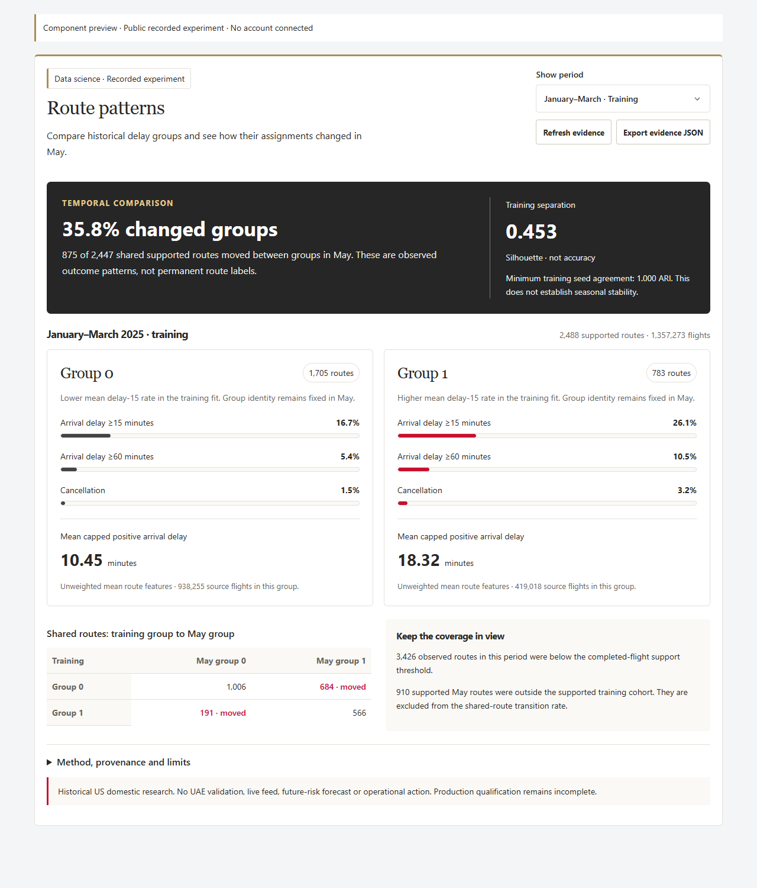

# Route patterns dashboard

The connected research dashboard now exposes the recorded route-segmentation experiment through an authenticated read-only API and a responsive comparison panel. Sign in to the local dashboard and choose **Explore route patterns** in the connected research toolbar.

The panel offers January–March training and May comparison views, two group profiles, delay/cancellation bars with text values, capped arrival-minute summaries, support coverage, the shared-route transition table, method/provenance details and JSON evidence export. Group IDs retain their training meaning in the May view. All 64 original workspaces remain available.

The screenshot is a component preview using the same renderer/styles and public experiment summary, without a real user account connected. It is not a screenshot of an authenticated production service.

## Recorded evidence, not live scoring

`GET /api/v1/research/route-segments` requires a valid session, including for viewer accounts. Other roles can read the same public research evidence. The proxy permits only the fixed GET route, forwards the scoped session cookie and rejects writes or arbitrary subpaths. Responses use the existing no-store policy.

The service reads only `docs/reports/Route_Segments_v1.json`, capped at 100 KB. Its canonical UTF-8/LF SHA-256 is pinned in the loader; missing, changed or unsupported evidence returns 503 without groups. The summary reconciles shared-route counts and the recorded transition fraction. It exposes selected aggregate fields, not route assignments, model files, import archives, account/session data or private filesystem paths. File integrity is not an independent audit or protection against a maintainer changing source and report together.

Refreshing rechecks the recorded report. It does not rerun clustering, query current flight aggregates, load a joblib model or invoke an LLM. Its counts and timestamp refer to the experiment rather than the present database. The service never accepts a user-provided report path or URL. A new experiment/report version requires a deliberate source and validation update.

The client validates production/research claims, finite metric ranges, supported profile totals and transition/cohort reconciliation before rendering or exporting. Unavailable or invalid evidence clears the prior view and disables export/period selection. Sign-out/session changes clear the component; late responses from an earlier session are ignored. Period switching retains the selector's focus because the control remains outside the replaced result region.

## Verified behavior

Four Python tests check fixed-summary reconciliation, private-field exclusion, missing/tampered evidence, Windows/Linux line endings, anonymous denial, viewer read access, no-store headers, write/subpath rejection and safe 503 handling. Three additional Node tests cover both period outputs, false claims and malformed metrics, transition consistency and proxy cookie/method/path restrictions. The full Windows suite has 176 tests: 146 Python and 30 Node; Linux skips the Windows-only DPAPI provider test.

A separate local headless Chrome profile exercised the actual component and event handlers against the public summary. Recorded browser checks passed for default training view, switching to May, JSON export construction, stale-group clearing after HTTP 503, recovery, and session clearing. Desktop rendering at a 1264 CSS-pixel viewport was inspected. A separate exact **390 CSS-pixel viewport** passed period/export checks, with document width 390 and no horizontal overflow; its complete screenshot was inspected. The first command-line narrow capture reported a 500-pixel viewport and clipped the requested screenshot, so it was not accepted as 390-pixel evidence. Chrome DevTools [device metrics emulation](https://chromedevtools.github.io/devtools-protocol/tot/Emulation/#method-setDeviceMetricsOverride) supplied the verified narrow viewport.

These browser checks used an isolated component preview, not a real user's signed-in session. Export verification intercepted the browser's download click and inspected the actual JSON Blob; it did not inspect or modify the user's Downloads folder. The preview server, test profiles and captures are local QA artifacts, excluded from the application source. GitHub repeats the Python/Node tests and additionally loads the verified summary inside its fresh API container to check report packaging. Hosted results must be checked for the exact published commit.

Aggregate check evidence is in [Route_Patterns_Dashboard.json](reports/Route_Patterns_Dashboard.json). The underlying model experiment and limitations are documented in [ROUTE_SEGMENTATION.md](ROUTE_SEGMENTATION.md).

This is retrospective US domestic research. Individual route browsing, live segment refresh, UAE validation, full device/accessibility qualification, forecasting, operational actions and production acceptance remain incomplete. Existing passwords and model-serving behavior are unchanged.
