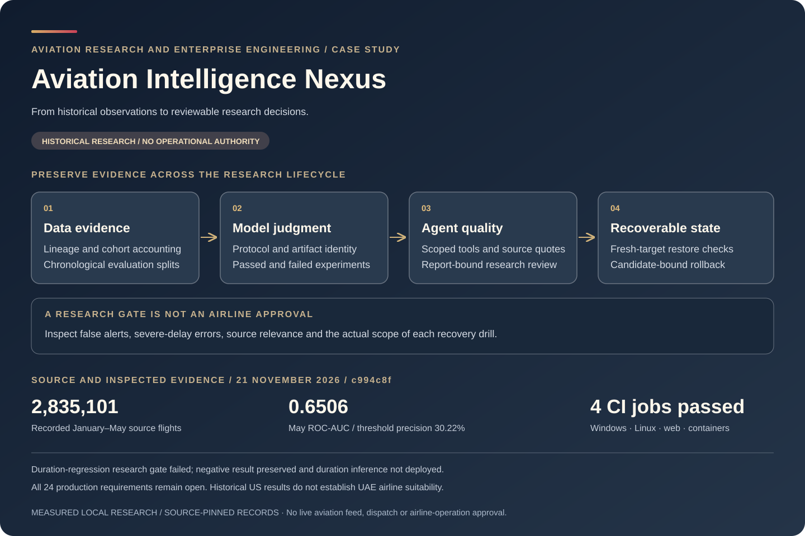
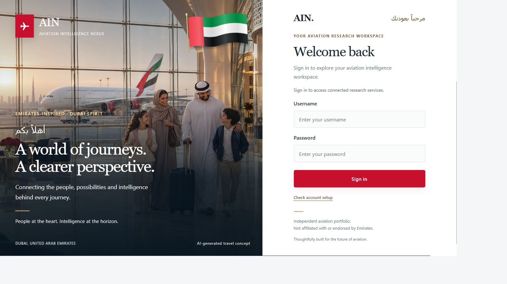
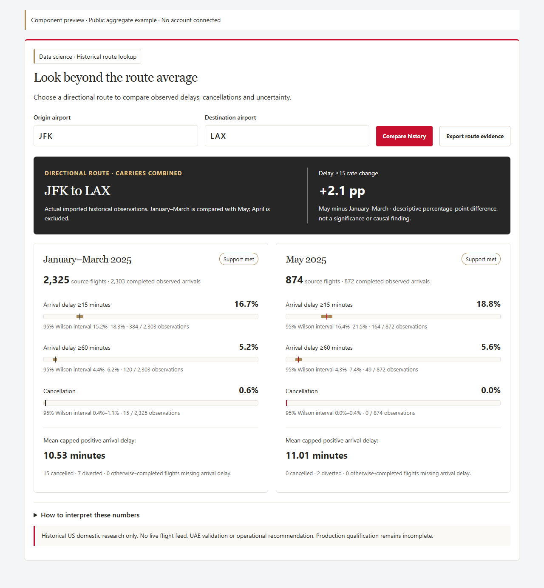
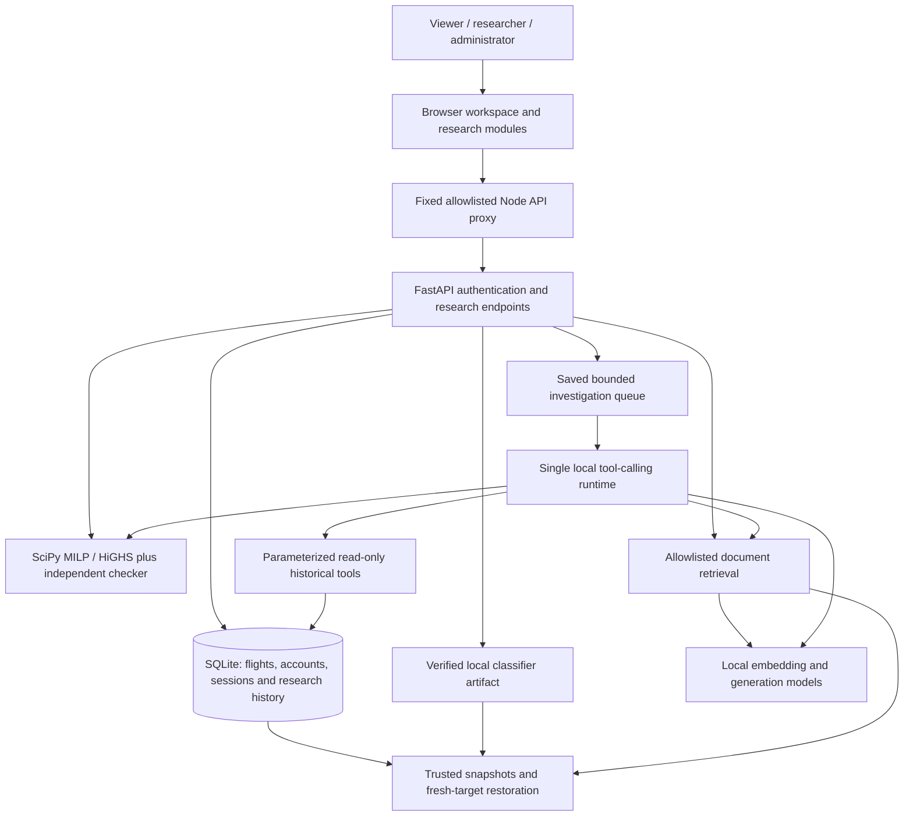
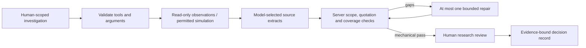

# Aviation Intelligence Nexus Case Study

## Architecting evidence-led aviation research, bounded AI investigations and verifiable local recovery

**Enterprise solution architecture · Applied machine learning · Generative AI and RAG · Agentic research workflows · Operations research · Data engineering · Security and governance · Infrastructure and recovery · Software engineering**

| Project | At a glance |
|---|---|
| Project owner | Shah Hussain Bangash · [GitHub](https://github.com/shah-hussain-bangash) |
| Source baseline | [`c994c8f`, reviewed 21 November 2026][baseline] |
| Domain | Historical aviation decision-support research |
| Data evidence | Recorded January–May 2025 BTS import: 2,835,101 stored flights; 2,786,350 eligible observed arrivals |
| Application | Browser JavaScript modules, local Node proxy, Python/FastAPI and SQLite |
| Research | Chronological delay classification, negative duration regression and synthetic mixed-integer gate allocation |
| Local AI | Ollama, EmbeddingGemma retrieval and bounded Qwen3 tool calling |
| Governance | Server-enforced roles, scoped tools, evidence-bound review and optional second-account research review |
| Delivery evidence | Local Docker restoration, encrypted recovery and isolated application rollback records |
| Current hosted checks | [Run 44885389229][ci]: all four jobs successful; Windows 286 Python tests passed, Linux 286 run with 1 skip, Node 90 passed, container checks passed |
| Acceptance boundary | Research prototype; all 24 production requirements remain open |

**The architectural contribution:** AIN connects historical data lineage, reproducible model evidence, constrained optimization, source-linked AI research and recovery verification. It preserves the distinction between an interesting result, a mechanically valid report, a human research decision and authority to operate an airline.

[Business context](#1-business-context-and-objectives) · [Architecture](#3-solution-architecture) · [Models](#4-temporal-model-evaluation-and-decision-trade-offs) · [Agent](#7-bounded-agentic-research-and-human-review) · [Recovery](#9-deployment-recovery-and-build-bound-rollback) · [Verification](#10-engineering-evidence-and-reproducibility) · [Demonstration](#12-technical-demonstration-and-next-delivery-gates)

## My contribution

- **Project scope.** I lead the independent Aviation Intelligence Nexus project. Its main areas are flight-data lineage, delay evaluation, and synthetic gate-proposal review.
- **Engineering trade-off.** The recorded audit moved to monthly processing in one consistent read transaction after the all-period query exceeded temporary storage.
- **Verification.** The case study links to pinned experiment evidence and GitHub checks and separates recorded results from proposed work. An independent fresh-checkout walkthrough is a next milestone.

## 1. Business context and objectives

Aviation research combines large historical datasets, uncertain predictions, operational constraints and decisions with different levels of authority. A model can discriminate delayed flights better than a constant baseline while still creating too many alerts. An optimization result can be feasible for a five-flight example without representing an airport. An AI report can quote a real source while omitting the limitation that matters most.

AIN explores how to keep those distinctions visible through a connected research platform. Its strongest contribution is the engineering around evidence: data populations reconcile, evaluation protocols are frozen, failures remain recorded, tools receive bounded human scope and recovery claims identify what was actually restored or rolled back.

| Objective | Implemented research response | Measure for a future pilot |
|---|---|---|
| Make model suitability inspectable | Time-based splits, constant comparators, calibration and threshold trade-offs | Discrimination, calibration and workload at an agreed operating point |
| Preserve source accountability | Recorded import lineage, cohort reconciliation and source/artifact fingerprints | Invalid records, reproducible populations and evidence freshness |
| Ground AI investigations | Validated tool arguments, structured observations, exact extracts and coverage gates | Supported findings, relevant evidence and human acceptance |
| Separate proposal from execution | Synthetic optimizer and research-only decisions | Feasibility and review quality within approved scope |
| Recover research state reliably | Fresh-target restores, session revocation and build-bound rollback receipts | State parity and measured recovery under an agreed drill |

No airline cost saving, disruption reduction, dispatch improvement or UAE transfer result is claimed. The recorded data concerns historical US domestic flights. The project has no airline affiliation or operational decision authority.

## 2. Product scope and an inspectable research journey

The application preserves 64 prototype workspaces across eight departments, 256 function specifications and 72 acceptance requirements. Connected research services are a separate, narrower implementation. Workspace counts are not counts of deployed airline integrations.

A useful journey starts with an explicit directional route. The researcher compares January–March with May, checks denominators and uncertainty, then permits a bounded agent to retrieve that same route evidence. The saved report retains structured tool results independently of the quotations selected by the model. A human can request changes even when mechanical coverage passes.

### Sign-in experience

*Captured from the running local release on 21 November 2026, with empty credential fields. The travel scene is an AI-generated design illustration. This screen presents access to local research services and does not imply airline affiliation or production acceptance.*

### Research dashboard preview

*Reviewed repository component preview of the recorded JFK–LAX example. It uses actual public aggregate research evidence through preview transport; no real user account is connected. The view is historical research, not a live flight feed or an operational airline dashboard. The component presents recorded research counts and uncertainty.*

The example contains 384 delayed arrivals among 2,303 eligible January–March observations, versus 164 among 872 in May. The displayed change is about 2.1 percentage points. Cancellation uses all source flights, while arrival-delay rates use completed, non-diverted flights with observed delay. Those denominators must not be mixed.

The [route lookup][route] also displays nominal 95% Wilson intervals. They describe a model-based uncertainty calculation under binomial assumptions; they are not a confidence guarantee for future UAE flights, a causal explanation or proof of a significant change.

## 3. Solution architecture

The frontend contains prototype interactions and connected research modules. The Node proxy admits fixed API routes; the browser cannot select an arbitrary backend, SQL query or model destination. API permissions remain authoritative even when the interface hides a control.

The local deployment runs separate web/API containers, with only the loopback dashboard port published. Ollama remains an external workstation dependency. The [deployment runbook][deployment] distinguishes native development, local containers and separately restored drill instances.

SQLite supports transactional history and WAL-based checkpoint visibility for this scope. The investigation worker belongs to one API process. This is a deliberate local boundary, with distributed leases, worker isolation, cloud identity and high availability left as further engineering.

## 4. Temporal model evaluation and decision trade-offs

### Freeze selection before evaluating the test period

The [second classifier experiment][classification] trains categorical histogram gradient boosting on January–March 2025, selects between prespecified candidates using April log loss and evaluates May after freezing selection. Categories are learned on training only; unseen categories have explicit handling.

Inputs are carrier, origin, destination, scheduled departure-time sine/cosine and weekday. Outcomes, exact day-of-month, flight number and month are excluded. This reduces some obvious leakage and identity dependencies; it does not establish point-in-time availability of historical schedules.

| Split | Period | Eligible flights |
|---|---|---:|
| Training | January–March 2025 | 1,611,046 |
| Validation | April 2025 | 577,730 |
| Temporal test | May 2025 | 597,574 |

The [training source][training-code] writes a persistent selection receipt before loading May labels. The research gate requires April and May ROC-AUC of at least 0.60, at least 1% lower log loss than a constant training-prior comparator and lower Brier score. This is a locally prespecified gate, not external preregistration or airline approval.

### Report the gain and the alert burden together

| Metric | April model | April constant prior | May model | May constant prior |
|---|---:|---:|---:|---:|
| ROC-AUC | 0.6355 | 0.5000 | 0.6506 | 0.5000 |
| Average precision | 0.2785 | 0.1966 | 0.3465 | 0.2360 |
| Log loss | 0.4781 | 0.4957 | 0.5261 | 0.5511 |
| Brier score | 0.1528 | 0.1580 | 0.1733 | 0.1818 |

The research gate passed. May log loss was about 4.53% below the same-period constant comparator. That does not establish operational utility.

At the April-selected threshold of 0.17, May contains 104,667 true alerts, 241,732 false alerts, 36,371 missed delays and 214,804 true negatives. An independent arithmetic check of the published matrix reproduces precision 30.22%, recall 74.21%, F1 0.4295 and accuracy 53.46%.

About 57.97% of eligible May flights are flagged. Always predicting on time would achieve 76.40% accuracy, illustrating why accuracy alone is insufficient. The model improves probabilistic metrics while its chosen alert rule would create a substantial review burden. Calibration diagnostics also show underprediction in several bins.

The threshold maximizes validation F1; it does not encode staffing limits or airline error costs. Future threshold/calibration work needs a new reviewed protocol and appropriate future evaluation data. No retuning or model execution was performed for this case study.

### Constrain the scenario API to the demonstrated scope

The [predictor][prediction] admits January–May 2025 scenarios, distinct airport codes and valid times. It verifies the expected local artifact identity and research assessment, rejects unknown categorical values and serializes local inference.

A historical scenario is not confirmation that the specified flight existed. Its result is conditional on completed, non-diverted flights with observed arrival delay. Artifact hashes detect mismatch relative to trusted records; they do not make an untrusted serialized model safe to load.

## 5. A retained negative experiment demonstrates research judgment

The [duration-regression experiment][duration] estimates nonnegative arrival-delay minutes with a separate frozen protocol and gradient-boosting regressor. Its temporal populations align by count with the earlier classifier, but it has its own data fingerprints.

The training mean is 15.0414 minutes and the training median is zero. The preset gate requires at least 1% lower RMSE than the training-mean comparator in both April and May.

| Period | Model RMSE | Mean-baseline RMSE | Model MAE | Median-baseline MAE |
|---|---:|---:|---:|---:|
| April | 49.7324 min | 49.9670 min | 21.0837 min | 14.5630 min |
| May | 55.6693 min | 56.1718 min | 23.1916 min | 18.1625 min |

RMSE improvements were only 0.4694% and 0.8946%; both missed the gate. MAE was worse than the zero-valued median comparator. Among 52,142 observed severe May delays, model MAE was 124.5464 minutes, exposing substantial tail underprediction.

The result remains published and duration inference is not deployed. The severe-delay cohort is defined retrospectively using outcomes, not prospectively detected by this model. May had already appeared in prior project analysis; this is a model-specific frozen benchmark, not a globally untouched holdout.

The engineering lesson is concrete: preserve a failed experiment, compare against the right simple baselines and inspect the error distribution before adding a model to a user workflow. A small average RMSE gain must not conceal poor absolute or severe-delay error.

## 6. Data lineage and independently checked optimization

### Reconcile populations without overstating source truth

The [recorded quality audit][data-quality] observed 2,835,101 source records and 2,786,350 eligible arrivals. Monthly cancellations and diversions reconcile to the modelling exclusions; structural checks reported zero detected field/key issues for that snapshot.

An initial all-period aggregation exceeded temporary-storage bounds. The successful audit processed one month at a time inside a consistent read transaction. This is a useful example of adapting SQL execution to a measured resource constraint without changing the research population.

Recorded archive hashes, URLs and row accounting provide lineage. The audit does not re-download archives, establish data rights, verify every source value or prove current live freshness. Raw rows, private databases and model artifacts remain outside Git.

### Verify the optimizer's plan independently

The [Gate Allocation Lab][optimization] uses SciPy MILP/HiGHS with one binary choice per flight/gate plus an unassigned option. It enforces exactly one outcome per flight, aircraft/gate compatibility and non-overlapping occupied intervals.

Occupancy is `[arrival, departure + buffer)`. Unassigned penalty is `number of flights × largest declared assignment cost + 1`, making coverage take priority over any possible assignment-cost saving in the bounded scenario.

A separate event-sweep checker rechecks flight accounting, compatibility, conflicts and assignment cost. The returned objective must reconcile with that checked plan; invalid or fractional candidates fail closed.

| Synthetic scenario | Optimizer assigned | Greedy assigned | Assignment cost |
|---|---:|---:|---:|
| 10-minute buffer; one narrow and one wide gate | 5/5 | 4/5 | 14 |
| 20-minute buffer; same gates | 4/5 | 4/5 | 6 |
| 20-minute buffer; two narrow and one wide gate | 5/5 | 4/5 | 13 |

Costs are invented units. Different coverage levels do not support a savings comparison. Requests are bounded to 16 flights, six gates and a three-second solver limit; these are not airport-scale benchmarks or request-latency guarantees.

[Proposal review][gate-review] binds the exact saved scenario/result and a 24-hour window, then rechecks feasibility and accounting at decision time. Self-review is permitted and labelled. This is research review, not independent approval or a gate-allocation command.

## 7. Bounded agentic research and human review

### Real local model execution with explicit capabilities

The [Evidence Studio][knowledge] indexes six allowlisted public project documents into 31 passages with line ranges, hashes and 768-dimensional EmbeddingGemma vectors. Retrieval combines 65% normalized dense cosine similarity and 35% TF-IDF.

Optional Qwen3 generation uses local Ollama. Claims must cite retrieved passages, include exact quotations and preserve numeric support. The recorded eight-question development exercise passed six expected-document checks and two abstention checks; two questions produced actual local generated answers. This is curated development evidence, not a general accuracy percentage.

The [investigation runtime][agent] is a custom single agent, not LangGraph or a multi-agent implementation. The model selects tools; the backend validates every argument and enforces the human-selected month, route and permissions. Available capabilities include historical metrics, document retrieval, explicitly scoped route history, opted-in evidence tools and a separately permitted synthetic gate simulation.

SQL text, shell commands, arbitrary files/URLs and model-selected route substitutions are not accepted. The runtime allows at most three tool executions and three planner calls. A 120-second cooperative budget and bounded model calls constrain work; they do not provide hard real-time cancellation.

### Mechanical evidence quality remains distinct from meaning

[Report quality controls][quality] require successful tool evidence, source coverage, exact quotations, valid scope and canonical report fingerprints. Finding text is set to the verified source extract rather than retaining an unsupported model paraphrase.

One bounded repair may add omitted evidence, with at most two summary calls and six retained extracts. Reports with unresolved mechanical gaps cannot be marked reviewed. Cached pass flags cannot bypass server validation.

*The repair edge is bounded to one attempt. A mechanical pass permits research review; no path in this workflow issues an airline command.*

The retained development history matters: seven defined cases eventually passed mechanical checks, but a broad-corpus case still selected a feature description instead of the requested model limitation. Coverage passed while semantic acceptance remained unresolved. The case study preserves that limitation.

For route investigations, typed counts, rates, nominal Wilson intervals and scope are checked and displayed independently of generated extract selection. The [recorded route exercise][route-agent] includes actual Qwen3 execution, exact airport echo, indexed read-only lookup and retry replay. Successful reports remained awaiting human review.

### Persist work without claiming distributed durability

The [background queue][queue] saves submissions before returning HTTP 202. It allows one running investigation, five waiting globally and two waiting per owner. Scoped retry keys prevent conflicting reuse; checkpoints and completed evidence remain inspectable.

On ordinary restart, queued work may resume while previously running work becomes interrupted without automatic tool replay. Restoration cancels restored queued work to avoid execution from a second restored copy. Cooperative stop checks occur between bounded calls; stopping a browser fetch does not forcibly stop model execution.

Optional [second-account review][peer-review] blocks the author from deciding an explicitly shared pending report. Current role/session and report integrity are rechecked transactionally. This proves distinct local accounts, not distinct humans or operational independence. Research review never enables an airline action.

## 8. Security and governance boundaries

| Concern | Implemented mechanism | Remaining enterprise work |
|---|---|---|
| User access | Argon2id local passwords, expiring hashed sessions, server roles and owner-scoped history | Managed identity/MFA, governed provisioning and access certification |
| Browser writes | Origin checks, session-bound CSRF and fixed proxy routes | Independent deployed security review and broader abuse testing |
| Tool authority | Strict schemas, explicit route/month scope, read-only SQL and simulation opt-in | Approved enterprise integrations and workload isolation |
| Report integrity | Request/trace/extract fingerprints and commit-time review checks | Protected audit storage, retention and trusted signatures |
| Evidence exposure | Public allowlisted corpus and scoped research records | Enterprise document permissions and source ACL synchronization |

The [identity implementation][identity] supports admin, researcher and viewer roles. Viewers can inspect permitted evidence but cannot calculate scenarios or accept investigations. An admin's visibility does not establish airline operating authority.

Research questions, notes and histories are private local records. Hashes stored alongside mutable local content are integrity controls, not tamper-proof auditing. Actual-user exports can contain identities and notes and should not be confused with the sanitized public reports.

## 9. Deployment, recovery and build-bound rollback

The [local Docker release][deployment] uses non-root containers, read-only root filesystems, dropped capabilities and loopback-only dashboard exposure. Hosted container checks verify core startup, isolation, packaged evidence and restart behavior without host Ollama or the workstation's full data.

Recorded local restoration recovered 2,835,101 flight rows, account records, the active model and document index. Restored sessions were revoked. A known historical scenario returned exactly the prior probability, 0.14414301173592028.

The [encrypted recovery drill][encrypted] uses authenticated streaming encryption and a Windows CurrentUser DPAPI-protected local key. It also restored the full recorded dataset and matching scenario. Losing the Windows profile/computer may make the key unavailable; same-machine protection is not independent off-site recovery.

The reported file restoration/validation timings exclude decryption or provisioning as specified in each drill. They must not be presented as full-system RTOs.

[Application rollback][rollback] mutates only an isolated restored Compose project. It uses immutable API/web image identities, compatible schema and selected state-contract fingerprints, checks state/model behavior and returns the isolated copy to its starting candidate.

The latest [build-binding controls][rollback-binding] require a version-2 receipt matching the running revision, schema and digest of ten selected source contracts. Historical receipts remain visible but unbound. A newer source commit needs a matching new drill; old rollback success does not certify the current build. There is no database downgrade, model/prompt rollback, zero-downtime or production failover claim.

## 10. Engineering evidence and reproducibility

The inspected hosted run targets the pinned source and completed all four jobs.

| Check | Observed result | What it supports |
|---|---|---|
| Windows Python | 286 tests run, all passed | Current automated regression, including Windows-specific key-provider coverage |
| Linux Python | 286 run, one Windows DPAPI test skipped | Same suite on Linux; 285 passed, one platform-specific skip |
| Frontend/source | 90 Node tests passed; source checks passed for 304 files | Contract/rendering checks and source integrity; not 90 live browser journeys |
| Container job | Build, deployment checks, packaged route evidence, bounded HTTP checks and API restart passed | Fresh CI fixture containers; not the million-row workstation restore or real Ollama evaluation |

Do not add the two operating-system Python counts as independent features. CI uses temporary data and mocked model responses where appropriate. The actual local model experiments, curated AI runs and full-data recovery are separate dated repository records; they were not rerun for this case study.

This review inspected source contracts, frozen protocols, reports, screenshots and current hosted logs. It independently recomputed the published May confusion-matrix metrics. The available local source folder lacked Git metadata, so its repository guard could not complete `npm run check`; the successful current hosted source check is the cited validation. Documentation/visual checks for this case study are separate from application regression.

[Evidence review and arithmetic audit](evidence/aviation-evidence-review-2026-11-21.json) records that distinction. Reproduction should preserve artifact/source identities and use isolated fixtures. Repeatedly evaluating May does not create a fresh holdout; a new experiment needs a separately reviewed evaluation design.

## 11. Architecture decisions and enterprise delivery

| Decision | Engineering value | Trade-off |
|---|---|---|
| Freeze chronological selection | Makes train/validation/test boundaries inspectable | Five months cannot establish seasonal or UAE robustness |
| Retain negative experiments | Prevents deployment claims from hiding failed baselines or tail errors | Research progress does not guarantee a useful model |
| Keep structured evidence outside generated wording | Humans can inspect counts and intervals despite incomplete summaries | Relevance and completeness still require evaluation |
| Separate synthetic optimization from historical data | Prevents invented gates/costs becoming apparent airline facts | Real operational constraints need authorized integration |
| Use bounded single-process research services | Supports measured local development and transparent failure behavior | Distributed ownership, scale and failover require redesign |
| Bind rollback evidence to the actual candidate | Stops historical receipts qualifying unrelated releases | Selected-contract compatibility remains narrower than full acceptance |

Cloud delivery should be a scoped next implementation, with an approved region, managed identity, independent backup/key recovery, private networking, external observability, governed model/artifact delivery and a durable worker architecture. Target services should follow the employer's platform and data permissions. A reference diagram is not a cloud deployment result.

The [readiness assessment][readiness] tracks 24 original production requirements. Twenty-three have some recorded local progress; all 24 remain open. That is neither a completion percentage nor independent acceptance.

## 12. Technical demonstration and next delivery gates

A focused demonstration can connect one research decision to its evidence:

1. Explain the 64-workspace prototype scope and identify the connected services.
2. Reconcile source counts with the modelling cohorts and time splits.
3. Compare classifier log loss with its alert burden at threshold 0.17.
4. Show the failed duration gate and severe-delay errors.
5. Compare the synthetic gate solution with greedy and inspect feasibility checks.
6. Open a scoped route investigation and inspect exact tool arguments and structured observations.
7. Show a mechanically incomplete report being blocked, then explain why a passing report still needs semantic review.
8. Demonstrate report-bound optional second-account research review.
9. Inspect restoration evidence and distinguish a historical rollback receipt from one bound to the running build.
10. Close with the selected production requirements, evidence owners and acceptance criteria.

| Next delivery gate | Evidence required |
|---|---|
| Aviation model suitability | Authorized representative data, new future evaluation periods, calibration and agreed review economics |
| Knowledge/agent quality | Larger reviewed corpora, document permissions, held-out relevance/completeness and adversarial evaluations |
| Runtime scale | Durable external workers, ownership/leases, capacity, timeout and recovery tests |
| Recovery resilience | Off-site encrypted storage, independent key recovery and complete measured restore/failover |
| Enterprise release | Managed identity/TLS, external alerts, protected auditing and independent security/load/accessibility acceptance |

AIN provides a substantive senior engineering discussion because it combines measured research with explicit limits, useful failure evidence and recoverable application state. Its evidence supports that discussion without implying operational airline or production approval.

[baseline]: https://github.com/shah-hussain-bangash/aviation-intelligence-nexus/commit/c994c8f136156fd49f8e0c19ea85f21e3ada3757
[ci]: https://github.com/shah-hussain-bangash/aviation-intelligence-nexus/actions/runs/44885389229
[classification]: https://github.com/shah-hussain-bangash/aviation-intelligence-nexus/blob/c994c8f136156fd49f8e0c19ea85f21e3ada3757/docs/DELAY_V2.md
[training-code]: https://github.com/shah-hussain-bangash/aviation-intelligence-nexus/blob/c994c8f136156fd49f8e0c19ea85f21e3ada3757/ml/train_v2.py
[prediction]: https://github.com/shah-hussain-bangash/aviation-intelligence-nexus/blob/c994c8f136156fd49f8e0c19ea85f21e3ada3757/services/api/prediction.py
[duration]: https://github.com/shah-hussain-bangash/aviation-intelligence-nexus/blob/c994c8f136156fd49f8e0c19ea85f21e3ada3757/docs/DELAY_DURATION_REGRESSION.md
[data-quality]: https://github.com/shah-hussain-bangash/aviation-intelligence-nexus/blob/c994c8f136156fd49f8e0c19ea85f21e3ada3757/docs/DATA_QUALITY_LINEAGE.md
[optimization]: https://github.com/shah-hussain-bangash/aviation-intelligence-nexus/blob/c994c8f136156fd49f8e0c19ea85f21e3ada3757/docs/GATE_OPTIMIZATION.md
[gate-review]: https://github.com/shah-hussain-bangash/aviation-intelligence-nexus/blob/c994c8f136156fd49f8e0c19ea85f21e3ada3757/docs/GATE_PROPOSAL_REVIEW.md
[knowledge]: https://github.com/shah-hussain-bangash/aviation-intelligence-nexus/blob/c994c8f136156fd49f8e0c19ea85f21e3ada3757/docs/KNOWLEDGE_STUDIO.md
[agent]: https://github.com/shah-hussain-bangash/aviation-intelligence-nexus/blob/c994c8f136156fd49f8e0c19ea85f21e3ada3757/agents/runtime.py
[quality]: https://github.com/shah-hussain-bangash/aviation-intelligence-nexus/blob/c994c8f136156fd49f8e0c19ea85f21e3ada3757/docs/AGENT_REPORT_QUALITY.md
[route]: https://github.com/shah-hussain-bangash/aviation-intelligence-nexus/blob/c994c8f136156fd49f8e0c19ea85f21e3ada3757/docs/HISTORICAL_ROUTE_LOOKUP.md
[route-agent]: https://github.com/shah-hussain-bangash/aviation-intelligence-nexus/blob/c994c8f136156fd49f8e0c19ea85f21e3ada3757/docs/ROUTE_AGENT_INTEGRATION.md
[queue]: https://github.com/shah-hussain-bangash/aviation-intelligence-nexus/blob/c994c8f136156fd49f8e0c19ea85f21e3ada3757/docs/BACKGROUND_INVESTIGATIONS.md
[peer-review]: https://github.com/shah-hussain-bangash/aviation-intelligence-nexus/blob/c994c8f136156fd49f8e0c19ea85f21e3ada3757/docs/SECOND_ACCOUNT_REVIEW.md
[identity]: https://github.com/shah-hussain-bangash/aviation-intelligence-nexus/blob/c994c8f136156fd49f8e0c19ea85f21e3ada3757/docs/LOCAL_IDENTITY.md
[deployment]: https://github.com/shah-hussain-bangash/aviation-intelligence-nexus/blob/c994c8f136156fd49f8e0c19ea85f21e3ada3757/docs/LOCAL_DEPLOYMENT_RECOVERY.md
[encrypted]: https://github.com/shah-hussain-bangash/aviation-intelligence-nexus/blob/c994c8f136156fd49f8e0c19ea85f21e3ada3757/docs/ENCRYPTED_RECOVERY.md
[rollback]: https://github.com/shah-hussain-bangash/aviation-intelligence-nexus/blob/c994c8f136156fd49f8e0c19ea85f21e3ada3757/docs/LOCAL_RELEASE_ROLLBACK.md
[rollback-binding]: https://github.com/shah-hussain-bangash/aviation-intelligence-nexus/blob/c994c8f136156fd49f8e0c19ea85f21e3ada3757/docs/ROLLBACK_BUILD_EVIDENCE.md
[readiness]: https://github.com/shah-hussain-bangash/aviation-intelligence-nexus/blob/c994c8f136156fd49f8e0c19ea85f21e3ada3757/docs/RELEASE_READINESS.md
