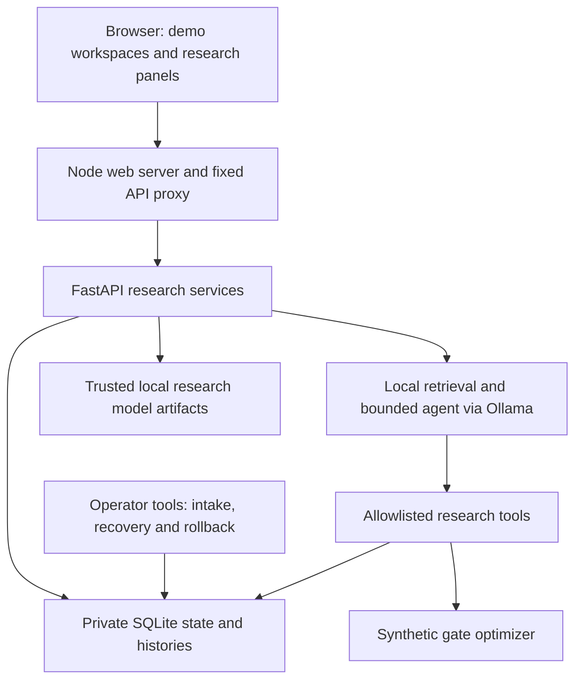

# AIN-EA-01 — Current Implementation Baseline

**Project:** Aviation Intelligence Nexus (AIN)  
**Baseline date:** 26 November 2026, Dubai  
**Document status:** Repository-reviewed baseline; not operational or production acceptance  
**Reviewed branch:** `main`  
**Reviewed source revision:** [`f08882e`](https://github.com/shah-hussain-bangash/aviation-intelligence-nexus/tree/f08882eb204f7df1cb0c946bb7860b046e70a878)  
**Change scope:** Documentation only. No application, model, credentials, dataset, private state or deployment changes.

[Project README](../../README.md) · [Current milestone history](../PROJECT_STATUS.md) · [Development instructions](../DEVELOPMENT.md) · [Readiness assessment](../../infra/readiness.json)

## 1. Purpose and review boundary

This is the first document in the enterprise architecture documentation sequence. It establishes what the existing application implements before business requirements, architecture views and engineering standards are consolidated.

The current system is a **local aviation research and decision-support prototype**. It combines 64 demonstration workspaces with a separately connected set of authenticated research services. Workspace count, screenshots and function previews do not establish 64 implemented backend business applications.

This baseline was prepared from the recursive repository inventory, selected source modules, runbooks, sanitized reports and the exact-revision GitHub Actions result. The review did not start the user's application, inspect private raw data or model weights, rerun training, reproduce browser tests, exercise a restore or independently assess security. Source inspection establishes implementation presence; existing receipts establish recorded historical results only.

The baseline revision predates this document's publication commit. Later commits must not inherit its test or deployment evidence automatically.

## 2. Status vocabulary

Implementation, evidence and acceptance are separate dimensions.

| Label | Meaning in this document |
|---|---|
| Implemented locally | Source contains an identifiable local implementation; prerequisites and runtime state may still be required. |
| Tested — recorded | The repository contains a scoped test/report or a hosted run was inspected. Specify revision, environment and limits. |
| Experimental | A research capability exists but its quality, generalisation or operating suitability is unresolved. It may also be implemented and tested. |
| Planned / not established | A target capability or acceptance condition is not demonstrated by the reviewed baseline. |
| Production accepted | Requires an accountable independent acceptance process and deployed evidence. **No production gate is accepted in this baseline.** |

No completion percentage is inferred from file counts, test totals, diagrams, gates or UI navigation.

## 3. Current system boundaries

This is a logical implementation map, not a network security certification. The normal native launcher uses a loopback web service on port 8080 and API on 8002. The saved Docker release uses loopback web port 8090 with API private to its Compose network. The isolated rollback drill uses its own project and port 8091. Follow the relevant runbook before starting any instance; do not overwrite existing volumes or assume they share state.

There is no established live airline feed, airport command integration, ticketing transaction, aircraft dispatch authority or autonomous operational action. Historical US flight records and synthetic gate inputs are distinct data classes.

## 4. Capability inventory and evidence map

Paths below identify the implementation and representative tests. They are not an exhaustive API specification or a claim of fresh execution.

| ID | Capability and implementation status | Source and representative tests | Evidence and practical limits |
|---|---|---|---|
| B01 | **Dashboard — implemented local UI; mixed demo/research scope.** Preserve all 64 workspaces. | [Web UI](../../apps/web), [dashboard tests](../../tests/test_dashboard.mjs), [runtime status](../../infra/status.py) | [README](../../README.md), [connected dashboard](../CONNECTED_DASHBOARD.md). Prototype workspaces remain demonstration data; connected research panels have separately identified services. |
| B02 | **Identity and access — implemented local sessions and roles.** Admin, researcher and viewer; session revocation and server-side checks. | [Auth](../../services/api/auth.py), [API](../../services/api/main.py), [auth tests](../../tests/test_auth.py), [account security tests](../../tests/test_account_security.py) | [Local identity](../LOCAL_IDENTITY.md), [account security](../ACCOUNT_SECURITY.md). Not managed SSO/MFA, enterprise lifecycle or independent identity assurance. |
| B03 | **Historical ingestion and data-quality audit — implemented local batch processing.** | [BTS importer](../../pipelines/import_bts.py), [quality audit](../../pipelines/audit_quality.py), [ingestion tests](../../tests/test_ingestion.py), [quality tests](../../tests/test_data_quality.py) | [Lineage](../DATA_QUALITY_LINEAGE.md), [ingestion](../DATA_INGESTION.md). Recorded January–May 2025 release has 2,835,101 rows. Historical US data is not UAE operational coverage or a live stream. |
| B04 | **Delay-15 classification — implemented offline training and bounded research inference; experimental suitability.** | [Training](../../ml/train_v2.py), [research predictor](../../services/api/prediction.py), [model tests](../../tests/test_v2.py), [prediction tests](../../tests/test_prediction.py) | [v2 design/results](../DELAY_V2.md), [public v2 report](../reports/Delay_v2.json). Research gate passed; operational approval remains false. Artifacts are private and absent from a fresh clone. |
| B05 | **Delay-duration regression — implemented offline experiment; failed research gate.** | [Duration model](../../ml/duration.py), [duration tests](../../tests/test_duration.py), [report API](../../services/api/duration.py) | [Negative result](../DELAY_DURATION_REGRESSION.md). Do not describe duration inference as deployed or hide the failed baseline comparison. |
| B06 | **Historical diagnostics — implemented report inspection and bounded lookup.** Threshold trade-offs, input distributions, model reliance and route evidence. | [Thresholds](../../ml/thresholds.py), [distributions](../../ml/input_distributions.py), [route lookup](../../services/api/route_history.py), [route tests](../../tests/test_route_history.py) | [Decision trade-offs](../MODEL_DECISION_TRADEOFFS.md), [route lookup](../HISTORICAL_ROUTE_LOOKUP.md). Retrospective comparisons do not prove causality, future forecasts or measured business benefit. |
| B07 | **Gate allocation — implemented synthetic mixed-integer optimizer and review history.** | [Solver](../../optimization/gates.py), [review service](../../optimization/reviews.py), [solver tests](../../tests/test_gates.py), [review tests](../../tests/test_gate_review.py) | [Gate lab](../GATE_OPTIMIZATION.md), [proposal review](../GATE_PROPOSAL_REVIEW.md). Fixed synthetic example; no real airport allocation. |
| B08 | **Document retrieval and Q&A — implemented local research RAG; experimental answer quality.** | [Index](../../rag/index.py), [RAG service](../../rag/service.py), [knowledge tests](../../tests/test_knowledge.py), [retrieval tests](../../tests/test_retrieval_diagnostics.py) | [Knowledge studio](../KNOWLEDGE_STUDIO.md), [retrieval diagnostics](../RAG_RETRIEVAL_DIAGNOSTICS.md). Approved public project documents, optional local generation, source/citation checks; no broad airline-corpus or semantic acceptance claim. |
| B09 | **Scoped Answer Lab — implemented opt-in research route with scope/coverage checks.** | [Scoped route](../../services/api/scoped_lab.py), [candidate](../../rag/scoped_answers.py), [coverage](../../rag/source_coverage.py), [lab tests](../../tests/test_scoped_lab.py) | [Lab](../SCOPED_ANSWER_LAB.md), [source coverage](../SOURCE_COVERAGE_GATE.md). Known false refusals and unsupported-topic blind spots remain. Exact quotations can still be irrelevant or incomplete. |
| B10 | **Self-review and imported review inspection — implemented browser-local controls.** | [Self-review](../../apps/web/scoped-review.mjs), [file import](../../apps/web/scoped-review-import.mjs), [Node tests](../../tests/test_scoped_review.mjs), [CLI verifier](../../scripts/verify-scoped-review.mjs) | [Self-review](../SCOPED_SELF_REVIEW.md), [inspector](../REVIEW_FILE_INSPECTOR.md). Unsigned digests check consistency, not author identity, independent review or semantic correctness. Imports do not upload or resubmit the question. |
| B11 | **Investigation agent — implemented bounded custom single-agent runtime; experimental quality.** | [Runtime](../../agents/runtime.py), [tools](../../agents/tools.py), [agent tests](../../tests/test_agent.py), [quality](../../agents/quality.py) | [Agent](../INVESTIGATION_AGENT.md), [quality](../AGENT_REPORT_QUALITY.md). Allowlisted read-only/evidence tools and optional synthetic optimization. Not a multi-agent platform, unrestricted tool executor or operational airline agent. |
| B12 | **Background execution and research review — implemented local persistence and bounded worker.** | [Jobs](../../agents/jobs.py), [review access](../../agents/review_access.py), [job tests](../../tests/test_jobs.py), [peer review tests](../../tests/test_peer_review.py) | [Background jobs](../BACKGROUND_INVESTIGATIONS.md), [second-account review](../SECOND_ACCOUNT_REVIEW.md), [cooperative stop](../COOPERATIVE_INVESTIGATION_STOP.md). One local worker, bounded queue; stop occurs between calls. Different accounts do not prove independent people or airline authority. |
| B13 | **Local deployment, backup and encrypted recovery — implemented operator tools with recorded local drills.** | [Compose](../../compose.yaml), [recovery](../../infra/recovery.py), [encryption](../../infra/sealed_recovery.py), [recovery tests](../../tests/test_recovery.py), [encryption tests](../../tests/test_sealed_recovery.py) | [Local recovery](../LOCAL_DEPLOYMENT_RECOVERY.md), [encrypted recovery](../ENCRYPTED_RECOVERY.md). Windows DPAPI key protection is tied to the local context; independent key escrow, off-site and computer-loss recovery are not qualified. |
| B14 | **Rollback and monitoring — implemented bounded local controls and recorded receipts.** | [Release tooling](../../infra/releases.py), [observer](../../infra/local_observer.py), [rollback tests](../../tests/test_releases.py), [observer tests](../../tests/test_local_observer.py) | [Rollback](../LOCAL_RELEASE_ROLLBACK.md), [observer](../LOCAL_OBSERVER.md), [monitor integrity](../MONITORING_INTEGRITY.md). Selected image-pair compatibility and local probes do not establish zero-downtime production rollback, centralized alerting or fleet availability. |
| B15 | **Engineering checks and readiness display — implemented source/test/container workflow and read-only assessment.** | [CI](../../.github/workflows/checks.yml), [package scripts](../../package.json), [assessment code](../../infra/readiness.py), [catalog](../../infra/readiness.json) | [Development](../DEVELOPMENT.md), [readiness](../RELEASE_READINESS.md). Integrity checks establish evidence consistency, not acceptance. All 24 production gates remain open. |

## 5. Recorded quantitative evidence

These results are taken from committed reports and milestone documents. They were not reproduced during this documentation change.

| Evidence | Recorded result | Interpretation |
|---|---|---|
| Historical release | 2,835,101 January–May 2025 BTS records | Dataset scale and provenance record; not live/UAE airline data. |
| v2 split | 1,611,046 training; 577,730 validation; 597,574 test | Chronological eligible completed-flight cohorts; cancelled/diverted flights are outside this prediction target. |
| v2 May evaluation | ROC-AUC 0.6506; precision 30.22%; recall 74.21%; F1 0.4295 at threshold 0.17 | Research gate passed, but the high false-alert burden and calibration limits block an unqualified operational claim. Threshold came from April; do not tune against May. |
| Synthetic gate case | 5/5 assigned vs greedy 4/5 at a 10-minute buffer with one narrow and one wide gate | One small designed scenario, not airport-scale performance or financial savings. |
| Duration regression | Preset improvement gate failed | Preserve the negative experiment; no duration inference deployment. |
| Latest reviewed local-suite statement | 478 tests: 364 Python + 114 Node on Windows | Reported by the inspector milestone/development guide. Linux skips the Windows-specific DPAPI provider case. Historical lower counts in older milestones are not current totals. |
| Inspector browser receipt | 23 inspector cases plus 6 existing query/review cases recorded | Public fixtures and synthetic notes; narrow check effective width 433 CSS pixels. Not every device or real analyst verdict. |

### Exact-revision hosted CI

At review time, [Project checks run 45179692206](https://github.com/shah-hussain-bangash/aviation-intelligence-nexus/actions/runs/45179692206) was **completed / success** for source revision `f08882eb204f7df1cb0c946bb7860b046e70a878`.

The checked workflow defines Linux source/Node checks, Python 3.14 test jobs on Linux and Windows, dependency consistency checking, and Linux container build/smoke/restart checks. The successful run metadata was inspected; individual job logs and exact per-job test counts were not independently recounted in this review. CI uses temporary/synthetic state and does not repeat million-row experiments, host Ollama evaluation, production security or a live airline journey.

The documentation publication will create a new revision with its own workflow result. The historical success above must not be relabeled as a successful run of that new commit.

## 6. What a fresh clone does and does not contain

**Present:** source modules, tests, selected dependency snapshots, startup scripts, sanitized aggregate reports, documentation and a CI workflow.

**Not bundled:** private SQLite state/accounts, original flight archives, split datasets, fitted model artifacts, local document indexes, Ollama weights, recovery keys, private backup archives or runtime drill receipts.

Consequently, cloning is not equivalent to reproducing the populated dashboard. The operator must choose a clean setup or a trusted restore, install the documented environment, provision a local account, and explicitly import/train/index where required. Do not invent credentials, commit private state or automatically retrain against an already evaluated holdout.

The reviewed baseline documents Node.js 24+ and a tested Python 3.14 environment. Local AI documentation names `embeddinggemma:300m` and `qwen3:8b` as the existing workstation models. These are reproduction references, not a recommendation to run the full workload on a 4GB MacBook Air. Windows Docker/Ollama receipts do not qualify Monterey, other computers or cloud deployment.

Follow [development](../DEVELOPMENT.md), [local identity](../LOCAL_IDENTITY.md), [data ingestion](../DATA_INGESTION.md) and [recovery](../LOCAL_DEPLOYMENT_RECOVERY.md) rather than treating this baseline as an automated setup script.

## 7. Production gap register

The existing [readiness catalog](../../infra/readiness.json) and [readiness implementation](../../infra/readiness.py) retain 24 production requirements. All have `production_accepted: false`; none is accepted by creating this document. Their remaining-work statements are carried forward below, not independently signed off. Some descriptions summarize older milestones; newer local implementations must be reconciled without treating local progress as production acceptance.

| Gate | Area | Remaining acceptance work from catalog | State |
|---|---|---|---|
| P01 | Backend services | Operational case/outcome services, durable jobs and reviewed deployed API acceptance remain outstanding. | Open |
| P02 | Persistent database | Managed database deployment, capacity/availability targets and production concurrency/failover qualification remain outstanding. | Open |
| P03 | Authorized datasets | UAE airline operational data, document permissions and purpose-specific source-rights review remain outstanding. | Open |
| P04 | Data ingestion | Scheduled incremental collectors, quarantine workflows, orchestration and operational replay remain outstanding. | Open |
| P05 | Big-data processing | Representative distributed processing, partitioning and bounded-query resource/load qualification remain outstanding. | Open |
| P06 | Data science models | Representative regression quality improvements, agreed forecasting/sentiment/anomaly use cases, semantic/business validation of route segments and UAE operational validation remain outstanding. | Open |
| P07 | Prediction deployment | Operational model monitoring, calibration, service objectives and demonstrated model rollback remain outstanding. | Open |
| P08 | Generative AI | Authorized aviation corpus coverage, robust grounding/security evaluation and deployed permission boundaries remain outstanding. | Open |
| P09 | Agent execution | External worker isolation, distributed leases/failover, forced interruption of running calls, broader task-completeness evaluation and operational acceptance remain outstanding. | Open |
| P10 | Mathematical optimization | Real authorized airline constraints/data, scale and operational acceptance remain outstanding. | Open |
| P11 | Connected business workflows | Persistent cross-service incident-to-outcome journeys and real operational integrations remain outstanding. | Open |
| P12 | Authentication | Managed user/service identity, MFA, lifecycle ownership and HTTPS deployment remain outstanding. | Open |
| P13 | Authorization | Applicable tenant isolation, purpose policy and separation-of-duties acceptance remain outstanding. | Open |
| P14 | Human approval controls | Operational reviewer assignment, expiry/retention, independently governed identity/separation and business authorization remain outstanding. | Open |
| P15 | Protected audit | Protected audit retention, correlation and independently reviewed tamper resistance remain outstanding. | Open |
| P16 | Security and privacy | Independent security/privacy review, protected secrets lifecycle, export/retention controls and vulnerability qualification remain outstanding. | Open |
| P17 | Production deployment | Cloud environment, TLS, controlled production configuration and reviewed release acceptance remain outstanding. | Open |
| P18 | Monitoring | Independent uptime, centralized protected telemetry, semantic AI/pipeline quality evaluation and owned external alerts remain outstanding. | Open |
| P19 | Backup and recovery | Off-site storage, independent key recovery, agreed RPO/RTO targets and independent environment drills remain outstanding. | Open |
| P20 | Rollback | A current candidate requires its own completed runtime drill receipt; a past source report cannot qualify later builds. Database downgrade, model/prompt rollback, independent production release/failover and zero-downtime compatibility qualification remain outstanding. | Open |
| P21 | Performance and accessibility | Agreed performance objectives, sustained representative authenticated/AI workloads, resource/queue contention, keyboard/screen-reader review and device matrix remain outstanding. | Open |
| P22 | Integrated acceptance testing | Reviewed deployed critical journeys, security/load results and resolution of material defects remain outstanding. | Open |
| P23 | Operational documentation | Independent operator walkthrough, production incident ownership and deployment/rollback runbooks remain outstanding. | Open |
| P24 | Final scope acceptance | Product/engineering acceptance must confirm actual deployed scope, exclusions, limitations and unresolved defects. | Open |

There is no claim here of production uptime, complete enterprise security, live UAE airline integration, independently approved AI outputs or operational aviation authority.

## 8. Documentation consistency findings

1. **Root AGENTS instructions:** describe an independent frontend prototype. Preserve their scope/claim/publication rules, but use current source and milestone evidence to describe the subsequently implemented research services. No instruction file is changed here.
2. **Backend foundation guide:** its early paragraph says authentication, prediction and integration are pending. Its final current-runtime note explicitly supersedes those historical limitations. Do not quote the early paragraph as the complete present state.
3. **Historic completion reports:** describe older frontend milestones, not the current software baseline. Keep their historic labels and point readers to the current status/readiness sources.
4. **Earlier recovery descriptions:** plaintext snapshot limits remain applicable to those snapshots; the later encrypted-recovery tool is separate and does not retroactively encrypt them or provide computer-loss recovery.
5. **Recorded tests and deploy receipts:** counts, browser fixtures and rollback identities apply only to their named milestone/build. A passing past receipt cannot qualify a later application build.
6. **Self-review, peer review and production approval:** they are different controls with different identity and scope limitations. Do not merge them into a single “approved AI” status.

This baseline adds a navigation link in the root README. It does not rewrite historical evidence, refresh readiness fingerprints, change model protocols or close acceptance gates.

## 9. Next documentation and engineering work

| Priority | Deliverable | Exit condition |
|---|---|---|
| 1 | Business requirements and acceptance criteria (AIN-EA-02) | Identify research users, decisions, scope/exclusions, requirement IDs, measurable criteria and proposed accountable roles. Mark stakeholder approval pending until obtained. |
| 2 | Consolidated enterprise/system architecture | Current vs target business/application/data/AI/security/deployment views, trust boundaries and references to B01–B15. |
| 3 | Decision records | Record actual choices and alternatives for local architecture, storage, historical splits, model gates, constrained agent tools, identity and recovery. |
| 4 | Requirements-to-evidence matrix | Map requirements to source, representative tests, exact revision and evidence limitations. Do not infer acceptance from a link. |
| 5 | Engineering and operations handbook | Consolidate existing setup/CI conventions and platform limits; review restore, rollback and secrets ownership. |
| 6 | Independently scoped deployment acceptance | Agree environment, source rights, identity, quality targets and operational owners before pursuing production claims. |

For the career portfolio, this sequence supplies evidence for data science, AI engineering, solution architecture and governed agent design. It does not establish authorship history, an employer's acceptance or a salary outcome.

## 10. Maintenance and review checklist

Refresh this baseline when a material feature, data period, model protocol, trust boundary, runtime or release mechanism changes.

- Record the new exact source revision and date.
- Reinspect source and link the applicable tests/reports; retain negative findings.
- Separate a fresh test from a historical receipt and synthetic from real data.
- Recheck CI at the intended revision; do not silently carry forward success.
- Identify changed contracts, migrations and compatibility requirements.
- Keep raw data, accounts, secrets, artifacts and private runtime evidence outside Git.
- Have a project owner review scope and an independent reviewer assess any claimed acceptance. No owner or reviewer sign-off is asserted for this document.

**Baseline conclusion:** substantial local research implementation and recorded verification exist. Enterprise architecture consolidation and all production acceptance obligations remain open.
