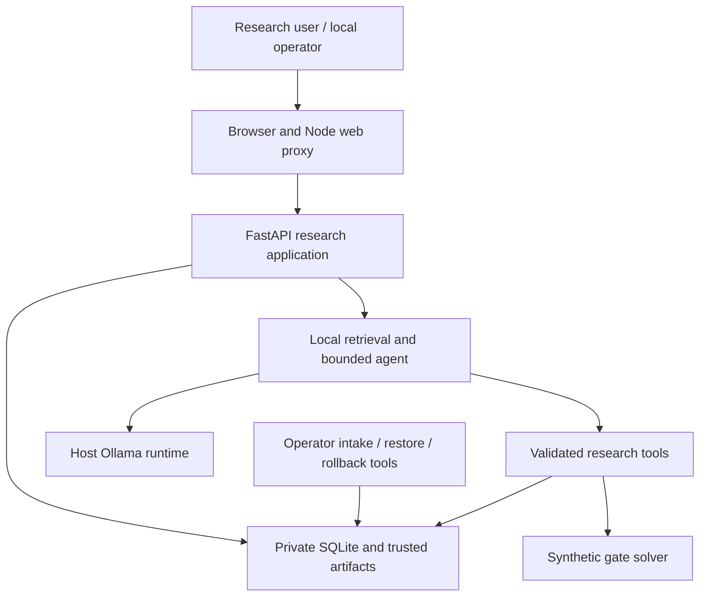
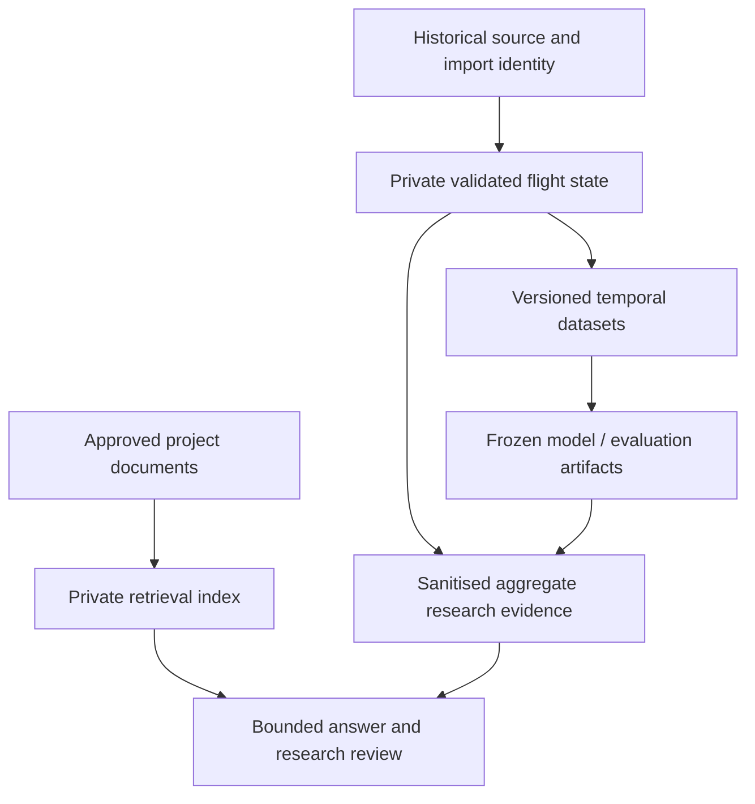

# AIN-EA-03 — Enterprise Architecture Overview

**Project:** Aviation Intelligence Nexus (AIN)  
**Date:** 26 November 2026, Dubai  
**Status:** Current-state repository review and proposed target architecture; owner review pending  
**Reviewed revision:** [`544b108`](https://github.com/shah-hussain-bangash/aviation-intelligence-nexus/tree/544b108cd0125b36b8151d2b15aa0fd6e8c59526)  
**Predecessors:** [AIN-EA-01 — Implementation Baseline](01-CURRENT-IMPLEMENTATION-BASELINE.md) · [AIN-EA-02 — Business Requirements](02-BUSINESS-REQUIREMENTS-AND-ACCEPTANCE.md)  
**Scope of this change:** Documentation and navigation only; no source behavior, data, model, credential, infrastructure or acceptance-state changes.

## 1. Executive architecture statement

AIN currently implements a **local aviation research decision-support system**. A Node-hosted browser interface and fixed API proxy connect to FastAPI research services, private SQLite state, trusted model/index artifacts and a locally hosted Ollama runtime. Historical BTS measurements, recorded experiments, synthetic gate scenarios and demonstration workspaces have different evidence and authority boundaries.

The proposed enterprise target is a governed, observable and recoverable research platform with explicit identity, data rights, model evaluation, bounded tools and human accountability. The target does not imply a purchased cloud platform, live airline integration, appointed reviewers or an operationally accepted service.

This overview brings business, application, data, AI, integration, security and infrastructure views together. It is not the detailed API/schema specification, full threat model or a deployment procedure. Later architecture documents should elaborate these views without replacing existing experiment protocols and scoped operational runbooks.

### 1.1 Evidence convention

- **Current:** an implementation identified in the reviewed source; runtime prerequisites and recorded verification limits still apply.
- **Target / proposed:** a design obligation or option requiring implementation, decisions and acceptance.
- **External decision:** needs an accountable owner, authorised environment, data rights or budget.
- **Accepted:** no production capability is marked accepted here. Existing P01–P24 gates remain open.

This review builds on AIN-EA-01 and selected source/configuration at the named revision. It does not rerun applications, experiments or recovery drills. Existing test receipts retain their original environment and build scope.

## 2. Architecture drivers and principles

| Driver | Architectural consequence | Business requirement link |
|---|---|---|
| Historical research must not masquerade as airline operations | Keep provenance, period, conditional target and synthetic labels attached to results and exports. | BR-01, BR-03–09 |
| Model and answer quality are uncertain | Retain failed experiments, calibrated limitations and refusal/unavailability states; require review beyond citation syntax. | BR-05–07, BR-10–13, NFR-08 |
| Identity and ownership matter even locally | Enforce permission/owner checks on the server independently of hidden UI controls; clear stale account results. | BR-02, BR-11–15 |
| AI tool use must be bounded | Validate canonical arguments against explicit user scope; use allowlisted tools and prohibit model-supplied SQL, paths and destinations. | BR-13–15 |
| The project must remain reproducible | Pin evidence to revisions/protocols; separate public code/reports from private state and model prerequisites. | BR-17, NFR-02–03 |
| A small local platform should remain understandable | Retain explicit modules and measured bounds; adopt distributed services only for a demonstrated scaling, isolation or availability requirement. | BR-14, NFR-04/07 |
| Recovery claims require real evidence | Restore to isolated destinations, verify selected state, preserve current instances and identify the exact rollback pair. | BR-16–18, NFR-05 |
| Portfolio evidence must be truthful | Connect requirements, decisions, source, tests and limitations; never close a readiness gate through documentation alone. | NFR-07 and all production gates |

BR/NFR identifiers refer to [AIN-EA-02](02-BUSINESS-REQUIREMENTS-AND-ACCEPTANCE.md). The principles express the proposed architecture direction, not signed stakeholder policy.

## 3. Business architecture

### 3.1 Capability map

| Business capability | Current research realisation | Target enterprise extension / decision |
|---|---|---|
| Evidence intake and stewardship | Historical BTS batch imports, receipts, source identities, recorded quality/lineage panels | Authorised incremental sources, purpose/retention policy, steward ownership and reviewed ingestion/replay operations |
| Quantitative research | Temporal delay classification, negative duration experiment, distribution/route diagnostics and baseline comparisons | Agreed decision costs, representative future periods, model approval criteria and independently reviewed domain applicability |
| Scenario evaluation | Synthetic gate optimisation with independent feasibility/accounting checks | Real constraints, authorised domain data, capacity tests and separate operational authority if ever proposed |
| Knowledge assistance | Allowlisted project documents, local retrieval and optional generation | Permissioned corpus lifecycle, relevance/grounding evaluation, source freshness and deletion propagation |
| Investigation and review | Bounded single-agent tools, persisted local jobs, research reviews and scoped sharing | Verified reviewer independence where required, robust worker isolation and auditable governance |
| Research access | Local admin/researcher/viewer sessions and owner boundaries | Managed identity, MFA/lifecycle, applicable tenant/site/resource scoping and reviewed authorisation model |
| Platform operations | Native/Docker startup, local monitoring/observer, recovery and isolated rollback | Approved environment, external alerts, recovery targets, independently recoverable backups and release ownership |

The 64 prototype workspaces form a demonstration and navigation layer. Their existence does not establish a corresponding deployed business capability.

### 3.2 Value streams and authority

1. **Historical evidence:** authorised source selection → validated import → provenance/quality inspection → bounded aggregate → research interpretation.
2. **Model research:** frozen question/protocol → temporal datasets → training/validation → frozen choice → held-out evaluation → explicit limitations.
3. **Investigation:** user-selected scope → server permission checks → bounded evidence tools → cited draft → research review/export.
4. **Synthetic planning:** declared synthetic scenario → solver → independent plan checker → saved proposal → time-bound research decision.
5. **Operation and recovery:** identify instance/build → observe state → controlled maintenance → isolated restore/rollback verification → recorded outcome.

Each stream ends in a research or engineering outcome. None produces an airline dispatch, airport allocation, payment or safety-critical instruction.

### 3.3 Proposed accountability

The product owner defines scope; a data steward reviews source rights; a research/domain reviewer evaluates findings; engineering owns contracts and tests; platform/security owners govern deployment and recovery. These roles remain proposed. Application `admin` privileges do not confer those independent business authorities.

## 4. Application architecture — current state

### 4.1 Logical container view

The AI/runtime/tool boxes are logical modules, not separate independently scaled microservices. The local agent worker is attached to the API process. Diagram arrows show functional dependencies rather than complete network policy.

### 4.2 Component responsibilities

| Boundary | Current responsibility and source | Important constraint |
|---|---|---|
| Web experience | [apps/web](../../apps/web): navigation, research panels, charts, review/export controls and stale-result handling | Mixed simulated and connected scope must remain visible. |
| Web hosting/proxy | [scripts/dev.mjs](../../scripts/dev.mjs), [API proxy](../../scripts/api-proxy.mjs), [release launcher](../../scripts/start-release.mjs) | Fixed allowed API transport; browser UI is not the authoritative access-control layer. |
| Research API | [services/api/main.py](../../services/api/main.py) and scoped route modules | Typed/bounded requests, current sessions/roles, owner scope and sanitised responses. |
| Local identity | [auth](../../services/api/auth.py), [account security](../../services/api/account_security.py), [user CLI](../../services/api/manage_users.py) | Local provisioning/session model; no managed enterprise identity qualification. |
| Historical intake | [pipelines](../../pipelines), including [importer](../../pipelines/import_bts.py) and [quality audit](../../pipelines/audit_quality.py) | Batch/history scope; public aggregate reports are not raw source truth. |
| ML research | [ml](../../ml), [predictor](../../services/api/prediction.py) | Versioned protocol/artifact gates; permitted historical scenarios only. |
| Optimization | [gates](../../optimization/gates.py), [reviews](../../optimization/reviews.py) | Synthetic feasibility and accounting; no actual airport effect. |
| Retrieval and generation | [rag](../../rag), [scoped lab](../../services/api/scoped_lab.py) | Approved source/index boundaries; exact excerpts do not prove relevance or completeness. |
| Agent execution | [runtime](../../agents/runtime.py), [tools](../../agents/tools.py), [jobs](../../agents/jobs.py) | Custom bounded single agent; limited local concurrency/queue and cooperative interruption. |
| Research persistence/review | [agents/store.py](../../agents/store.py), [review access](../../agents/review_access.py), [history](../../rag/history.py) | Persist exact research state; different accounts are not independently verified people. |
| Operator platform | [infra](../../infra), [state paths](../../services/api/paths.py), [Compose](../../compose.yaml) | Private state, explicit instance identity and qualified isolated recovery/rollback targets. |
| Readiness governance | [assessment](../../infra/readiness.py), [catalog](../../infra/readiness.json) | Evidence consistency and 24 open gates; no automatic production acceptance. |

The current baseline uses a modular application structure. Physical service decomposition, queue technology or a database migration must be justified by required isolation, scale and availability, not by diagram aesthetics.

## 5. Data architecture and governance

### 5.1 Data classes and lifecycle

| Data class | Current handling | Target obligation / known limit |
|---|---|---|
| Historical source data | BTS archives/import records and private historical flight rows | Confirm purpose/source terms, versioned rights register, retention and handling of future sources. Historical US records do not substitute for UAE airline operations. |
| Research datasets | Temporal split files and recorded hashes, outside Git | Reproducible lineage, protected storage and controlled new evaluation periods; no hidden holdout reuse. |
| Model artifacts | Trusted private fitted files with report/protocol identity checks | Provenance/signing/trust policy, controlled promotion and model rollback. Loading arbitrary serialized models is outside scope. |
| Public aggregate evidence | Sanitised reports and Markdown under docs/reports and docs | Revision/date binding and scope labels. Report presence is not evidence of a running deployment. |
| Research state | SQLite accounts, sessions, histories, proposals, jobs and reviews | Managed persistence and tenant/retention/recovery rules if required by the target environment. |
| Knowledge sources/index | Allowlisted public project documents and a private derived index | Approved corpus onboarding, ACL/source lifecycle, refreshed/deleted-source propagation and evaluated coverage. |
| Local exports/self-reviews | Explicit user downloads; unsigned browser-local artifacts | Warn that exported copies cannot be recalled; approve privacy/retention practices. Do not treat hashes as signatures. |
| Backups, keys and runtime receipts | Private local snapshots, optional encrypted recovery and exact-build/drill records | Independent key recovery, off-site storage, retention/rotation, protected evidence and loss-of-computer testing. |

Raw data, credentials, runtime databases, private artifacts, keys and backups must remain outside Git and images. Exact local paths, account details or private receipts should not be copied into public evidence.

### 5.2 Lineage and state boundaries

This view does not imply a cloud lakehouse, live streaming backbone or enterprise data catalog is deployed. SQLite migrations and selected restore checks exist; a managed database and scale/availability targets remain design decisions.

## 6. AI and agent architecture

### 6.1 Separate research from inference and control

| Workload | Current mechanism | Control and remaining gap |
|---|---|---|
| Delay-15 classification | Offline temporal training/selection and restricted local inference | Research gate passed for the documented experiment; calibration, alert burden and operational population remain unresolved. |
| Duration regression | Offline training/evaluation with preserved failure | Failed preset research improvement check; no duration inference deployment. |
| Route/distribution/reliance studies | Recorded retrospective diagnostics and bounded history reads | No causal explanation, live drift guarantee or unrestricted forecasting claim. |
| Document Q&A | Local embeddings/retrieval with optional Ollama generation | Citation/source checks and refusals; representative semantic evaluation remains pending. |
| Scoped excerpts | Explicit version/scope/coverage checks with exact returned text | Known conservative false refusals and short-topic blind spots remain. |
| Investigation | Local Ollama-assisted custom runtime chooses permitted tools and drafts evidence-based research text | Tool calls are server-validated; no arbitrary SQL, shell, file path or network destination. |
| Synthetic gate optimization | SciPy mixed-integer solver and independent feasibility checker | Not an LLM-controlled airport allocation or validated real-airport optimizer. |

### 6.2 Actual tool boundary

[agents/tools.py](../../agents/tools.py) defines strict argument schemas and conditionally offered tools:

- `flight_metrics` and `knowledge_search`: bounded historical aggregates and approved document evidence.
- `gate_simulation`: offered only with the appropriate synthetic-simulation opt-in.
- `route_history`: explicit user-selected origin/destination with exact scope enforcement.
- `model_evidence`, `distribution_evidence` and `duration_evidence`: opt-in recorded evidence tools with empty arguments.

Availability depends on the user-selected scope and runtime checks; this is not permission to expose every tool in every request. A model's selection is an untrusted proposal until application validation succeeds. Retrieved content is evidence, not authority to override tools or policy.

### 6.3 Target lifecycle

The proposed lifecycle is source rights → frozen experiment → independently reviewed metrics/limitations → controlled research release → monitoring/re-evaluation → explicit promotion/rollback. Production promotion requires accountable acceptance, applicable representative data and security/operational evidence. No new quality thresholds, agent frameworks, model provider or runtime service are selected by this overview.

## 7. Integration architecture and contracts

| Interface | Current contract/reference | Target extension and validation |
|---|---|---|
| Browser → research API | Same-origin web proxy and current authenticated route contracts | Versioned interface inventory, bounded errors, role/owner negatives and explicit client compatibility. |
| Import source → local store | BTS schemas, receipts, duplicate handling and intake checks | Incremental source orchestration, source-rights controls, replay and explicit failure ownership. |
| API → model artifact | Fixed trusted local artifact/report verification | Approved model registry/promotion, protected provenance and qualified replacement/rollback. |
| API/agent → Ollama | Configured host local-model dependency | Version/resource/timeout policy and reviewed network boundary; managed external-provider use is not implied. |
| Agent → research tools | Allowlisted names, strict arguments, scope and opt-in gates | Independent malicious-input/permission evaluation and workload isolation. |
| Worker → SQLite job state | Saved local bounded queue and checkpoint/restart semantics | Durable external workers/leases/compensation only if workload and availability justify them. |
| Operator → recovery/rollback | Explicit CLI/runbook and isolated destination/project | Independently recoverable keys, off-site copies and qualified target-environment drills. |
| Future airline/vendor system | **Not established** | Separate integration contract, authority/data rights, sandbox, reconciled retries, audit and domain acceptance before any effect. |

Do not add an event bus, distributed graph runtime, lakehouse or ERP/airline connector to the current-state architecture until code, contracts and evidence exist.

## 8. Security and trust boundaries

| Boundary | Current controls / evidence | Remaining target work |
|---|---|---|
| User/browser ↔ web/API | Local sessions, current role/owner checks, CSRF/origin controls, response policies and stale-account display handling | Managed identity/MFA, lifecycle, applicable tenant model and reviewed HTTPS deployment |
| Untrusted input ↔ research service | Typed/bounded inputs, sanitized failures, constrained source/model paths | Independent abuse/security review, deployed limits and resource isolation |
| Generated tool proposal ↔ execution | Canonical tool names/arguments, user scope, restricted read-only research and synthetic tools | Adversarial evaluation, stronger workload isolation and policy/decision governance |
| API ↔ private state/artifacts | Local private storage, transactions and integrity checks | Least-privilege managed access, storage encryption policy, retention and protected audit |
| API ↔ host Ollama | Explicit local dependency; Docker uses host.docker.internal | Enforced network/egress controls and reviewed host/runtime hardening; a Docker bridge is not network isolation certification |
| Research result ↔ human review/export | Exact-result/proposal binding, scoped sharing and unsigned artifact labels | Verified reviewer authority where needed, independent semantic review and export governance |
| Recovery operator ↔ keys/backups | Separate encryption/key tools and no-overwrite restore behavior | Key escrow, off-site storage, rotation and computer-loss qualification |

**Authority rule:** citation validity, model confidence, independent feasibility checking, a second account or a positive self-review never confers operational airline authority.

A local administrator can change trusted files and state. Matching hashes do not establish protection against a compromised administrator. Unsigned exports, local audit histories and receipts are not immutable off-host assurance.

## 9. Infrastructure and deployment views

### 9.1 Current environments

| Environment | Current design | State and qualification limits |
|---|---|---|
| Native development | Combined launcher; loopback web 8080 and API 8002, project Python environment and optional host Ollama | Developer-controlled private state; follow the documented environment rather than assuming all computers are compatible. |
| Local Docker release | Node web and Python API images; named state volume; only web published at 127.0.0.1:8090 by default | Compose API has no host port; read-only roots, capability dropping and no-new-privileges are configured. Controls do not establish complete security assurance. |
| Local AI runtime | Host Ollama accessed by the local service; Compose references host.docker.internal | Weights/index/artifacts are separate prerequisites; documented Windows-host receipts do not qualify every host platform. |
| Isolated rollback | Dedicated project/volume and loopback 8091, retained compatible image pair | Operator drill, not automatic production rollback or database/model/prompt downgrade. |
| CI | Source/Node, Linux/Windows Python and Linux container smoke jobs | Temporary/synthetic state; no million-row training or host-model qualification implied. |
| Cloud staging/production | **Not deployed/accepted by this architecture document** | Cloud/provider, identity, network, data, budgets, SLOs and accountable owners remain external decisions. |

### 9.2 Proposed enterprise deployment progression

1. Preserve a reproducible local research baseline and scoped acceptance evidence.
2. Agree the intended pilot users, data rights, quality requirements, capacity and environment.
3. Design a controlled staging deployment with managed identity, TLS, secrets, persistence, bounded AI access, observability and independent recovery.
4. Validate exact-build critical journeys, denied access, failures, load, restore and rollback in staging.
5. Consider a limited production research release only after all applicable gates and accountable reviews are satisfied.

A modular application with explicit worker/runtime boundaries is the starting option. PostgreSQL or another managed database, durable queue, object storage, IdP, cloud platform and model registry require later decision records. Kubernetes and microservice decomposition are options only if measured requirements warrant their operational cost.

## 10. Quality scenarios and failure behaviour

These scenarios are design/acceptance obligations; this document does not record new test passes.

| Scenario | Required research behaviour | Evidence reference / unresolved qualification |
|---|---|---|
| Invalid/out-of-scope prediction | Reject with no invented score; missing artifact becomes unavailable | [Prediction](../RESEARCH_PREDICTION.md), [tests](../../tests/test_prediction.py) |
| Session revoked or user changes during request | Enforce current server authority; prevent stale results/export from reappearing | [Scoped lab](../SCOPED_ANSWER_LAB.md), [account security](../ACCOUNT_SECURITY.md) |
| Model returns irrelevant but exact quotation | Preserve semantic uncertainty; do not infer quality from quote matching | [Quality limits](../AGENT_REPORT_QUALITY.md), [coverage limits](../SOURCE_COVERAGE_GATE.md) |
| Duplicate job or process interruption | Preserve documented identity/checkpoints; never claim exactly-once replay/failover | [Background jobs](../BACKGROUND_INVESTIGATIONS.md), [job tests](../../tests/test_jobs.py) |
| Solver time limit or infeasible assignment | Report bounded status; reject unverifiable candidates, with no false optimum | [Gate lab](../GATE_OPTIMIZATION.md), [solver tests](../../tests/test_gates.py) |
| Backend outage / stale observer sample | Show unavailable/unknown; frontend liveness alone cannot mean full system readiness | [Monitoring integrity](../MONITORING_INTEGRITY.md), [observer](../LOCAL_OBSERVER.md) |
| Wrong backup key / altered archive | Fail closed, preserve original/live state and refuse existing destination | [Encrypted recovery](../ENCRYPTED_RECOVERY.md), [tests](../../tests/test_sealed_recovery.py) |
| Incompatible rollback candidate | Reject the isolated drill; require the exact supported state-contract/image pair | [Rollback](../LOCAL_RELEASE_ROLLBACK.md), [tests](../../tests/test_releases.py) |

Define measurable performance, concurrency, availability, accessibility and RPO/RTO targets through owner review. Prior local latencies and restore timings are scoped observations, not enterprise commitments.

## 11. Gaps and transition work

| Priority | Architectural gap | Next concrete output | Acceptance boundary |
|---|---|---|---|
| T01 | Current architecture dispersed across milestone docs | Detailed system/context/container/deployment diagrams and interface index | Source references and current-vs-target labels reviewed |
| T02 | Important choices not collected as decision records | ADRs for local structure, storage, identity, model protocol, tool restrictions and recovery | Alternatives/trade-offs/consequences recorded; no fabricated historical approval |
| T03 | Business requirements not mapped to exact evidence | Requirement → module → test → artifact/revision matrix | Applicable critical journeys independently reviewed |
| T04 | Historical reports vs running-state confusion | Consistent provenance/build/experiment labels and explicit prerequisites | No stale receipt automatically qualifies a later build |
| T05 | Research quality vs business-use gap | Agreed independent domain/semantic evaluation and representative data protocol | Measured thresholds and known failures reviewed by accountable owners |
| T06 | Identity, data rights and operational ownership unresolved | Owner-approved pilot/environment/security/data decisions | No cloud or live integration assumption |
| T07 | Distributed/operational resilience incomplete | Workload-driven persistence/worker/monitoring/recovery design and staging drills | Qualified failure/recovery outcomes, not design-only promises |

The [P01–P24 readiness catalog](../../infra/readiness.json) remains the existing production obligation register. This overview neither refreshes its fingerprints nor changes acceptance values.

## 12. Enterprise decisions to record

| Decision candidate | Current fact | Proposed decision question |
|---|---|---|
| ADR candidate — application structure | Local Node/FastAPI modules and attached worker | What measured isolation/load target would justify separate services? |
| ADR candidate — persistence | SQLite/private artifacts and versioned local migrations | What tenant/concurrency/availability requirements justify a managed database and object storage? |
| ADR candidate — identity | Local admin/researcher/viewer model | Which approved IdP/lifecycle and resource-scoping model applies to a pilot? |
| ADR candidate — AI runtime | Local Ollama and bounded tool/excerpt workflows | Which quality, data-boundary, cost and resource criteria govern runtime choice? |
| ADR candidate — experiment governance | Frozen temporal protocols and recorded negative results | Who approves future evaluation periods, semantic review and promotion? |
| ADR candidate — recovery | Local encrypted snapshots and isolated compatibility-limited rollback | How will key escrow, off-site storage, RPO/RTO and independent restoration be qualified? |

These are questions for later ADRs, not already approved choices. The next planned document is **AIN-EA-04 — System Architecture Diagrams**, expanding exact current topology, runtime flows and trust boundaries without inventing deployments.

## 13. Review and maintenance

- Revisit this overview when scope, data, identity, artifacts, runtime, tool authority, deployment or recovery mechanisms change.
- Pin subsequent evidence to the actual revision and environment; do not inherit historic green CI or drill results.
- Preserve all 64 workspaces and their truthful simulated/current labels.
- Keep diagrams and module references aligned with code; check all local links before publication.
- Link new decisions and traceability evidence without overwriting earlier experiment results.
- Product, data, domain, security and operations review/sign-off are **pending**, with no named approval asserted.

**Architecture conclusion:** AIN has a substantial local research implementation and a clear route toward governed delivery. The enterprise target remains proposed and all production acceptance obligations remain open.
