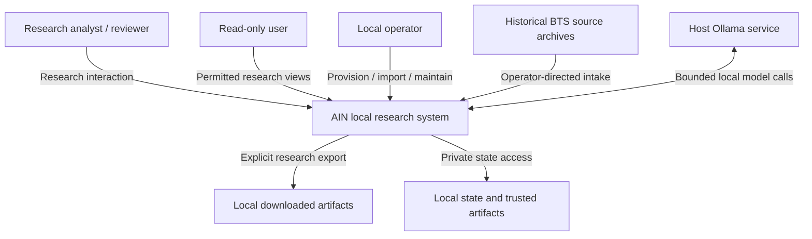
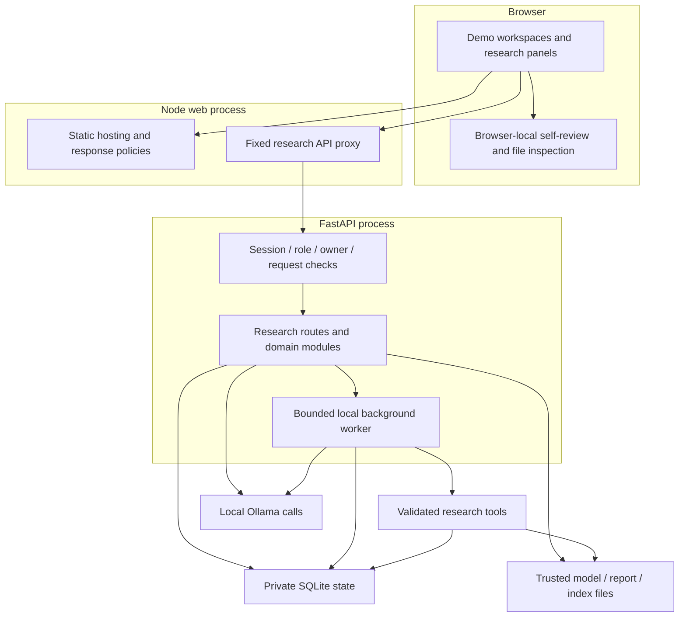
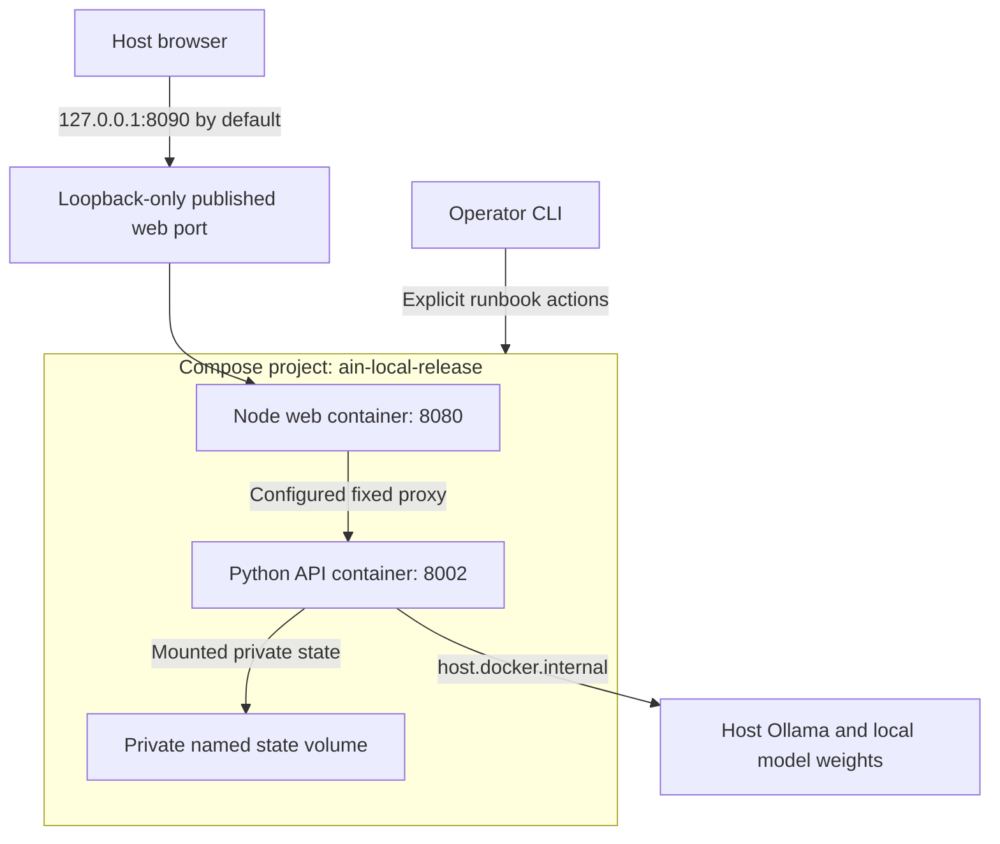
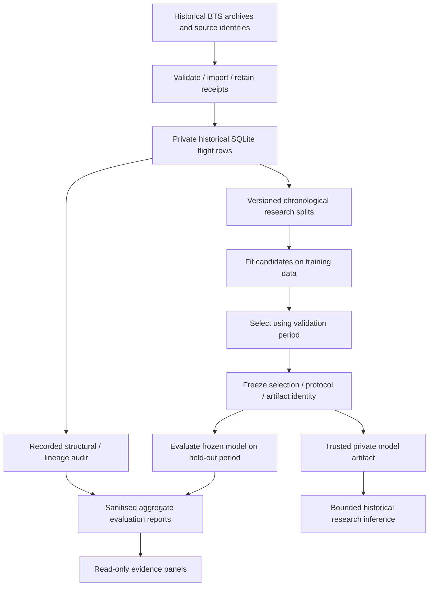
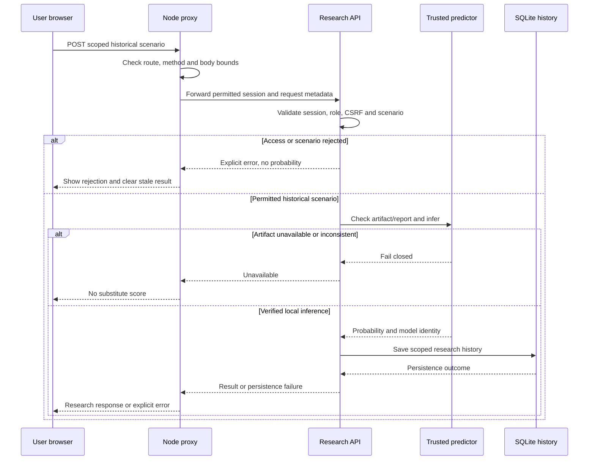
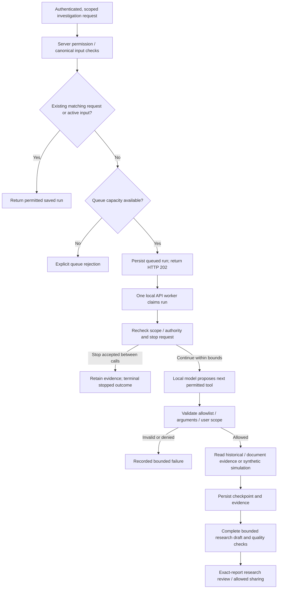
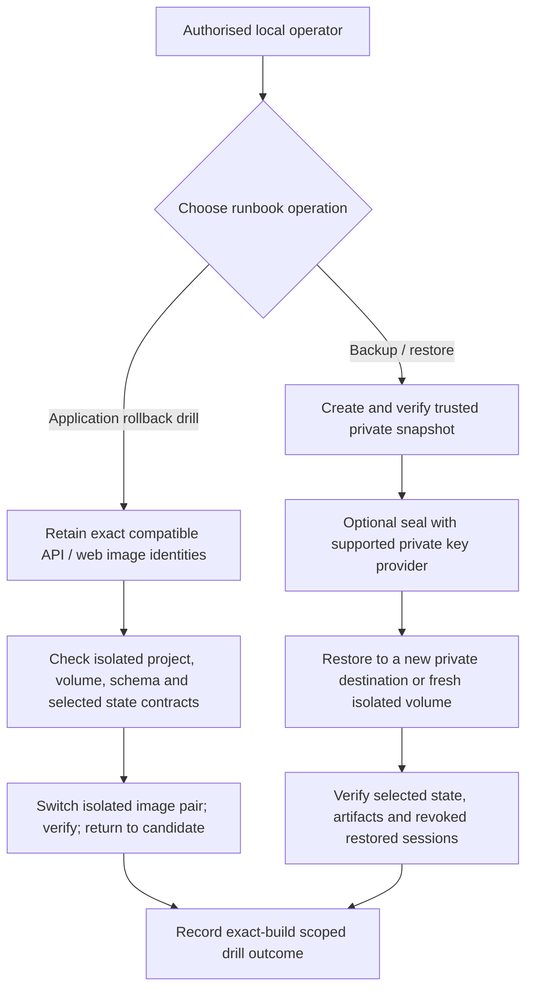

# AIN-EA-04 — System Architecture Diagrams

**Project:** Aviation Intelligence Nexus (AIN)  
**Date:** 26 November 2026, Dubai  
**Reviewed revision:** [`96bc632`](https://github.com/shah-hussain-bangash/aviation-intelligence-nexus/tree/96bc63221b90b4505ecd7147db89aa2a2069c655)  
**Status:** Source-grounded current-state diagrams; target changes are explicitly proposed  
**Change scope:** Documentation only. No runtime, model, data, credential or deployment changes.

[Implementation baseline](01-CURRENT-IMPLEMENTATION-BASELINE.md) · [Requirements](02-BUSINESS-REQUIREMENTS-AND-ACCEPTANCE.md) · [Enterprise overview](03-ENTERPRISE-ARCHITECTURE-OVERVIEW.md) · [Project README](../../README.md)

## 1. How to read these diagrams

Seven diagrams describe different relationships: system context, logical components, physical Docker topology, research data lineage, a prediction request, the bounded agent workflow and operator recovery/rollback.

Boxes are logical responsibilities unless explicitly labelled as processes, containers, files or volumes. An arrow shows a dependency or transfer, not proof of a deployed firewall rule or an accepted service-level objective. A local implementation can be working and tested while remaining experimental or unaccepted for production.

The diagrams preserve the separation between:
- 64 demonstration workspaces and connected research services;
- historical BTS observations, frozen experiment evidence and synthetic gate inputs;
- local generated drafts, research reviews and operational airline authority;
- public source/reports and private accounts, data, artifacts, keys and backups.

No live airline/airport transaction, managed cloud deployment or production acceptance is depicted as current. Tests and runbooks below are representative references, not newly executed results.

## 2. D01 — System context: actors and external dependencies

**Meaning:** AIN helps users inspect historical aviation research and synthetic proposals. Source acquisition/import and operator administration are separate from ordinary browser use. Ollama is an optional dependency for the applicable local AI workflows; model-free reports and tests have different prerequisites.

**Outside the boundary:** live airline APIs, ticket sales, payments, airport commands, aircraft dispatch and a managed enterprise identity provider. A downloaded review artifact is unsigned and cannot establish author identity or operational approval.

**Sources:** [README](../../README.md), [local identity](../LOCAL_IDENTITY.md), [data ingestion](../DATA_INGESTION.md), [knowledge studio](../KNOWLEDGE_STUDIO.md), [file inspector](../REVIEW_FILE_INSPECTOR.md).  
**Requirements:** BR-01–04, BR-10–13, BR-17; NFR-01–03/08.

## 3. D02 — Logical application and component view

**Process boundary:** the worker is attached to the local API; it is not an independently deployed broker or distributed graph engine. Python packages under ml, rag, agents and optimization are module boundaries, not automatically microservices.

**Browser-local boundary:** exported self-review inspection does not upload the selected file or run a new model query. Do not draw that file-import flow through the API.

**Proxy boundary:** the Node proxy recognises fixed research routes and allowed methods, bounds request bodies, forwards the scoped session/CSRF metadata and uses a configured API host. It is not a generic browser-selected destination proxy. The server independently checks permission; UI hiding is not authorisation.

**Sources:** [web modules](../../apps/web), [proxy](../../scripts/api-proxy.mjs), [API](../../services/api/main.py), [auth](../../services/api/auth.py), [jobs](../../agents/jobs.py), [tools](../../agents/tools.py).  
**Verification references:** [dashboard tests](../../tests/test_dashboard.mjs), [API tests](../../tests/test_api.py), [auth tests](../../tests/test_auth.py), [job tests](../../tests/test_jobs.py), [self-review tests](../../tests/test_scoped_review.mjs).  
**Requirements:** BR-01/02/10–16, NFR-01/02/07.

## 4. D03 — Local Docker deployment and native alternative

### Current Docker facts

| Item | Configuration at reviewed revision | Limit |
|---|---|---|
| Web publication | `127.0.0.1:${AIN_WEB_PORT:-8090}:8080` | Local access; not a managed internet endpoint. |
| API | Service host `api`, port 8002, no published host port | Private Compose networking is not proof of enforced outbound isolation. |
| State | Named volume mounted at `/app/.local`; active root `/app/.local/active` | Fresh volume is not populated with workstation accounts, flights or fitted models. |
| Browser session | Release cookie namespace configured separately | Does not imply SSO with native/dev instances. |
| Container protections | Read-only roots, temporary filesystems, dropped capabilities and no-new-privileges | Configuration controls, not an independent security certification. |
| Startup dependency | Web depends on API service health | Health/readiness is not coverage of every user/model/tool journey. |
| Host model dependency | `AIN_OLLAMA_HOST=host.docker.internal` | Documented Windows-host evidence does not qualify every host/OS. |
| Background jobs | `AIN_AGENT_JOBS=1` in Compose | Bounded local worker, not durable multi-node failover. |

### Native development is a separate mode

[scripts/start-local.mjs](../../scripts/start-local.mjs) uses the project .venv, defaults to web loopback **8080** and API loopback **8002**, and checks occupied ports before starting or reusing identified services. It does not terminate an unidentified process to make room. Ctrl+C stops services launched by that invocation, not arbitrary reused instances.

The saved release launcher and the native development launcher are different operations. Do not start both on conflicting ports or assume their state, cookies or exact artifacts are interchangeable.

The qualified isolated rollback project uses **8091** and its own named volume. It is not the primary release at 8090 and is intentionally absent from the ordinary-user traffic path above.

**Sources:** [Compose](../../compose.yaml), [Dockerfile](../../Dockerfile), [native launcher](../../scripts/start-local.mjs), [development](../DEVELOPMENT.md), [daily startup](../DAILY_STARTUP.md), [local recovery](../LOCAL_DEPLOYMENT_RECOVERY.md), [rollback](../LOCAL_RELEASE_ROLLBACK.md).  
**Verification references:** [startup tests](../../tests/test_startup.mjs), [deployment verifier](../../infra/verify_deployment.py), [CI workflow](../../.github/workflows/checks.yml). No fresh runtime checks were performed for these diagrams.  
**Requirements:** BR-16–18, NFR-01/03–05/07.

## 5. D04 — Historical data, model and evidence lineage

This view describes the classifier's temporal research discipline, not a streaming or continuously retrained production pipeline.

- Recorded v2 periods are **January–March 2025 training, April validation, May test**.
- Raw archives, split files, private database and fitted artifact are not downloaded by cloning the repository.
- Reports, protocols and selected aggregate evidence are public; test data does not become a fresh holdout after it has already been evaluated.
- Do not automatically retrain/re-evaluate a previously consumed experiment to make a documentation check pass.
- The separate duration-regression experiment failed its preset research gate and is not deployed for duration inference.
- Synthetic gate flights do not enter this historical model pipeline as if they were actual BTS operations.
- Exact citations and audit hashes preserve declared relationships; they do not prove source truth, airline relevance or protection against a compromised local administrator.

**Sources:** [BTS importer](../../pipelines/import_bts.py), [dataset preparation](../../ml/prepare_dataset.py), [v2 training](../../ml/train_v2.py), [v2 protocol](../../ml/experiment_v2.json), [v2 results](../DELAY_V2.md), [lineage](../DATA_QUALITY_LINEAGE.md), [duration experiment](../DELAY_DURATION_REGRESSION.md).  
**Verification references:** [ingestion tests](../../tests/test_ingestion.py), [dataset tests](../../tests/test_dataset.py), [v2 tests](../../tests/test_v2.py).  
**Requirements:** BR-03–07, NFR-02/03/08.

## 6. D05 — Historical prediction request sequence

The sequence abstracts route internals; it does not establish a distributed transaction or a separate predictor process. Inspect the actual route/tests for exact status codes, retry identity and response fields.

The historical scenario contract restricts dates, training vocabulary and fields. Returned probability is conditional on the documented completed, non-diverted observed-arrival population; it does not model cancellations or prove that the entered schedule operated as a real flight. The browser must not retain/export an old result as if it belonged to edited inputs or a replacement account.

**Sources:** [proxy](../../scripts/api-proxy.mjs), [API route](../../services/api/main.py), [predictor](../../services/api/prediction.py), [history](../../services/api/history.py), [prediction contract](../RESEARCH_PREDICTION.md).  
**Verification references:** [prediction tests](../../tests/test_prediction.py), [history tests](../../tests/test_history.py), [authenticated workload](../AUTHENTICATED_RESEARCH_WORKLOAD.md).  
**Requirements:** BR-02/05/06, NFR-01–03/08.

## 7. D06 — Background investigation, bounded tools and research review

The diagram collapses the bounded multi-step tool loop into one representative pass. The runtime may repeat validated tool/evidence steps within its configured limits. It does not allow unbounded recursion or unrestricted model-selected execution.

### Queue and execution semantics

- At most **five waiting jobs globally** and **two waiting jobs per owner** are allowed by the reviewed enqueue path. One local worker runs investigations.
- HTTP 202 means **saved/queued**, not successful generation, reviewed quality or operational approval.
- Matching request identity can replay a saved result; differing payloads with the same key conflict. Matching active input can reference the existing run.
- A waiting request can be cancelled before execution. A running request can be asked to stop between bounded calls; the currently executing call is not forcibly interrupted.
- Normal restart and restored-state handling have explicit documented outcomes; this is not a distributed exactly-once or automatic failover claim.
- Model-proposed SQL, executable shell, arbitrary paths and destinations are not tool inputs. The validated tool set is defined in code, with optional tools offered only for the corresponding user opt-in.
- Mechanically valid source quotations can remain irrelevant or incomplete. Research review and separate-account sharing do not establish independent operational airline authority.

**Sources:** [job queue](../../agents/jobs.py), [agent runtime](../../agents/runtime.py), [tools](../../agents/tools.py), [review access](../../agents/review_access.py), [jobs runbook](../BACKGROUND_INVESTIGATIONS.md), [cooperative stop](../COOPERATIVE_INVESTIGATION_STOP.md), [agent quality](../AGENT_REPORT_QUALITY.md), [second-account review](../SECOND_ACCOUNT_REVIEW.md).  
**Verification references:** [job tests](../../tests/test_jobs.py), [agent tests](../../tests/test_agent.py), [stop tests](../../tests/test_agent_stop.py), [peer-review tests](../../tests/test_peer_review.py).  
**Requirements:** BR-10–15, NFR-01–04/07/08.

## 8. D07 — Operator recovery and isolated rollback

### Recovery boundaries

The backup branch is schematic: plaintext snapshot verification precedes optional encryption, and restore uses the matching tool for the selected input format. Do not pass ciphertext to the plaintext restore command.

| Boundary | Required interpretation |
|---|---|
| Live vs restored state | Restore to a new destination; no overwrite of existing live state is shown or authorised. |
| Snapshot coverage | Selected database/model/index state, not every download, dataset, host model weight or external dependency. |
| Encryption key | The documented Windows provider uses DPAPI CurrentUser; portable escrow, key-loss and computer-loss recovery are not qualified. |
| Plaintext originals | Optional sealing does not retroactively encrypt or erase existing snapshots and runtime data. |
| Rollback target | Dedicated project/volume on 8091, not primary release on 8090. |
| Compatibility | Retained local image identities and matching selected state contracts; not a universal schema downgrade or model/prompt rollback. |
| Verification | Selected identities/counts/artifacts and research behavior at the exact tested build; no full-system RTO or production availability commitment. |
| Drill receipts | Private/runtime records and sanitised historical reports are not independently signed production acceptance. |

Read the full runbooks before executing a CLI. These diagrams are not substitute commands, permission to delete/recreate volumes or instructions to overwrite keys/manifests.

**Sources:** [recovery](../../infra/recovery.py), [encrypted recovery](../../infra/sealed_recovery.py), [release control](../../infra/releases.py), [state validation](../../infra/validate_restored_state.py), [recovery runbook](../LOCAL_DEPLOYMENT_RECOVERY.md), [encryption runbook](../ENCRYPTED_RECOVERY.md), [rollback runbook](../LOCAL_RELEASE_ROLLBACK.md).  
**Verification references:** [recovery tests](../../tests/test_recovery.py), [encryption tests](../../tests/test_sealed_recovery.py), [release tests](../../tests/test_releases.py).  
**Requirements:** BR-17/18, NFR-01–03/05/07.

## 9. Trust-boundary summary

| Boundary | Where shown | Current control | Not established by the diagram |
|---|---|---|---|
| User input / browser ↔ service | D01/D02/D05 | Typed/bounded inputs and server session/role/owner checks | Complete identity lifecycle, tenant isolation or independent security assurance |
| Web ↔ API | D02/D03/D05 | Fixed proxy routes, allowed methods, limited metadata and private API topology | General gateway policy, TLS deployment or network egress enforcement |
| Generated suggestion ↔ tool execution | D02/D06 | Strict allowlist, arguments, user scope and opt-in gates | Safe unrestricted agent autonomy |
| Source data ↔ derived evidence | D04 | Period/protocol/artifact identities, import and quality checks | Source truth, external rights approval or production generalisation |
| Local artifact ↔ user review | D02/D06 | Exact-report/result checks and scoped access | Verified independent human identity, semantic truth or airline approval |
| Runtime ↔ recovery/key material | D03/D07 | Private state and operator-only tools | Off-site recovery, key escrow or guaranteed service restoration |

## 10. Proposed target additions — not current topology

| Proposed extension | Current starting point | Decision and evidence needed before adding to a current diagram |
|---|---|---|
| Managed IdP/MFA and lifecycle | Local account/session service | Approved IdP/resource model, deployed flows and revocation/denial evidence |
| Managed persistence / protected object store | SQLite and private local artifacts | Workload/tenancy/availability need, migration constraints, access and restore testing |
| Isolated durable workers | Bounded worker attached to API | Queue/lease/retry/compensation design with crash/duplicate/recovery evidence |
| Central monitoring and external alerts | Local monitor/observer and bounded receipts | Agreed SLOs, owners, alert delivery, representative load and incident drills |
| Independently recoverable backup/key storage | Local snapshots and DPAPI-protected key | Approved escrow/off-site/rotation policy and recovery on an independent environment |
| Controlled cloud staging | Local native/Docker deployment | Cloud authority, budget, TLS/secrets/network policy, data rights and exact-build acceptance |
| Real airline/vendor integration | Historical research and synthetic scenarios | Explicit source/action authority, domain contract and sandbox acceptance |

No provider, database, queue product or orchestration platform is selected merely by listing it as a target extension. Document those choices in architecture decision records after the required scope and owner decisions.

## 11. Diagram verification and maintenance

For this documentation change:
- Diagram relationships were checked against the reviewed source/configuration and prior scoped baseline.
- Relative Markdown source/test/runbook links were checked against the repository tree.
- No application/experiment/restore/browser test was rerun and no new deployment receipt was created.
- Mermaid source is supplied for GitHub rendering; renderer/platform layout can vary. This document does not claim a separate visual render test.
- No P01–P24 gate was accepted or modified.

Refresh diagrams when process boundaries, routes, state storage, host dependencies, job semantics, dataset/model protocol, permissions or release/recovery compatibility change. Keep these current-state diagrams separate from proposed target architecture.

**Next planned document:** AIN-EA-05 — Architecture Decision Records. Record actual choices, alternatives and consequences without inventing historical approvals.
