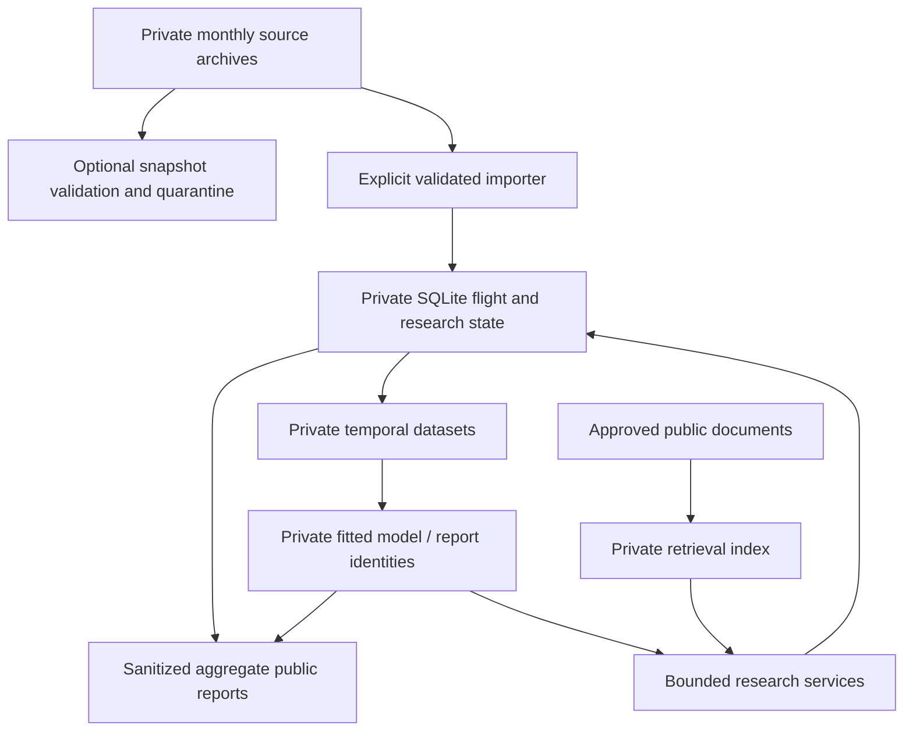

# AIN-EA-06 — Data Architecture and Governance

**Project:** Aviation Intelligence Nexus (AIN)  
**Date:** 26 November 2026, Dubai  
**Reviewed revision:** [`2d32ea4`](https://github.com/shah-hussain-bangash/aviation-intelligence-nexus/tree/2d32ea4435b02df4ea1ec03fc460a470884f098a)  
**Status:** Current-state data design with proposed governance controls; owner/steward review pending  
**Change scope:** Documentation only. No source data, account, schema, model, index, retention job or production gate changes.

[Baseline](01-CURRENT-IMPLEMENTATION-BASELINE.md) · [Business requirements](02-BUSINESS-REQUIREMENTS-AND-ACCEPTANCE.md) · [Enterprise overview](03-ENTERPRISE-ARCHITECTURE-OVERVIEW.md) · [Diagrams](04-SYSTEM-ARCHITECTURE-DIAGRAMS.md) · [Decision records](05-ARCHITECTURE-DECISION-RECORDS.md)

## 1. Purpose and scope

This document identifies AIN's data classes, current storage/processing contracts, provenance, identity boundaries and governance gaps. It separates implemented local behavior from proposed enterprise policy. It is not a source-rights approval, a complete physical database specification, a legal assessment or evidence of production acceptance.

The current system uses historical US BTS flight records, approved public project documents, private research state/artifacts and explicitly synthetic scenarios. It has no established live UAE airline dataset, passenger/customer record integration or deployed enterprise lakehouse. The research target is conditional on the recorded completed, non-diverted flight population; do not generalise it to all airline disruption.

## 2. Data inventory and proposed classification

The classifications below are proposed handling categories, not an employer-approved classification scheme.

| Class | Data and current location/boundary | Handling and publication rule |
|---|---|---|
| Public project material | Source, Markdown, synthetic fixtures and sanitized aggregate reports committed to Git | Publish only reviewed material; public availability does not settle third-party rights or licence requirements. |
| Historical source archives | Operator-obtained BTS monthly ZIPs in private local storage | Retain original identity/period/URL/hash; no raw archive upload to this repository. Source-rights review remains purpose-specific. |
| Validated historical rows | Private SQLite flights/import records | Treat as controlled research inputs. Bounded aggregates, not unrestricted database access, are exposed through the application. |
| Research splits | Private temporal dataset files/manifests | Preserve period groups, population/exclusions, protocol and file hashes; never silently replace evaluated datasets. |
| Fitted models and retrieval indexes | Trusted private model/index files | Do not commit. Verify declared identities; do not load arbitrary/untrusted serialized artifacts. |
| Research queries/results | Private histories, investigation jobs, proposals and reviews | Account/owner scope applies; free-text questions/notes can contain sensitive content even if source documents are public. |
| Account/security state | Private password hashes, session-token hashes, roles and login-limit state | Never publish or place in images. Hashing does not make credentials/session material public-safe. |
| Exported self-reviews | Explicit local user downloads and browser-local imported artifacts | Unsigned; may include questions, quotations and notes. Content consistency is not verified identity. Downloaded copies cannot be recalled. |
| Recovery material | Private snapshots, encrypted archives, key files and runtime drill receipts | Protect outside Git; keys and ciphertext require separate handling. Encryption does not erase plaintext originals. |
| Synthetic gate/demo data | Declared invented flights, costs and workspace fixtures | Always label synthetic; never merge into historical evidence as real airport observations. |

Proposed accountable roles: data steward for source/purpose/lifecycle; research lead for split/protocol integrity; application owner for access and records; platform/security owner for storage, recovery and keys. Named appointments and sign-off are not established.

## 3. Source register

| ID | Source / use | Current provenance | Unresolved approval or limitation |
|---|---|---|---|
| SRC-BTS-01 | Historical Reporting Carrier On-Time Performance; research import and evaluation | Importer constructs a monthly BTS source URL and records archive SHA-256, period and read/insert/duplicate counts | Confirm source terms, attribution, allowed purpose, geographic limitations and any redistribution policy before broader use. A URL/hash is not a legal permission record. |
| SRC-DOC-01 | Six allowlisted public project Markdown documents; local RAG | rag/index.py identifies exact paths; derived chunks retain source/heading/line ranges and identities | Expanding to airline/OEM/private documents requires rights, ACL, lifecycle and evaluation decisions first. |
| SRC-SYN-01 | Fixed synthetic gate scenarios and demo fixtures | Explicit synthetic inputs and invented cost units; independent solver checks | No measured airline cost/saving or actual stand allocation. |
| SRC-USER-01 | Local account input, research questions, notes and decisions | CLI/session identity and scoped request/history controls | Define privacy notice, permitted content, retention, subject-request and export policy for any pilot. |
| SRC-MODEL-01 | Host Ollama model weights/runtime | Existing model names and index/runtime checks are documented separately | Record approved exact versions, provenance, licence, resource and data-boundary review; no third-party model rights audit is claimed here. |

The index allowlist at the reviewed revision is:
1. docs/DELAY_V2.md
2. docs/DELAY_BASELINE.md
3. docs/DATA_INGESTION.md
4. docs/MODEL_DATASET.md
5. docs/GATE_OPTIMIZATION.md
6. docs/LOCAL_IDENTITY.md

These enterprise-architecture documents are **not automatically added to the RAG corpus** by publication.

Sources: [importer](../../pipelines/import_bts.py), [index builder](../../rag/index.py), [knowledge setup](../KNOWLEDGE_STUDIO.md), [gate lab](../GATE_OPTIMIZATION.md).

## 4. Current storage and logical model

The optional intake path validates a copy and records accepted/quarantined status; it does not import, train or mutate the primary database. An accepted intake receipt is not automatic database admission or source-rights approval. Use the explicit import process after the intended checks.

### 4.1 Logical entities

| Entity / family | Identity and relationship | Boundary |
|---|---|---|
| schema_migrations | Applied local schema versions | Implementation detail; unknown future schema must not be silently downgraded. |
| flights | Local id plus unique (source, source_record_id) | Historical rows; logical identity is importer-defined, not a universal global flight ID. |
| imports | Archive SHA-256 primary key, period and source/count metadata | One recorded archive identity; same digest with a conflicting declared period is rejected. |
| auth_users | Unique username, id, password hash, role and active state | Local account authority, not an external verified person or organisation. |
| auth_sessions | Token hash, user id and expiry | Treat session metadata as security-sensitive; do not export to public evidence. |
| auth_limits | Local throttling state | Not a distributed enterprise rate-limit service. |
| research_runs | Scenario/run records with owner scope and request identity | Inspect current route semantics before assuming every history uses the same retry key. |
| gate_runs | Owner/request key, scenario hash, saved result/time | Exact synthetic proposal and review-window semantics. |
| knowledge_runs | Owner-linked saved Q&A result/time | Separate from the Scoped Answer Lab's unsaved query/result path. |
| agent_runs | Owner/request identities and bounded job/report state | Queue, checkpoint, sharing and review information in the implementation's persisted structure. |

This is a logical summary. [services/api/main.py](../../services/api/main.py), [agent store](../../agents/store.py), [job queue](../../agents/jobs.py) and related migrations/code are authoritative for actual columns and constraints. The diagram does not assert database-enforced tenant isolation or complete foreign-key governance.

## 5. Historical field dictionary and validation

| Source field | Normalized meaning | Current importer rule / research limit |
|---|---|---|
| FlightDate | ISO historical flight date | Must parse and belong to declared import month. |
| Reporting_Airline | Carrier code | Uppercase alphanumeric, two or three characters. |
| Flight_Number_Reporting_Airline | Flight number | Numeric, 1–99999; used in source record identity. |
| Origin / Dest | Airport codes | Three uppercase letters; strings do not establish route authority or operational validity. |
| CRSDepTime | Scheduled local departure representation | Four-digit valid time, with source 2400 case accepted; not a UTC event timestamp. |
| DepDelay / ArrDelay | Observed delay minutes | Empty becomes missing; present values must be finite. Not feature inputs merely because they exist in the source. |
| Cancelled / Diverted | Observed source flags | Values must be 0 or 1; affect model-population eligibility. |
| source | Source namespace | Current importer uses BTS_REPORTING_CARRIER. |
| source_record_id | Composite logical row key | Date, carrier, normalized flight number, origin, destination and departure representation. |
| archive SHA-256 / period | Import lineage | Records the input bytes and declared month; does not independently verify source truth. |

The importer requires the declared columns and reads a single CSV directly from ZIP without extracting member paths. An invalid record aborts the data-import transaction; a conflicting duplicate demands revision review, while identical duplicates are counted and not reinserted. Initialization/migration is a separate database setup concern and should not be confused with atomic import contents.

The optional intake validates additional bounded ZIP/CSV structure and stores accepted/quarantined snapshots with separate receipts. Do not assume that invoking the importer alone performs every optional intake check.

Evidence: [importer](../../pipelines/import_bts.py), [intake runbook](../LOCAL_DATA_INTAKE.md), [ingestion tests](../../tests/test_ingestion.py), [intake tests](../../tests/test_intake_bts.py).

## 6. Lineage and temporal ML governance

The recorded historical release contains **2,835,101 rows** for January–May 2025. The recorded eligible completed/non-diverted observed-arrival population contains **2,786,350 rows**.

| v2 population | Historical period | Recorded eligible rows |
|---|---|---:|
| Training | January–March 2025 | 1,611,046 |
| Validation / selection | April 2025 | 577,730 |
| Held-out evaluation | May 2025 | 597,574 |

These are committed historical report figures, not a new database scan. Count agreement does not establish original CSV byte identity, row equality, source truth or current runtime state.

### 6.1 Required lineage chain

Source URL/declared month + archive hash → validated import/counts → query/population/exclusion rules → temporal split/file identities → fixed experiment protocol → fitted artifact and selected parameters → frozen evaluation report → bounded research response/export.

- For v2, use [ml/experiment_v2.json](../../ml/experiment_v2.json) and [v2 results](../DELAY_V2.md), not the dataset utility's older default v1 periods.
- The generic [dataset utility](../../ml/prepare_dataset.py) retains older defaults; an operator must select the intended experiment's explicit period groups and version. Do not assume every invocation prepares v2.
- Preserve the model's conditional target and excluded fields; avoid leakage from observed arrival/departure outcomes.
- May has already been evaluated. A new model/threshold/calibration question needs an appropriate new validation/test protocol.
- Retain failed experiments, including [duration regression](../DELAY_DURATION_REGRESSION.md); do not erase failure evidence or label its inference deployed.
- Only trusted local artifacts may be loaded. Hashes are integrity comparisons, not signatures or a defence against an administrator replacing both artifact and report.

Sources: [data quality](../DATA_QUALITY_LINEAGE.md), [model preparation](../../ml/prepare_dataset.py), [v2 training](../../ml/train_v2.py), [prediction boundary](../RESEARCH_PREDICTION.md).

## 7. Knowledge and research artifact governance

### 7.1 Retrieval lifecycle

Approved source paths → explicit index build → bounded chunks with source/line metadata → validated vectors/index identity → permission-scoped research request → retrieved evidence → optional generated/scoped excerpt result → appropriate research review/export.

The reviewed index builder validates finite nonempty vectors of the expected shape. That is a technical contract, not proof of semantic relevance. Changing an embedding model/dimension, corpus, chunking or source revision requires compatibility and evaluation review.

The existing source allowlist does not implement arbitrary user-document onboarding or enterprise source ACL sync. A target corpus change needs explicit provenance/permission, versioning, relevance/refusal tests and deletion/rebuild behavior.

### 7.2 Three records that must remain distinct

| Record | Current persistence and authority |
|---|---|
| Original saved knowledge Q&A | Existing scoped history behavior; inspect the relevant owner checks. |
| Scoped Answer Lab query/result | Documented as unsaved in research-history/database tables; aggregate monitoring still exists. This is not a promise of zero data exposure to the local model process. |
| Browser self-review / imported file | Local explicit export/inspection, no import upload or new model query; unsigned digests verify consistency only. |

A question or note may be sensitive even when its answer quotes a public source. Export controls must not imply recall of files already downloaded.

References: [knowledge studio](../KNOWLEDGE_STUDIO.md), [Scoped Answer Lab](../SCOPED_ANSWER_LAB.md), [self-review](../SCOPED_SELF_REVIEW.md), [file inspector](../REVIEW_FILE_INSPECTOR.md).

## 8. Access, privacy and secret handling

| Data boundary | Current behavior | Proposed enterprise obligation |
|---|---|---|
| Accounts/sessions | Local Argon2 password hashing, token-hash session storage, configured role/owner checks | Managed identity/MFA/lifecycle, applicable tenant/resource model, security review and secret rotation |
| Historical flight data | Authenticated bounded research routes; operator imports outside ordinary browser workflow | Purpose-scoped access, approved source terms and query/resource policy |
| User histories/jobs/reviews | Owner/admin and explicit sharing/review rules in the relevant service | Reviewed separation of duties, attributable audit, privacy notice and lifecycle |
| Model/index | Fixed trusted private locations and declared identity checks | Protected provenance, controlled promotion/rebuild/deletion and approved artifact access |
| Downloads | Explicit allowed export shapes and research labels | Approved sensitive-field handling, retention guidance and downstream disclosure controls |
| Backups/keys | Private operator-only material; supported encrypted workflow | Independent key recovery, off-site access/retention/rotation and qualified recovery |

There are no public default credentials. Do not place passwords, API secrets, raw account hashes, session tokens, private local file paths or recovery keys into source, screenshots or public evidence.

Local role checks do not prove database-enforced tenant isolation. A second account is not independently verified reviewer identity. This document does not claim UAE privacy-law compliance, aviation certification or a completed legal review.

## 9. Retention, correction and deletion — decisions pending

No arbitrary retention duration is imposed here. Appropriate periods depend on source terms, research reproducibility, approved privacy purpose and operational recovery requirements.

| Data class | Existing boundary | Policy/implementation still required |
|---|---|---|
| Source/intake snapshots | Originals preserved; new intake runs create separate receipts; quarantine is not automatic disposal | Steward-approved retention, quarantine review/disposition, source corrections and evidence preservation |
| Historical normalized rows | Reimports avoid identical duplicates; conflicting rows require revision review | Approved source revision/deletion process with reproducible downstream lineage |
| Datasets/models/reports | Private derived artifacts; public aggregate experiment evidence | Versioned expiry, invalidation and evaluation-preservation rules; avoid rewriting consumed holdouts |
| Accounts/histories/notes | Local disable/revoke and scoped access behaviors | Reviewed deletion/retention/subject-request policy; do not assume account disabling erases history |
| Knowledge/index artifacts | Explicit source/index build | Index/derived-cache/source-removal propagation and evaluation of stale-source behavior |
| Downloaded exports | Outside the application's ability to recall copies | User communication, authorised recipients and retention instructions |
| Snapshots/ciphertext/keys | Private local recovery; automatic rotation/deletion not established | Approved backup rotation, key lifecycle, off-site expiry and deletion evidence |

A deletion request must be assessed across source → normalized rows → splits → model/index → histories/exports → backups. Retraining/unlearning or deleting an evaluated artifact is not assumed to be implemented. Proposed future controls need dependency mapping and test evidence; do not delete research evidence or private state to make a checklist look complete.

## 10. Recovery and data-integrity boundaries

- SQLite backup and selected file identities support a trusted local restore; this is not an atomic snapshot of every host dependency.
- Restore refuses existing destinations; no live overwrite is authorised.
- Restored sessions are revoked according to the supported recovery procedure.
- Optional encryption does not retroactively protect original data or plaintext snapshots.
- The documented Windows key provider uses DPAPI CurrentUser. Off-site backup, portable escrow, key-loss and computer-loss recovery remain unqualified.
- Hash agreement detects some consistency/corruption problems; it is not an immutable audit, signature or guarantee of trust in serialized models.
- RPO/RTO and independent operator/reviewer acceptance require real target-environment drills.

References: [recovery](../LOCAL_DEPLOYMENT_RECOVERY.md), [encrypted recovery](../ENCRYPTED_RECOVERY.md), [rollback](../LOCAL_RELEASE_ROLLBACK.md).

## 11. Governance acceptance checklist

These are proposed exercises, not newly recorded passes.

| ID | Required exercise | Evidence and requirement linkage |
|---|---|---|
| DG-01 | Review each source's purpose, provenance, rights and publication limits | Signed/attributed source register; BR-03/04, NFR-01/02 |
| DG-02 | Import valid, invalid, identical and conflicting duplicate fixtures into disposable state | Reconciled counts, failure behavior and retained source identity; BR-03 |
| DG-03 | Check source-period/population/split/protocol/artifact relationships | Exact revision/manifests and known limitations; BR-05/06 |
| DG-04 | Exercise anonymous/viewer/other-owner/revoked-account denial | Actual status/results, no leaked records; BR-02, NFR-01 |
| DG-05 | Verify source/index change, malformed evidence and unavailability behavior | Citation/identity/compatibility checks plus independent relevance review; BR-10–12, NFR-08 |
| DG-06 | Review export shape and private-field exclusion | Sanitized examples; questions/notes classified for intended use; BR-11/12/15 |
| DG-07 | Define correction/retention/deletion across dependencies | Accountable policy, no claimed automation without implementation; NFR-01/07 |
| DG-08 | Restore trusted state and test tampered/wrong-key/no-overwrite paths | Scoped environment/build receipt with selected row/artifact checks; BR-17/18, NFR-05 |
| DG-09 | Establish independent key/off-site and recovery targets before enterprise commitment | Qualified target-environment exercise, not metadata-only approval; P19/P20 readiness obligations |

Record requirement, source revision, environment, fixture/dataset identities, operator/reviewer, observed outcome, sanitized artifact identity, defects and review date. Keep independent acceptance separate from self-review, metadata validation and historical receipts.

## 12. Traceability, decisions and next step

| Topic | Existing architecture / requirement linkage |
|---|---|
| Private storage and artifacts | AIN-ADR-002; BR-03/14/17/18 |
| Identity and scoped access | AIN-ADR-004; BR-02/11–15 |
| Temporal experiments | AIN-ADR-005/006; BR-05–07 |
| Knowledge and unsigned reviews | AIN-ADR-007; BR-10–12 |
| Recovery/key boundaries | AIN-ADR-011; BR-17/18 |
| Evidence vs acceptance | AIN-ADR-012; NFR-02/03/07/08 |

See [decision records](05-ARCHITECTURE-DECISION-RECORDS.md) for observed choices and the proposed managed-storage/identity/AI/recovery decision queue.

**Review status:** data rights, retention periods, named stewardship, independent semantic/privacy review and production acceptance are pending. No P01–P24 gate was modified. Recorded row counts and source behavior were reviewed from committed materials; no private database, dataset, model or recovery environment was accessed or rerun for this document.

**Next planned document:** AIN-EA-07 — AI and Agent Architecture, detailing train/infer/retrieve/tool/review boundaries, model and corpus lifecycle, evaluation and failure handling.
