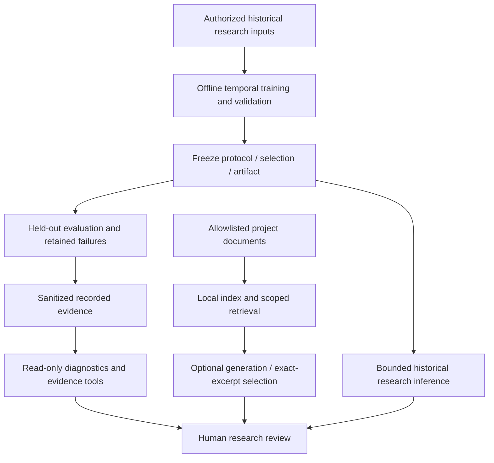
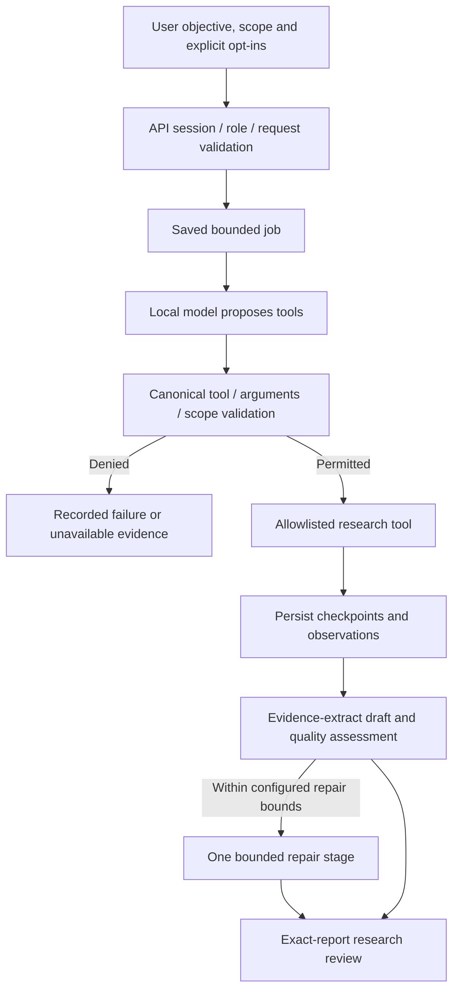

# AIN-EA-07 — AI and Agent Architecture

**Project:** Aviation Intelligence Nexus (AIN)  
**Date:** 26 November 2026, Dubai  
**Reviewed source revision:** [`07a3f81`](https://github.com/shah-hussain-bangash/aviation-intelligence-nexus/tree/07a3f815b9ff26b0ef6fee9c9bba3c3ab38dc5b0)  
**Status:** Current local architecture and experimental limits; proposed enterprise lifecycle requires review  
**Change scope:** Documentation only. No model training, provider calls, artifact/index changes, permissions or deployment changes.

[Baseline](01-CURRENT-IMPLEMENTATION-BASELINE.md) · [Requirements](02-BUSINESS-REQUIREMENTS-AND-ACCEPTANCE.md) · [Enterprise overview](03-ENTERPRISE-ARCHITECTURE-OVERVIEW.md) · [System diagrams](04-SYSTEM-ARCHITECTURE-DIAGRAMS.md) · [Decisions](05-ARCHITECTURE-DECISION-RECORDS.md) · [Data governance](06-DATA-ARCHITECTURE-AND-GOVERNANCE.md)

## 1. Scope and architecture statement

AIN combines **classical ML, document retrieval, optional local language-model generation, a constrained custom single-agent runtime and deterministic optimization**. These are distinct mechanisms. A model-generated draft is not a validated optimization plan; a solver result is not a forecast; an exact quotation is not a semantic verdict.

The architecture supports historical research and explicitly synthetic scenarios. It does not implement an autonomous airline control platform, a multi-agent framework, unrestricted tools, operational model approval or enterprise model governance merely by having source modules and reports.

This document describes current code at the reviewed revision and identifies future governance obligations. Existing reported results retain their original environment and experiment scope. No runtime, experiment, semantic evaluation, model call or deployment test was executed for this document.

## 2. AI capability and runtime inventory

| Capability | Mechanism and source | Current state and limit |
|---|---|---|
| Delay-15 baseline/v2 | Offline logistic baseline and categorical histogram gradient-boosting experiment; [ml](../../ml), [v2 training](../../ml/train_v2.py) | Research classification on historical US records; v2 passed its recorded research gate, not operational acceptance. |
| Historical prediction | Fixed trusted artifact/report verification and bounded scenario contract; [predictor](../../services/api/prediction.py) | Actual local inference when prerequisites exist; dates/vocabulary restricted; missing artifacts do not produce substitute scores. |
| Duration regression | Offline separate model/evaluation; [duration](../../ml/duration.py) | Preset improvement gate failed; duration inference is not deployed. |
| Model/distribution/route diagnostics | Frozen/report-based studies and bounded historical aggregate reads | Retrospective diagnostics; not causal explanations, live drift acceptance or future route forecasts. |
| Document retrieval | Explicit six-document index, neural embeddings and implemented lexical/retrieval comparisons; [index](../../rag/index.py), [RAG service](../../rag/service.py) | Local project evidence; not arbitrary airline/OEM corpus onboarding or enterprise ACL synchronization. |
| Optional document generation | Host Ollama via constrained adapter; [adapter](../../rag/ollama.py) | Local generation with mechanical citation/quote checks; semantic quality and relevance remain independently reviewable. |
| Scoped excerpts | Explicit experiment/scope/coverage checks and model-selected evidence IDs; [candidate](../../rag/scoped_answers.py), [route](../../services/api/scoped_lab.py) | Final excerpts constructed from verified source text; conservative false refusals and unsupported-topic gaps remain. |
| Investigation agent | Custom bounded runtime with validated tools and a local saved queue; [runtime](../../agents/runtime.py), [jobs](../../agents/jobs.py) | One research agent, not LangGraph/CrewAI/AutoGen or distributed autonomous orchestration. |
| Gate optimization | SciPy mixed-integer optimization and independent feasibility/accounting; [solver](../../optimization/gates.py) | Small synthetic scenarios; no actual airport command or measured commercial benefit. |
| Review/inspection | Exact-report/proposal research decisions and separate browser-local self-review/import | Review authority and proof limits differ; none creates operational airline approval. |

### 2.1 Local model configuration observed in source

[rag/ollama.py](../../rag/ollama.py) identifies:
- Embedding model: `embeddinggemma:300m`.
- Chat model: `qwen3:8b`.
- A restricted model-service host set: `127.0.0.1`, `ollama` or `host.docker.internal`; non-loopback container routing requires explicit container configuration.
- Redirect rejection, bypass of ambient proxy routing and bounded response handling.

Model names are source configuration references, not guarantees that compatible weights are installed or that arbitrary hardware can run them. Record actual runtime/model digests when producing evidence. The existing full workstation/Docker receipts do not qualify a 4GB MacBook Air, another operating system or a cloud service.

No hosted external LLM provider integration or managed model registry is introduced by this document.

## 3. Separation of training, inference and evidence inspection

The diagram shows logical dependencies, not a continuously retraining production platform. Diagnostic evidence tools read fixed reports; they do not silently retrain, rescore the test set or diagnose a cause.

### 3.1 Existing temporal protocol

The recorded v2 model uses January–March 2025 for training, April for selection and May for held-out evaluation. The chosen threshold is an April demonstration rule, not an airline staffing/cost decision.

The recorded May metrics include ROC-AUC **0.6506**, precision **30.22%**, recall **74.21%** and F1 **0.4295** at threshold **0.17**. These are historical report values, not a fresh evaluation. False alerts and calibration issues remain material limitations.

Do not tune against May observations and then represent May as an untouched test. Preserve v1 and the failed duration-regression result. New targets, features, calibration or threshold studies need a new frozen protocol and suitable evaluation periods.

Sources: [v2 protocol](../../ml/experiment_v2.json), [v2 results](../DELAY_V2.md), [duration negative result](../DELAY_DURATION_REGRESSION.md), [data governance](06-DATA-ARCHITECTURE-AND-GOVERNANCE.md).

## 4. Prediction-serving boundary

The current [ResearchPredictor](../../services/api/prediction.py) accepts a bounded historical scenario, not uploaded model files or arbitrary future flights.

| Stage | Required boundary | Failure behavior |
|---|---|---|
| Request authority | API validates current session, role and applicable request controls | Explicit denial; UI visibility is not the security decision. |
| Scenario validation | Reject extra fields, invalid time/date, identical airports and unsupported historical/vocabulary scope | No probability for rejected inputs. |
| Artifact validation | Use a fixed trusted local artifact with matching report/identity and research gate | Missing/inconsistent prerequisite becomes unavailable. |
| Local inference | Serialized use of the verified local predictor | No arbitrary model path or silent fake fallback. |
| Research response/history | Bind result to echoed scenario, model identity and declared population | Preserve scope and actual persistence outcome. |
| UI display/export | Clear invalidated/stale input/account results | Old results cannot masquerade as a new query response. |

Hashes compare local identities; they are not digital signatures or protection against an administrator replacing both model and report. Only trusted serialized artifacts may be loaded.

The probability is conditional on completed, non-diverted flights with observed arrival delay. It is not cancellation risk, proof an entered schedule actually operated or permission to take an airline action.

References: [prediction contract](../RESEARCH_PREDICTION.md), [prediction tests](../../tests/test_prediction.py), [history tests](../../tests/test_history.py).

## 5. Retrieval, generation and scoped-answer architecture

### 5.1 Original knowledge Q&A

The current path uses an explicitly built index of approved public project documents, query embedding/retrieval and optional local generation. Source metadata and quotations support inspection. The original saved Q&A path has its own history behavior and must not be confused with the unsaved Scoped Answer Lab.

### 5.2 Scoped Answer Lab

The separate opt-in route composes explicit experiment scope, coverage checks and a constrained excerpt-selection candidate. The model proposes source IDs; final excerpt text is assembled from validated source vocabulary rather than trusting free-form model interpretation. Index/model identity is checked around execution in the candidate.

Its user-visible outcomes include cited excerpts, clarification, coverage refusal, empty answer and unavailable/rejected generation. An available answer and a refusal are different outcomes; neither should be relabeled to conceal a failure.

Known limits include valid-paraphrase rejection, short unsupported-topic blind spots and exact but irrelevant/incomplete quotations. Coverage is not a general entailment or prompt-injection proof.

### 5.3 Evaluation boundaries

| Check | What it can establish | What it cannot establish alone |
|---|---|---|
| Source/line/quote consistency | An allowed recorded text span matches the declared source identity | Truth, relevance, completeness, applicability or safe action |
| Model/index identity | Selected runtime prerequisites match expected local identities | Signed provenance or administrator-compromise resistance |
| Scope/coverage guard | Specific explicit conflicts or missing terms are handled under defined rules | General language understanding or zero false refusals |
| Browser stale-state controls | Earlier results are withheld after tested input/session changes | Independent server authority or every possible race |
| Self-review digest | Exported/imported fields remain internally consistent | Verified reviewer identity or independent semantic acceptance |

Sources: [knowledge studio](../KNOWLEDGE_STUDIO.md), [retrieval diagnostics](../RAG_RETRIEVAL_DIAGNOSTICS.md), [generation diagnostics](../RAG_GENERATION_DIAGNOSTICS.md), [scope guard](../EXPLICIT_SCOPE_GUARD.md), [coverage limits](../SOURCE_COVERAGE_GATE.md), [Scoped Answer Lab](../SCOPED_ANSWER_LAB.md).

## 6. Bounded agent runtime and authority

This is a logical summary. Multiple tool/planner steps occur only within the actual runtime's budgets. The repair path is conditional and does not promise semantic success or unlimited retries.

### 6.1 Tool contract

| Tool | Authority | Required scope / interpretation |
|---|---|---|
| flight_metrics | Parameterized read-only historical SQL aggregates | Declared supported month; not live/UAE data. |
| knowledge_search | Approved project-document evidence retrieval | Applicable explicit document scope; no arbitrary files or browsing. |
| gate_simulation | Fixed small synthetic optimizer | Explicit simulation permission; never real airport allocation. |
| route_history | Bounded directional historical route evidence | User-provided airports must be echoed exactly. |
| model_evidence | Fixed classifier error/calibration/reliance record | Explicit opt-in and required-tool consistency; not live scoring or causal explanation. |
| distribution_evidence | Fixed historical marginal input comparison | Explicit opt-in; not proof of drift-induced degradation or source-row identity. |
| duration_evidence | Fixed negative regression evaluation | Explicit opt-in; preserve failed gate and non-deployment limitations. |

[agents/tools.py](../../agents/tools.py) and [Investigation validation](../../agents/runtime.py) define the actual allowed schema and opt-in rules. Model text never supplies executable SQL, arbitrary shell commands, paths or destination URLs. Tool definitions are not all offered for every request.

### 6.2 Observed execution budgets

The reviewed runtime records these bounds:
- Maximum **3 tool calls** and **3 planner calls**.
- Maximum **2 summary calls**, including the bounded repair opportunity.
- First planner timeout up to **45 seconds**; later planner timeout up to **20 seconds**, bounded by remaining runtime budget.
- A declared **120-second** investigation deadline.
- Operational writes: **false**.

These are application budgets and cooperative checks, not a proven strict end-to-end latency SLA. Calls already in progress are not forcibly interrupted; HTTP/proxy waiting and resource contention must be assessed separately.

### 6.3 Queue and restart boundaries

The local SQLite-backed queue has at most five waiting jobs globally and two waiting jobs per owner, with one local API worker. HTTP 202 acknowledges saved/queued work, not a successful or approved answer. Matching retry identity or active inputs can refer to an existing run.

Queued cancellation and cooperative running stop are different controls. A stop is handled between bounded calls. Restart/interruption/restore handling follows the existing job contract; no distributed exactly-once, cross-node lease or automatic replay guarantee is claimed.

References: [background jobs](../BACKGROUND_INVESTIGATIONS.md), [cooperative stop](../COOPERATIVE_INVESTIGATION_STOP.md), [jobs source](../../agents/jobs.py), [job tests](../../tests/test_jobs.py), [stop tests](../../tests/test_agent_stop.py).

## 7. Quality assessment, repair and human review

[agents/quality.py](../../agents/quality.py) assesses mechanical evidence completeness and contract consistency, including required tools, failed/unavailable steps, citation coverage, source scope, recorded-evidence identity and required limitation extracts.

Model interpretations are not published as verified facts merely because they accompany a quotation. The current extract-oriented approach discards unsupported free-form interpretation before collecting validated claims. A bounded repair may improve defined mechanical completeness, but neither repair nor a passed mechanical check establishes objective completion.

| Review mechanism | Current meaning | Authority limit |
|---|---|---|
| Agent research review | Decision bound to the exact saved report with current server checks | No operational airline approval; relevant limitations and unresolved semantic gaps remain. |
| Opted-in second-account review | Different authorised account reviews a shared report under documented ownership/race rules | Different account does not establish a different person or verified independent authority. |
| Synthetic gate review | Exact proposal, original 24-hour window and independently checked plan accounting | Self-review is allowed for this research workflow; no real allocation effect. |
| Browser self-review | Analyst asserts source/support/relevance judgments for a result | Unsigned self-assessment, not independent semantic validation. |
| Imported review artifact | Bounded local file parsing and digest/shape validation | No upload/new model call and no verified author identity; separate from live query state. |

Preserve negative, draft, refusal, unavailable and needs-changes states. Do not automatically upgrade one to another based on export, a checksum or a successful tool call.

Sources: [agent quality](../AGENT_REPORT_QUALITY.md), [second-account review](../SECOND_ACCOUNT_REVIEW.md), [sharing withdrawal](../SHARING_WITHDRAWAL.md), [gate review](../GATE_PROPOSAL_REVIEW.md), [self-review](../SCOPED_SELF_REVIEW.md), [file inspector](../REVIEW_FILE_INSPECTOR.md).

## 8. Evaluation strategy and evidence register

| Evaluation family | Existing source / evidence | Remaining acceptance work |
|---|---|---|
| Classical ML | [v2 tests](../../tests/test_v2.py), [prediction tests](../../tests/test_prediction.py), [v2 report](../reports/Delay_v2.json) | Representative future/target population, agreed error costs, calibration and workload suitability |
| Retrieval | [knowledge tests](../../tests/test_knowledge.py), [retrieval diagnostics](../../tests/test_retrieval_diagnostics.py) | Independent relevance labels, authorised corpus coverage and deletion/ACL lifecycle |
| Generated/scoped answers | [scope tests](../../tests/test_scope_guard.py), [coverage tests](../../tests/test_source_coverage.py), [scoped lab tests](../../tests/test_scoped_lab.py) | Grounding, refusal/false-refusal and semantic completeness against frozen independent cases |
| Tool authority and evidence | [agent tests](../../tests/test_agent.py), [model evidence tests](../../tests/test_agent_model.py), [duration evidence tests](../../tests/test_agent_duration.py) | Adversarial scope/argument cases, independent task completeness and target environment acceptance |
| Queue/review state | [job tests](../../tests/test_jobs.py), [peer-review tests](../../tests/test_peer_review.py), [withdrawal tests](../../tests/test_sharing_withdrawal.py) | Representative crash/resource/race workloads and verified independent reviewer authority where required |
| Browser self-review | [self-review tests](../../tests/test_scoped_review.mjs), [inspector receipt](../reports/Review_Inspector_Browser.json) | Accessibility/device coverage and real domain-review semantics; synthetic fixtures are not real verdicts |
| Optimization | [solver tests](../../tests/test_gates.py), [review tests](../../tests/test_gate_review.py) | Real authorised constraints/data, scale and operational qualification |

Before a new experiment, record the question, permitted sources, cohort/splits, comparator, quality metrics, thresholds, resource budget and handling of failures. Do not invent numeric targets retrospectively or select only successful runs. Separate test fixtures, development cases, frozen evaluation and operational acceptance.

For local runtime evidence, capture exact code/protocol/model/index identities, environment, input scope, tool observations, result state, latency definition and reviewer limitations. Publish only sanitized artifacts; raw queries, private documents, model files and credentials stay private.

## 9. AI risk and failure register

| Risk | Implemented boundary / safe expectation | Remaining limitation |
|---|---|---|
| Hallucinated or irrelevant findings | Validate evidence/source and publish constrained extracts; retain quality gaps | Verbatim text can still be irrelevant or incomplete. |
| Prompt injection / tool escalation | Approved sources, strict tool schemas, explicit scope and permissions | No claim of general adversarial immunity or arbitrary-source safety. |
| Data leakage / holdout reuse | Frozen temporal protocol and excluded outcome features | Future experiments require new governance; public metrics do not establish untouched data. |
| Unsupported population | Historical date/vocabulary and target restrictions | Historical US evidence is not UAE airline generalisation. |
| Artifact/model replacement | Check trusted paths and identities; reject inconsistency | Local administrator compromise and unsigned artifact provenance remain. |
| Dependency timeout/unavailability | Sanitized unavailable/failure state; no fake answer/score | Cooperative bounds do not forcibly stop every ongoing call or ensure production SLO. |
| Stale account/result | Current service checks and browser invalidation | Test scope does not prove elimination of every race. |
| Sensitive query or export | Private state, bounded projection and explicit downloads | Downloaded copies cannot be recalled; retention/privacy policy remains pending. |
| Overstated review authority | Research-only labels and distinct review mechanisms | Independent identity, operational authority and semantic acceptance are not established. |
| Uncontrolled operational effect | Tool set has no airline command authority | Any future effect requires a separate scoped contract, approval, audit and recovery design. |

## 10. Proposed model and corpus lifecycle

| Stage | Required decision/evidence | Current status |
|---|---|---|
| Define purpose and data rights | User decision, approved source/corpus, lawful purpose and permitted outputs | Research scope documented; external/pilot rights and owners pending. |
| Freeze experiment | Protocol, splits/cases, baseline, metrics and quality thresholds before evaluation | Existing model protocols present; future corpus/semantic gates need agreement. |
| Build and evaluate | Reproducible identities, retained failures and resource/error accounting | Local code/reports exist; production acceptance not established. |
| Review release candidate | Independent domain/semantic/security review of exact artifact and limits | No enterprise promotion authority asserted. |
| Deploy controlled research use | Approved runtime/data boundary, secrets, identity and inference limits | Local research implementation; managed pilot decisions pending. |
| Observe | Quality, refusals, input changes, latency/cost and incident ownership | Local diagnostics/monitoring are partial; no accepted production AI SLO. |
| Replace/rollback/retire | Compatible artifacts, new evaluation, source/index deletion and trusted restoration | Application rollback is qualified only for selected local pairs; model/prompt rollback and lifecycle automation remain open. |

This lifecycle does not choose a new model/provider, embedding service, vector database, agent framework or fine-tuning plan. A purchase or model change should follow an identified requirement and measured benefit, not add complexity solely for a portfolio label.

## 11. Traceability and maintenance

| Architectural concern | Requirements / decision linkage |
|---|---|
| Temporal training and bounded inference | BR-05–07; ADR-005/006; NFR-02/03/08 |
| Retrieval and scoped excerpts | BR-10–12; ADR-007; NFR-01/08 |
| Bounded tools, jobs and review | BR-13–15; ADR-008/009; NFR-01/04/07/08 |
| Local runtime and reproducibility | BR-16–18; ADR-010/011; NFR-03/05 |
| Evidence vs acceptance | ADR-012; all applicable P01–P24 obligations |

Refresh this document after material protocol, corpus, model, tool, scope, worker, authority or release changes. Link actual tests/receipts at their revision; a documentation update cannot close a semantic, security or production gate.

**Verification for this change:** source relationships and Markdown link targets were checked; no inference, generation, training, benchmark, browser or restore was run. All production acceptance gates remain open.

**Next planned document:** AIN-EA-08 — Security and Threat Model, expanding identities, trust boundaries, abuse cases, privacy, secrets and control/evidence ownership.
