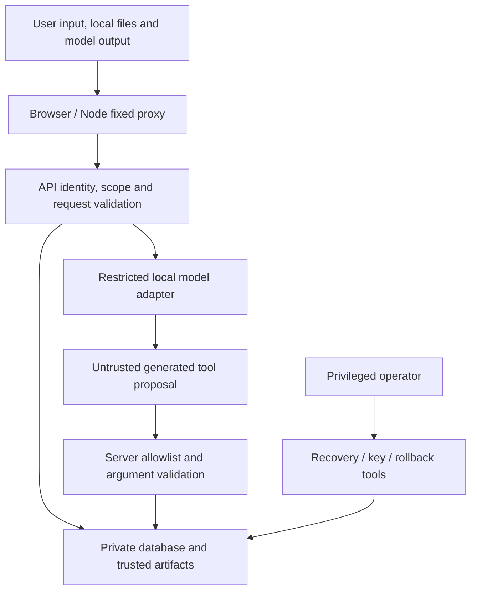

# AIN-EA-08 — Security and Threat Model

**Project:** Aviation Intelligence Nexus (AIN)  
**Date:** 26 November 2026, Dubai  
**Reviewed revision:** [`7df5e33`](https://github.com/shah-hussain-bangash/aviation-intelligence-nexus/tree/7df5e335cf9131cd67cab55dedd0bbd240dd7e43)  
**Status:** Repository-grounded threat assessment and proposed assurance plan; not penetration testing, certification or risk sign-off  
**Change scope:** Documentation only. No security settings, credentials, network access, model behavior, private state or acceptance gates changed.

[Baseline](01-CURRENT-IMPLEMENTATION-BASELINE.md) · [Requirements](02-BUSINESS-REQUIREMENTS-AND-ACCEPTANCE.md) · [Architecture](03-ENTERPRISE-ARCHITECTURE-OVERVIEW.md) · [Diagrams](04-SYSTEM-ARCHITECTURE-DIAGRAMS.md) · [ADRs](05-ARCHITECTURE-DECISION-RECORDS.md) · [Data governance](06-DATA-ARCHITECTURE-AND-GOVERNANCE.md) · [AI architecture](07-AI-AND-AGENT-ARCHITECTURE.md)

## 1. Purpose, scope and assumptions

Protect local research accounts, historical data integrity, trusted artifacts, scoped queries/reviews and operator recovery state while preserving clear research-only authority. The current application is not approved for public internet exposure or airline operational decisions.

This assessment uses selected source/configuration, tests and existing runbooks at the reviewed revision. It does not scan a host, enumerate live secrets, perform attacks against a deployment, rerun a test suite or verify private runtime artifacts. Existing test files show intended coverage, not fresh execution in this change.

Assumptions to validate before a pilot:
- The operator controls a trusted workstation and installs reviewed source/dependencies.
- Source data/documents/model artifacts have appropriate rights and trusted provenance.
- Native services remain loopback; Docker publishes only the declared loopback web port.
- The host Ollama dependency and private state are separately managed.
- Local administrators and the host OS are powerful trust principals; source checks do not protect against their compromise.
- The application holds no authority to dispatch airline/airport actions. Any future effect requires a new threat review and explicit business approval.

No cloud account, managed IdP, tenant policy, legal compliance or independently approved residual risk is assumed.

## 2. Assets, classifications and security objectives

| Asset | Main objective | Handling boundary |
|---|---|---|
| Password hashes, session metadata, local roles | Confidentiality and correct authority | Private database; never publish, screenshot or place in container images. |
| Historical flight rows and import identities | Integrity and reproducibility | Explicit import, provenance/count checks and bounded research access. |
| Dataset splits and model artifacts | Integrity and trusted loading | Private versioned artifacts; protocol/identity checks; never load arbitrary serialized files. |
| Knowledge documents/index | Source integrity, allowed scope and relevance transparency | Explicit source allowlist; index/model compatibility; untrusted text never grants tool authority. |
| Questions, notes, histories and reviews | Confidentiality, owner scope and exact-result binding | Free text may contain sensitive content even with public source documents. |
| Synthetic gate proposals | Correct feasibility/accounting and truthful scope | Exact proposal/review identity; no operational effect. |
| Jobs/tool observations | Authority, bounded resource use and recoverable state | Server checks, local queue/worker limits and explicit interruption semantics. |
| Backups, keys and drill receipts | Confidentiality, recoverability and scoped evidence | Private operator material; no-overwrite restores and separate key boundary. |
| Public reports/source/CI | Supply-chain and claim integrity | Exact revision/evidence scope; no secrets or fabricated acceptance. |

Requirements: BR-02–18 and NFR-01–08 in [AIN-EA-02](02-BUSINESS-REQUIREMENTS-AND-ACCEPTANCE.md).

## 3. Threat actors and misuse cases

| Actor / condition | Relevant misuse |
|---|---|
| Unauthenticated requester or malicious local webpage | Attempt protected requests, login guessing, forged mutation or local-service access. |
| Authenticated user exceeding their role | Read another owner's records, call researcher/admin functions or change/replay a review outside authority. |
| Hostile query, document text or model output | Prompt/tool escalation, unsafe content rendering, irrelevant but syntactically valid evidence. |
| Malformed archive or imported review file | Resource exhaustion, unsafe path handling, parsing errors or content injection. |
| Compromised dependency/model/artifact | Execute unsafe code, replace data/weights/reports or undermine provenance. |
| Compromised workstation/operator account | Read private state/keys, alter both artifact and expected hashes or delete recovery copies. |
| Accidental operator action or partial failure | Wrong-instance restore, reused destination, incompatible rollback, misleading stale health or lost key. |

This includes insider/accidental risk and AI-specific misuse. Actor descriptions are analytical categories, not allegations or tested vulnerabilities.

## 4. Trust-boundary view

The diagram is logical, not a firewall guarantee. The browser is not authoritative for access decisions. Generated suggestions and source text must cross application validation before tool execution. Operator access remains privileged even when a CLI performs safety checks.

## 5. Current controls and concrete limitations

| Area | Observed control | Important limit |
|---|---|---|
| Local accounts | Argon2 password hashing; account provisioning, role/active state and password validation in auth source | No managed SSO/MFA, remote identity lifecycle or independent human identity established. |
| Sessions | Opaque token with stored hash, eight-hour lifetime, server lookups and revocation | Local host/session compromise remains possible; expiry is not production lifecycle governance. |
| Cookie | HttpOnly, SameSite Strict, path /api; **Secure=false** in current local login response | Suitable scope is loopback HTTP research; do not expose publicly by merely changing bind/port. HTTPS and cookie configuration require reviewed implementation. |
| CSRF/origin | Unsafe API requests check configured local origins and applicable session-derived CSRF metadata | Not a substitute for role/owner checks, XSS prevention or reviewed reverse-proxy deployment. |
| Roles/ownership | Server admin/researcher/viewer and owner/sharing checks in relevant routes | Not proof of complete database-enforced tenant isolation or independent reviewers. |
| Proxy | Fixed paths/methods/body bounds and scoped metadata to configured API host | Not a general secure enterprise gateway or outbound network policy. |
| Browser policies | Partial CSP, no-sniff/frame/referrer/permissions policies from Node server | CSP does not restrict script/style execution; no blanket XSS protection. Internal direct API responses are outside this frontend policy's scope. |
| Input/exports | Typed/bounded requests, safe text handling and selected response/export projections | Free text and downloaded files can remain sensitive; exports cannot be recalled. |
| Model calls | Restricted local host choices, redirect rejection, bounded calls/responses | Not independent network enforcement; local runtime and installed weights need protection. |
| Tools/jobs | Strict schemas, allowlists, user scope/opt-ins, bounded queue and calls | Cooperative stop is not forced interruption or multi-node failover. |
| Artifacts | Trusted local paths and identity checks | An administrator can replace both artifact and report; hashes are not signatures. |
| Containers | Loopback-only web publication, unpublished API, read-only roots, dropped capabilities and no-new-privileges | Configuration does not establish vulnerability, egress, kernel or supply-chain assurance. |
| Recovery | Trusted snapshots, optional authenticated encryption, separate key provider and isolated destinations | Plaintext originals remain; DPAPI dependence is not portable escrow or computer-loss recovery. |

Sources: [auth](../../services/api/auth.py), [API](../../services/api/main.py), [proxy](../../scripts/api-proxy.mjs), [headers](../../scripts/security-headers.mjs), [browser policy limits](../LOCAL_BROWSER_SECURITY.md), [model adapter](../../rag/ollama.py), [Compose](../../compose.yaml), [encrypted recovery](../ENCRYPTED_RECOVERY.md).

## 6. Threat and control register

Priorities below are proposed review/implementation priorities based on potential impact, not measured exploit likelihood or an accepted residual-risk rating. **P0** means resolve before any broader/networked pilot; **P1** means qualify before the corresponding expanded use; **P2** means maintain and assess within the scoped research workflow. Every residual-risk acceptance is pending an accountable reviewer.

| ID / type | Threat and impact | Existing control / representative evidence | Residual gap and proposed action | Priority / proposed owner |
|---|---|---|---|---|
| TH-01 / Spoofing | Stolen/guessed credentials impersonate a researcher/admin | Local hashing, throttling, active sessions; [auth tests](../../tests/test_auth.py) | Define managed identity/MFA/lifecycle and review deployed abuse resistance; no production login assurance | P0 / identity-security owner |
| TH-02 / Elevation / disclosure | Viewer or another owner reads/calls privileged research functions | Server role/owner checks; [API tests](../../tests/test_api.py), [peer tests](../../tests/test_peer_review.py) | Complete route/resource inventory and negative matrix; qualify tenant policy if introduced | P0 / backend-security owner |
| TH-03 / Forged mutation | Malicious origin induces a session-backed mutation | Origin/CSRF controls; [account tests](../../tests/test_account_security.py) | Retest deployed origins/proxy/cookies; do not broaden CORS or disable CSRF to bypass setup problems | P0 / web-security owner |
| TH-04 / Script/content injection | Query, note or imported artifact executes/rendered malicious content | Literal text and bounded import/projection; [self-review tests](../../tests/test_scoped_review.mjs) | Partial CSP is not script policy; independently review DOM sinks, exports and browser/device paths | P1 / frontend-security owner |
| TH-05 / Proxy/SSRF abuse | Request chooses an unintended destination or leaks credentials | Fixed proxy and restricted model adapter; [dashboard tests](../../tests/test_dashboard.mjs) | Review configured hosts, egress and deployment DNS/network trust; no firewall guarantee | P0 / platform-security owner |
| TH-06 / Prompt/tool escalation | Model/source text requests arbitrary SQL, files, shell or operational action | Tool allowlist/strict arguments/scope; [agent tests](../../tests/test_agent.py) | Adversarial corpus/query testing and stronger worker isolation; no general prompt-injection immunity | P0 / AI-security owner |
| TH-07 / Evidence/meaning tampering | Irrelevant exact quotation or positive self-review appears correct/approved | Scope/coverage/quality checks and explicit labels; [scope tests](../../tests/test_scope_guard.py), [coverage tests](../../tests/test_source_coverage.py) | Independent semantic/domain review; preserve failures and false refusals | P1 / research-domain reviewer |
| TH-08 / Model supply chain | Untrusted serialized model or replacement artifact causes execution/false results | Fixed trusted paths/report identities; [prediction tests](../../tests/test_prediction.py) | Approved artifact provenance, controlled promotion and host protection; do not load untrusted joblib files | P0 / ML-platform owner |
| TH-09 / Source/lineage corruption | Malformed/conflicting data contaminates experiments | Atomic import-content checks/duplicates and intake validation; [ingestion tests](../../tests/test_ingestion.py), [intake tests](../../tests/test_intake_bts.py) | Source-rights/truth review and governed corrections; count/hash consistency is insufficient | P1 / data steward |
| TH-10 / Denial of service | Expensive SQL/model/solver or oversized input exhausts workstation | Bounds, timeouts, serialized work and queue caps; [job tests](../../tests/test_jobs.py), [solver tests](../../tests/test_gates.py) | Representative resource/load and hostile-workload evaluation; no strict end-to-end SLA | P1 / platform-AI owner |
| TH-11 / Review replay/race | Stale, changed, expired or self-authored peer record is accepted | Exact proposal/report, expiry/retry/transaction guards; [gate tests](../../tests/test_gate_review.py), [withdrawal tests](../../tests/test_sharing_withdrawal.py) | Verified independent reviewer identity/authority and complete deployed race cases | P1 / workflow-governance owner |
| TH-12 / Stale account data | Late result/export reappears after input/account/session changes | UI invalidation and service rechecks; [scoped lab tests](../../tests/test_scoped_lab.py) | No proof all races eliminated; assess each new asynchronous path | P1 / frontend-backend owner |
| TH-13 / Repudiation | Local history or hashes mistaken for protected audit | Scoped records and explicit unsigned/consistency limits | Define attributable off-host retention, access review and tamper assurance before enterprise claims | P0 / security-governance owner |
| TH-14 / Secret/privacy leakage | Questions, account state or keys enter Git, images, logs or exports | Ignored private state and allowlisted projections; [repository guard](../../scripts/repository-guards.mjs) | Secret scanning, logging/export review, retention and incident response across actual environment | P0 / security-data owner |
| TH-15 / Recovery compromise/loss | Backup theft/tamper or lost DPAPI profile prevents restoration | Encrypted restore/no-overwrite checks; [encryption tests](../../tests/test_sealed_recovery.py) | Independent keys/off-site/RPO/RTO and computer-loss drill; plaintext copies remain | P0 / recovery/key custodians |
| TH-16 / Wrong-instance rollback | Operator replaces live state or incompatible build | Isolated target and state-contract checks; [release tests](../../tests/test_releases.py) | Independent operator walkthrough and exact current-build qualification; no general schema/model downgrade | P1 / release operator |
| TH-17 / Dependency compromise | Build dependency, image, model weights or CI changes undermine trust | Dependency snapshots, selected image pins and configured CI | SBOM/scans/provenance/signing and reviewed update process; config presence is not current clean scan evidence | P0 / engineering-platform owner |
| TH-18 / Host compromise | Local admin/malware reads state/keys or changes expected hashes | Container/private-path restrictions offer limited boundaries | Host hardening, least privilege, secure backups and incident procedure; no application defense against full host ownership claimed | P0 / workstation-platform owner |
| TH-19 / Operational misuse | Research forecast/synthetic plan is used as airline authority | Research-only labels and no airline effect tools | Enforce organisational permitted-use policy and domain review before any integration | P0 / product-domain owner |

These priorities do not block authorised local research through invented approval flows; they define what needs qualification before expanding use or making enterprise claims.

## 7. Security verification plan

Use disposable accounts/state and authorised fixtures. Do not test destructive cases against primary user data or probe unauthorised third-party services.

| Family | Proposed verification | Evidence to retain |
|---|---|---|
| Identity/session | Invalid login, throttling, expiry, disabled role, revoked session and permitted self-service session controls | Exact revision/environment, expected status, fixture identity and sanitized result |
| Authorisation | Anonymous/viewer/researcher/admin by route; other-owner ID; opted-in sharing and withdrawal | Route/resource matrix and success/denial outputs |
| Browser/request | Origin/CSRF rejection, safe text/DOM rendering, bounded files/queries, stale state and header coverage | Native HTTP/Node/browser receipts with actual browser and viewport scope |
| AI authority | Forbidden/repeated tool, extra fields, mismatched route/document scope, missing opt-in and hostile source instructions | Canonical request, observed denial and retained safe state; no private prompts/secrets |
| Integrity | Changed protocol/report/index/model, malformed evidence, unsupported artifacts and wrong source period | Fail-closed outputs and no unintended state mutation |
| Resource abuse | Queue saturation, timeout, large inputs and partial failures at representative concurrency | Error-inclusive latency/resource results; clarify cooperative vs forced cancellation |
| Recovery/release | Wrong key, ciphertext tamper, existing destination, incompatible image/state contract and lost-host scenario | Separate qualified drill receipts; loss-of-host/key recovery remains unestablished until performed |
| Supply chain | Reviewed dependency/image/model inventory and build provenance | Actual scan/SBOM/attestation and exception review, not simply a checklist |
| Privacy | Private-field/log/export/Git/image inspection with authorised representative data | Sanitized findings and explicit retention/deletion decisions |

Automated source tests and CI are part of the evidence, not an independent penetration test. This documentation change does not create passing records or claim those exercises have just run.

## 8. Privacy, keys and data lifecycle

Questions and notes may reveal business context even when they refer to public documents. Keep them private by default and communicate any model/runtime transfer. The local model process may receive prompt/evidence; the unsaved scoped-query path is not a promise of no transient processing.

- Publish reviewed aggregate/synthetic evidence only.
- Never place raw account hashes, session tokens, passwords, private runtime databases, keys or model files in public source or screenshots.
- Identify log fields, download recipients and retention for a pilot; downloaded copies cannot be recalled.
- Separate key custody from backup data; currently documented DPAPI is user/profile/computer dependent.
- Protect plaintext originals as well as encrypted copies; sealing does not securely erase originals or all temporary remnants.
- Define source/index/history/backup retention and correction/deletion propagation before claiming automation.
- Do not infer UAE privacy-law compliance from this document; accountable legal/privacy review is pending.

See [data governance](06-DATA-ARCHITECTURE-AND-GOVERNANCE.md), [self-review](../SCOPED_SELF_REVIEW.md), [encrypted recovery](../ENCRYPTED_RECOVERY.md).

## 9. Proposed incident response and responsibility

This is an operating-design proposal, not a staffed or tested response service.

| Event | Initial containment to plan | Preservation / recovery decision |
|---|---|---|
| Suspected account/session theft | Revoke affected sessions and disable compromised access using documented controls | Preserve sanitized timeline; re-establish trusted credentials and assess exposed histories/exports |
| Suspected artifact/corpus tamper | Withhold affected inference/retrieval and preserve identities | Rebuild/restore only from trusted verified sources; do not overwrite evidence |
| Secret/private-data publication | Restrict exposure, revoke/rotate affected secrets and stop further publication | Deleting the current file alone does not remove Git history/copies; review authorised remediation |
| Dependency/host compromise | Isolate the affected environment and avoid trusting its keys/artifacts | Independent trusted rebuild and recovery assessment; local hashes may be attacker-controlled |
| Backup/key loss | Preserve remaining trusted copies and stop unsafe overwrite/recreation | Escalate to key/data custodians; do not promise recovery without accessible qualified material |

Product/security/platform/data owners must agree contacts, severity, response times and communication duties before an externally used service. No names, pager routing or response-time commitments are invented.

## 10. Release restrictions and open decisions

Before broader/networked use, explicitly resolve:
1. Approved HTTPS origin, cookie/session/proxy behavior and managed identity/MFA.
2. Applicable resource/tenant separation and independently verified reviewer authority.
3. Source/document rights, privacy/retention/export policy and permitted model/runtime boundaries.
4. Protected audit/telemetry, vulnerability/supply-chain review and incident ownership.
5. Workload limits, external alerts, secrets management and network/egress policy.
6. Off-site/key recovery and target-environment restore/rollback evidence.
7. Independent domain/semantic evaluation and the absence or explicit governance of any operational effect.

The relevant ADR proposals remain in [AIN-EA-05](05-ARCHITECTURE-DECISION-RECORDS.md). Existing P01–P24 production gates remain open in [infra/readiness.json](../../infra/readiness.json).

## 11. Review, acceptance and maintenance

- Proposed owners are roles, not appointments or sign-off.
- No residual risk is marked accepted by creating this document.
- Reassess after changes to authentication, sources, tools, model/runtime, exports, hosting, state, backups or permitted effect.
- Pin findings/tests to the actual revision and environment.
- Preserve all prototype workspaces and truthful current/experimental labels.
- Fixes need actual reviewed code/configuration and appropriate tests; documentation alone does not implement a control.
- Obtain independent security/privacy/domain review before claiming production qualification.

**Next planned document:** AIN-EA-09 — Software Engineering Handbook, consolidating setup, module boundaries, coding/testing practices, dependencies, change control and release workflow.
