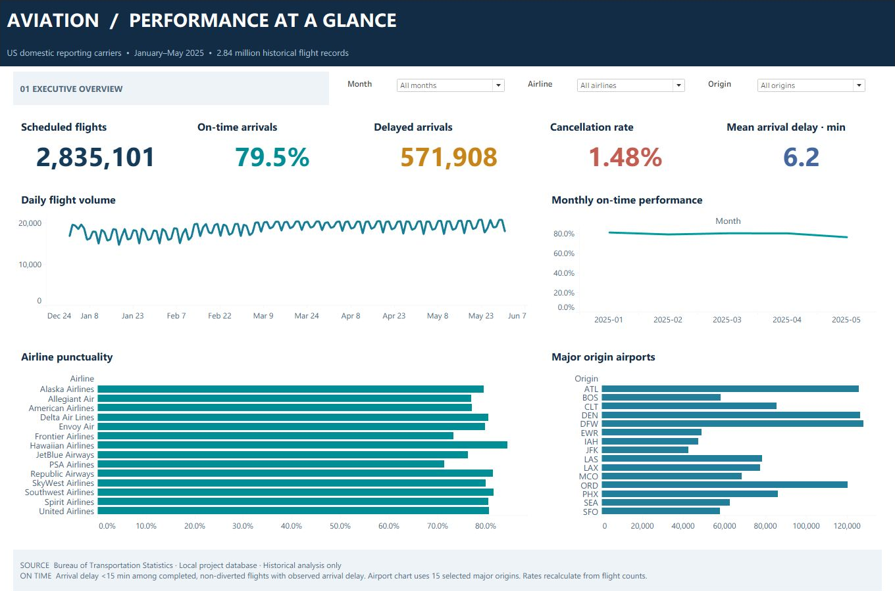
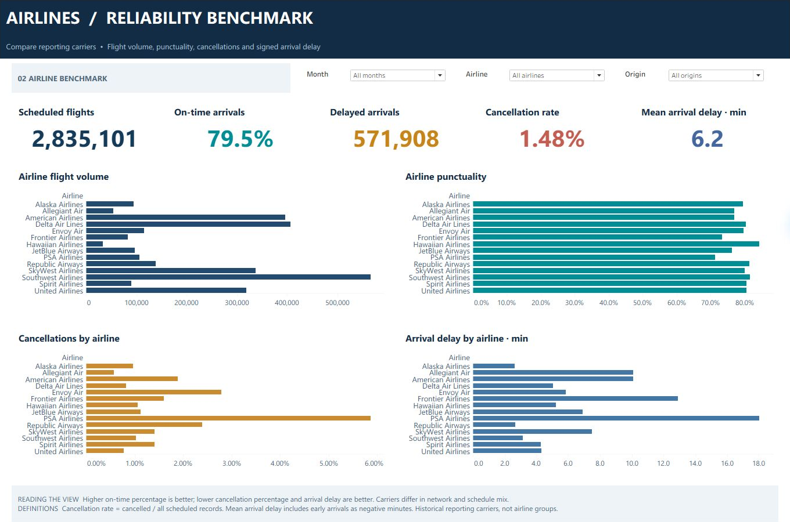
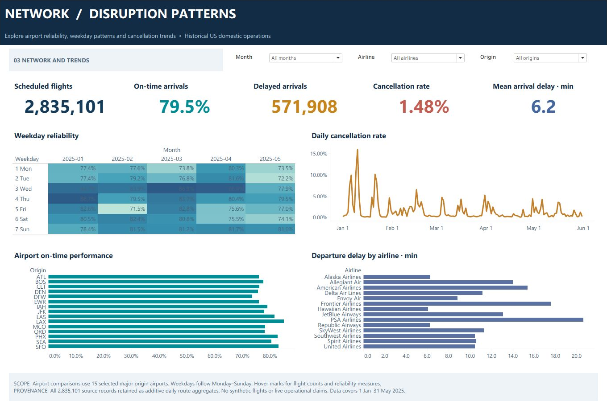

# Tableau historical flight analysis

Prepared **27 November 2026**. Coverage: **1 January–31 May 2025**. Source: the BTS historical US domestic reporting-carrier records embedded as additive aggregates in the [published Tableau workbook](Aviation_Intelligence_Nexus.twbx?raw=true). The three screenshots below show the actual Tableau application with all filters set to All.

## Executive results

The dataset contains **2,835,101 scheduled flight records**, including **2,786,350 completed non-diverted flights with observed arrival delay**. Of that completed-flight population, **2,214,442 arrived less than 15 minutes late** and **571,908 arrived at least 15 minutes late**. The weighted on-time rate was **79.47%** (79.5% on the dashboard). There were **41,898 cancellations**, or **1.48%** of scheduled records, and **6,853 non-cancelled diversions**. Mean signed arrival delay was **6.24 minutes** (6.2 on the dashboard).

## Monthly findings

| Month | Scheduled flights | On-time rate | Cancellations | Cancellation rate | Mean arrival delay, min |
| --- | ---: | ---: | ---: | ---: | ---: |
| 2025-01 | 539,747 | 81.21% | 16,312 | 3.02% | 3.76 |
| 2025-02 | 504,884 | 79.23% | 7,405 | 1.47% | 5.72 |
| 2025-03 | 600,872 | 80.41% | 6,923 | 1.15% | 5.45 |
| 2025-04 | 583,950 | 80.34% | 4,914 | 0.84% | 5.66 |
| 2025-05 | 605,648 | 76.40% | 6,344 | 1.05% | 10.19 |

May combined the highest flight volume in these five months with the lowest on-time rate. On-time performance declined by **4.81 percentage points** from January to May. May's mean arrival delay of **10.19 minutes** exceeded the other four monthly means. The monthly pattern supports investigating May by carrier, airport and day; it does not establish that increased traffic caused the change.

January had the highest cancellation rate (**3.02%**), while April had the lowest (**0.84%**). January's stronger arrival punctuality is conditional on completed flights, so it should be read alongside its higher cancellation rate.

## Airline comparison

| Reporting carrier | Scheduled flights | On-time rate | Cancellation rate | Mean arrival delay, min |
| --- | ---: | ---: | ---: | ---: |
| Hawaiian Airlines | 33,058 | 84.40% | 1.06% | 5.24 |
| Southwest Airlines | 565,379 | 81.58% | 1.03% | 3.15 |
| Republic Airways | 138,591 | 81.46% | 2.40% | 2.68 |
| United Airlines | 318,692 | 80.66% | 0.77% | 4.31 |
| Spirit Airlines | 89,651 | 80.50% | 1.41% | 4.28 |
| Delta Air Lines | 406,245 | 80.48% | 0.82% | 5.04 |
| SkyWest Airlines | 337,640 | 79.99% | 1.41% | 7.51 |
| Envoy Air | 115,794 | 79.75% | 2.79% | 5.83 |
| Alaska Airlines | 94,179 | 79.51% | 0.98% | 2.63 |
| American Airlines | 395,884 | 77.04% | 1.89% | 10.07 |
| Allegiant Air | 54,076 | 76.96% | 0.58% | 10.08 |
| JetBlue Airways | 96,572 | 76.33% | 1.12% | 6.90 |
| Frontier Airlines | 83,299 | 73.36% | 1.61% | 12.91 |
| PSA Airlines | 106,041 | 71.40% | 5.86% | 18.03 |

Hawaiian had the highest observed on-time rate, **84.40%**, across **33,058** records. PSA had the lowest, **71.40%**, and a **5.86%** cancellation rate. Southwest supplied the most records (**565,379**, or **19.94%** of the total) and had an **81.58%** on-time rate. These are reporting-carrier comparisons within this sample, not consolidated airline-group results. Network, airport, schedule and flight-mix differences are not adjusted away.

## Airport and daily disruption patterns

Top five origin airports by scheduled records in the complete embedded dataset:

| Origin | Scheduled flights | On-time rate | Cancellation rate |
| --- | ---: | ---: | ---: |
| DFW | 127,955 | 73.48% | 3.48% |
| DEN | 126,377 | 75.64% | 0.79% |
| ATL | 125,754 | 76.01% | 1.45% |
| ORD | 120,338 | 78.08% | 1.12% |
| PHX | 86,087 | 82.73% | 0.54% |

DFW was the busiest recorded origin, with **127,955 flights** and a **73.48%** on-time rate. These are origin flight counts within this BTS dataset, not global airport traffic rankings. Dashboard airport charts use 15 selected major origins; the all-origins KPIs cover the complete source population.

The largest daily cancellation rate was **15.98% on 10 January 2025**: **2,856 cancellations from 17,873 scheduled records**. No cause is assigned because this workbook does not contain verified disruption-cause evidence. The weekday/month matrix is a descriptive comparison rather than a seasonal forecast.

## Definitions, reproducibility and limits

- **On time:** arrival delay <15 minutes among non-cancelled, non-diverted flights with an observed arrival delay. Cancelled or diverted flights are excluded from this denominator, not counted as on time.
- **Cancellation rate:** cancellations / all scheduled records.
- **Mean arrival delay:** sum of signed arrival-delay minutes / completed non-diverted records with observed arrival delay. Early arrivals remain negative; this is not the mean delay among late flights alone.
- **Aggregation:** 1,154,864 date/carrier/origin/destination groups retain the additive counts and delay sums from all 2,835,101 source flights. Rates are ratios of filtered sums, not averages of route percentages.
- **Verification:** displayed full-period values and the month/airline/origin filter counts were reconciled to independent database queries. This report's monthly, carrier, airport and peak-day tables were recomputed directly from the embedded CSV.
- **Limits:** five historical US domestic reporting months do not establish full-year, international or UAE-airline performance. No live feeds, model predictions, causal effects or operational readiness are claimed.

The exact workbook SHA-256 is recorded in [manifest.json](manifest.json); the report tables and screenshot checksums are in [analysis-summary.json](analysis-summary.json). For setup and the verified filter examples, see the [Tableau guide](README.md).
